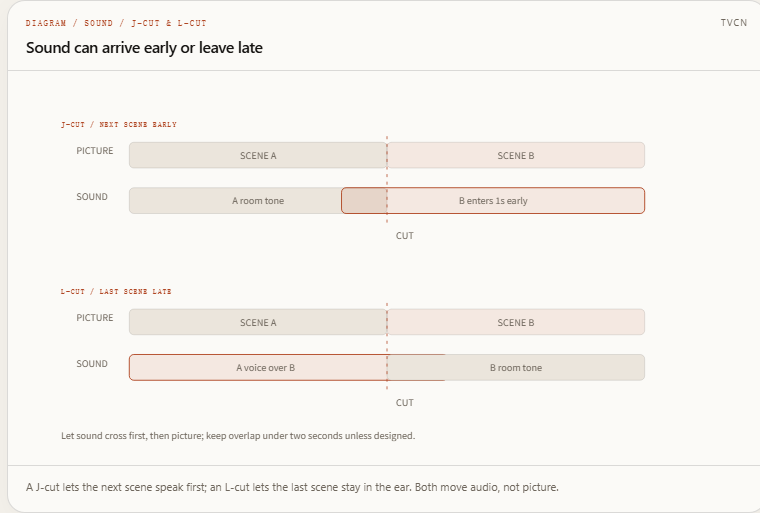

<!-- DIAGRAM_START -->
## Diagram

<figure>
  
  <figcaption>A J-cut lets the next scene speak first; an L-cut lets the last scene stay in the ear. Both move audio, not picture.</figcaption>
</figure>
<!-- DIAGRAM_END -->

## Decide whose ear leads

A cut is not only a picture change. It is a change of attention. Before the cut, ask what the audience needs to hear first. If the next scene’s sound can build the space early, let it cross the cut.

Sound arriving half a beat ahead keeps the audience from feeling pushed. Picture and sound slamming together at the same frame feels like a door shutting.

## J-cut: the next scene speaks first

The picture is still in the previous scene, but the next scene’s room tone or line has already entered. Hear the market before you see it; hear the voice on the phone before cutting to the person holding it. The audience enters the next scene early, so the picture cut does not feel like a gap.

Method: drag the next scene’s audio 12–24 frames left. Try one second first. Dialogue scenes can go longer, but do not let the next line steal focus while the previous character is still speaking.

## L-cut: the last scene stays in the ear

The picture has cut to the listener, but the previous voice continues. A character lands a hard line; we cut to the other face and the sentence is still in the air. The audience uses that gap to think about what was just said.

Method: drag the previous audio right so it covers the first one or two seconds of the new picture. Give the new frame an action that can stand on its own; do not leave the audience watching a static face.

## Do not use sound to hide a bad cut

J-cuts and L-cuts are bridges, not bandages. If the picture has a continuity error, a crossed line, or a broken performance, covering it with sound does not fix it. Make the picture cut work first, then use sound to make it smoother.

## Checks

- For every J-cut or L-cut, you can say what the audience hears first and sees second.
- The audio overlap stays under two seconds unless there is a deliberate design.
- Watch it muted. The picture still works.

<section><h2>Boundary</h2>
This page only covers “Let Sound Cross the Cut: J-cuts and L-cuts”; it does not replace Fix the Noise Before You Build a Mood, Sound Post: The Order from Dialogue to Final Mix, Cross the Line and the Room Disappears. When the problem belongs to one of those pages, use that page instead of adding more parameters here.
</section>
<!-- SOURCES_START -->
## References and further reading

- [S27] [ITU-R BS.1770: Loudness and True Peak](https://www.itu.int/rec/R-REC-BS.1770/en) — Accessed 2026-11-26. Used to check the terminology/method/rule in the “Decide whose ear leads” section against BS.1770 loudness measurement, not microphone buying advice; it does not verify numbers, model choices or on-set conclusions derived from this page, and is not a substitute for a test.
- [S35] [Avid: Resource Center](https://www.avid.com/resource-center) — Accessed 2026-11-26. Used to check the terminology/method/rule in the “J-cut: the next scene speaks first” section against Avid resource center, not an independent review; it does not verify numbers, model choices or on-set conclusions derived from this page, and is not a substitute for a test.
<!-- SOURCES_END -->

