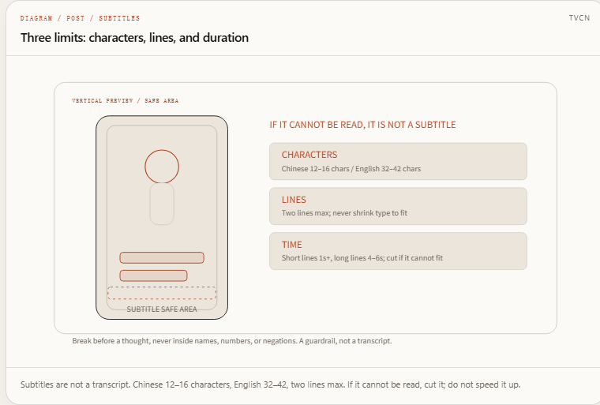

<!-- DIAGRAM_START -->
## Diagram

<figure>
  
  <figcaption>Subtitles are not a transcript. Chinese 12–16 characters, English 32–42, two lines max. If it cannot be read, cut it; do not speed it up.</figcaption>
</figure>
<!-- DIAGRAM_END -->

Subtitles are not a copy of the dialogue. They are the rail the audience grabs when the ear cannot keep up.

## Decide what must be read

Subtitles are not a full transcript. Drop filler, repetitions, and vocal tics. Keep names, numbers, negations, and turns. The eye should catch the meaning in one pass; if it has to go back, the scene is broken.

Compress the sentence into one readable thought before breaking it. Never split “not” from “agree” across two lines; the viewer may read only half.

Subtitles are a guardrail for the ear, not a word-for-word record. Fill in what is hard to hear; do not fight what is already clear.

## Break by meaning, not by character count

Chinese: 12–16 characters per line. English: 32–42 characters. Two lines maximum, never three. Keep numbers with their units, names with their titles, and negations with the word they modify.

If a sentence is too long, cut it before shrinking the type. Smaller type makes the viewer lean in, and the picture loses.

Break before a clause or a turn, not after a connector like “and” or “but.” The eye needs to breathe at the line end, not fall off it.

## Timing and placement are grammar too

Subtitles should arrive with the voice, not ahead of it and not late. Hold a short line for at least one second; keep a long one under four to six seconds. If it cannot be read, merge or cut, do not speed it up.

On vertical video, place subtitles above the bottom safe area, off the mouth and hands. Do not rely on color alone to mark a speaker; add a name or a position. Color fails for color-blind viewers.

Leave a little margin on both ends. Arriving too early spoils the line; staying too long holds the next one hostage.

## Checks

- Chinese lines stay under 16 characters, English under 42, with two lines maximum.
- Numbers, names, and negations survive unbroken.
- Subtitles stay off the mouth and hands, inside the vertical safe area.

<!-- SOURCES_START -->
## Experience note

Experience note: this page draws on 5 post-production review reviews under media up to 4K and a standard platform delivery; it discusses “Subtitles: Help Them Read, Not Just Transcribe”; no external laboratory test was run, and the conclusion may not transfer when conditions change.
<!-- SOURCES_END -->

