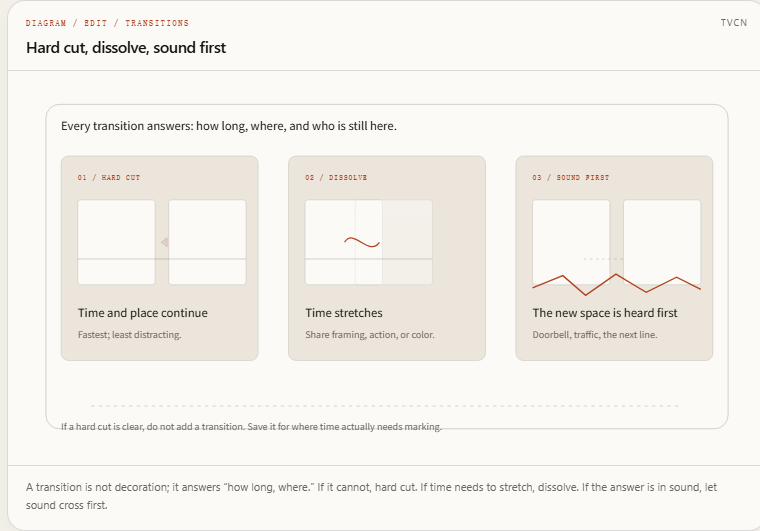

<!-- DIAGRAM_START -->
## Diagram

<figure>
  
  <figcaption>A transition is not decoration; it answers “how long, where.” If it cannot, hard cut. If time needs to stretch, dissolve. If the answer is in sound, let sound cross first.</figcaption>
</figure>
<!-- DIAGRAM_END -->

A dissolve, a fade, a wipe is not decoration. Every transition answers three questions: how long, where, and who is still here. If it cannot answer, hard cut.

## Hard cut is the default

Time and place continue: cut. The audience does not need to be told “this is another shot.” A hard cut is the fastest and least distracting. Most films should be ninety percent hard cuts.

Do not use a fancy transition to cover a scene you failed to shoot clearly. The audience sees a dissolve and does not think time passed; they think “something is being hidden.”

## Dissolve only when time stretches

A dissolve says time has passed, places have merged, a state has changed. The two images need to share composition, action, or color, or it reads as an accident. If the person sits in the same place and the light goes from day to dusk, the dissolve holds.

Do not dissolve between every scene. The first one tells the audience years passed; the third one starts a slideshow. One or two in a short film is enough.

## Sound can cross first

The picture is still in the old room, but the sound has entered the new one: a doorbell, traffic, the next scene's dialogue. The audience hears the new space before seeing it, and the transition softens.

The reverse works too: the picture has cut to the new scene while the old room's sound stays half a second. One sound stitches two spaces together, cheaper than an effect and more believable.

## Checks

- Does this transition answer “how long, where”?
- If it were a hard cut, would the audience misunderstand? If not, cut.
- Do the two images share composition, action, or sound?
