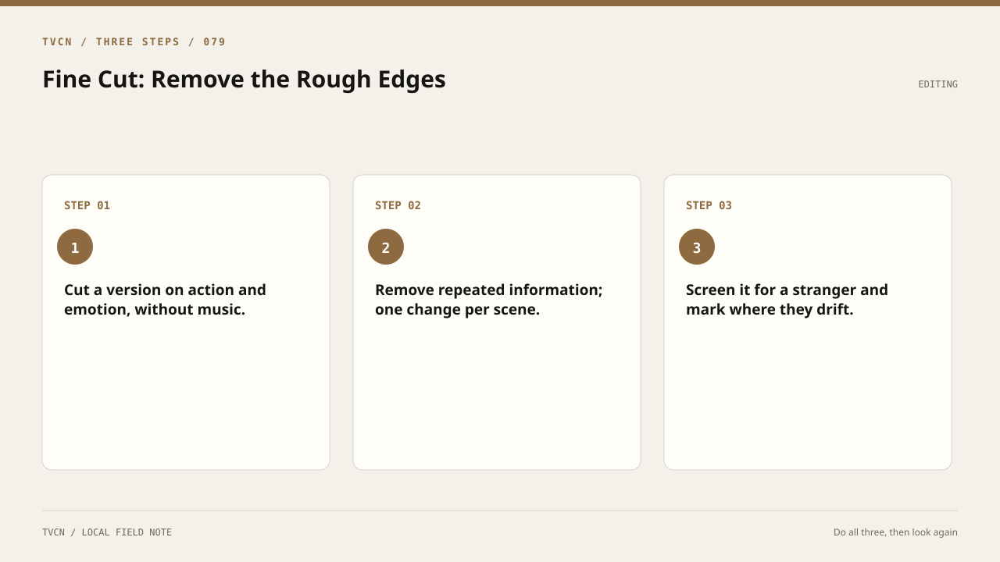

A fine cut does three things: remove the extra half second around each shot, align action cuts, and drop reactions the performance does not need. Structural problems go back to the rough cut; do not hide them with transitions here.

<!-- DIAGRAM_START -->
<h2>Diagram</h2>
<figure>
  
  <figcaption>Watch “Find three burrs per scene: a cut half” and “Fix only those three categories without adding shots.”; judge whether removing one shot makes the scene faster rather than muddier.</figcaption>
</figure>
<!-- DIAGRAM_END -->
<section><h2 id="section-1">Fine cut trims edges, not structure</h2>
After every cut ask what the audience knows less. If cause and effect survive, the cut works. If a caption must explain it, go back to the rough cut.
<h2 id="section-2">Limits</h2>
Shorter is not automatically better. Remove every breath and pause and the character becomes a machine; keep the pauses that carry relationship.
</section><section><h2 id="section-3">On set</h2>
Find three rough edges per scene: a cut half a frame early, overlapping breaths, an extra second of air. Then let a stranger watch and note when they check their phone.
</section><section><h2 id="section-4">Do this</h2>
Fine cut is not adding effects; it smooths every cut, breath, and extra half-second.
<ol><li>Find three burrs per scene: a cut half a frame early, overlapping breath, an empty shot one second long.</li><li>Fix only those three categories without adding shots.</li><li>Show a stranger and note when they check their phone; fix that second.</li></ol></section><section><h2 id="section-5">Avoid</h2>
Do not hide structure problems with fancy transitions; a wipe cannot save a drag.
</section><section><h2>Judge</h2>
Three signals are observable on set:
<ul><li>removing one shot makes the scene faster, not muddier</li><li>skin, highlights and blacks sit inside scope limits</li><li>loudness, subtitles and file specs pass one delivery check</li></ul></section><section><h2>Failures</h2>
These three moves erase the detail you just built:
<ul><li>cuts follow the music, not the action</li><li>style before unity: shots jump in color</li><li>loudness and subtitles are checked at the very end</li></ul></section><section><h2>Extend</h2>
<strong>10-minute exercise:</strong> Take 30 seconds of footage and make an A/B, changing only “Find three burrs per scene: a cut half”. Note one timecode and one difference before keeping it.
</section>
<h2>Check</h2><ul><li>Each scene loses at least three specific burrs and cuts no longer bite.</li><li>Breaths and pauses connect without a line being cut in half.</li><li>The stranger checks the phone less, or you can name why the drag remains.</li></ul>

<!-- DEEP_DIVE_START -->
## Deep dive

<strong>About 5 minutes.</strong> The rough cut answers “is it clear?” The fine cut answers “does it flow, does it sting, and is anything extra?”

### Fix four kinds of cut first

Cut on action halfway through a reach; cut on eyeline between looker and looked-at; cut on sound by letting a line tail cover the picture change; cut on shape by aligning a door, table edge, or shoulder across frames.

These are not tricks; they keep the audience from noticing the cut. If a join still fights you after three passes, the problem is usually missing coverage, not the edit.

### Cut three things

Cut repeated information, cut the full walk from sofa to door, and cut reactions that change nothing. The audience does not need the transit; start with the character already at the door.

After every deletion, ask what the character loses. If the answer is nothing, the scene was filler.

### Pace is change, not speed

Three shots of the same length in a row lose attention; three progressively shorter shots build pressure. Pace is alternation, not cutting everything faster.

Leave one shot that holds for two seconds so the audience can breathe. Without a pause, the later break has nothing to contrast against.

### Cut a scene in half

Take a three-minute scene and keep only three beats: arrival, turn, decision. Cut everything else. The scene will still read, often better.

Add back one necessary reaction. Do this three times and you will see which shots were habit, not story.

### Ten joins to fix in the first fine-cut pass
<ul><li>Cut halfway through a reach</li><li>Cut between the looker and the looked-at</li><li>Let a line tail cover the picture change</li><li>Align a door, table edge, or shoulder across the cut</li><li>Delete repeated information</li><li>Delete the full walk from sofa to door</li><li>Delete reactions that change nothing</li><li>Leave one two-second pause in every scene</li><li>Break three same-length shots in a row</li><li>After every deletion, ask what the character loses</li></ul>
Fine-cutting is not beautifying frames; it is finding the places that are almost right. Do it ten times and you will start trusting your discomfort. After every cut, play five seconds on each side; pace lives in the relationship, not the cut point alone.

<!-- DEEP_DIVE_END -->
<!-- SOURCES_START -->
<aside class="article-sources experience-source" data-source-kind="experience">

Sources / 来源
Experience source

Experience source: TVCN field handbook and editorial review; no laboratory measurement or external data is claimed here.
</aside>
