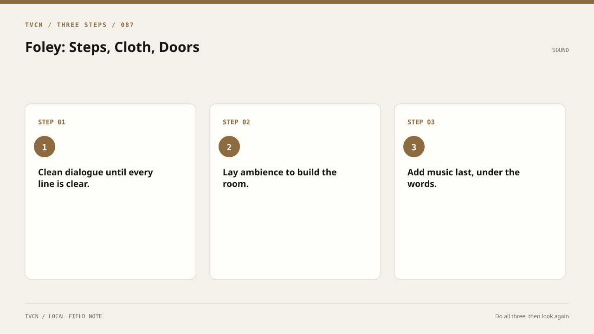

Foley passes first on sync: the frame the foot lands, cloth rubs, cup meets table. Match the action, then add weight and material; out-of-sync Foley is worse than none.

<!-- DIAGRAM_START -->
<h2>Diagram</h2>
<figure>
  
  <figcaption>Watch “Record footsteps, cloth rub, and door handles after” and “Mute the picture and sync each sound to”; judge whether removing one shot makes the scene faster rather than muddier.</figcaption>
</figure>
<!-- DIAGRAM_END -->
<section><h2 id="section-1">Sync to action before getting creative</h2>
Layer contact, movement and ambience separately and mix them independently; do not put everything on one track.
<h2 id="section-2">Limits</h2>
Foley is not “more sound equals richer.” Do not add actions the picture does not show; the audience feels the separation.
<h2 id="section-3">Foley in three layers: feet, cloth, props</h2>

Foley is not “add sound effects”; it makes on-screen action carry audible weight. Feet first, cloth second, prop contact last. Record them separately so post can adjust.

<ol><li>Feet by surface: wood, concrete, carpet. Record one foot at a time, not both.</li><li>Cloth only on visible movement, never a continuous bed; keep it 12–18dB under dialogue.</li><li>Door handles, cups and paper on a close mic, dry. Leave reverb to the mix.</li></ol>

Acceptance: with music off, Foley and dialogue alone should tell you body weight and surface. If not, add feet first.
</section><section><h2 id="section-4">On set</h2>
Record footsteps, cloth rustle, and a door handle after the shoot. Match them in silence, then mix under room tone without covering dialogue.
</section><section><h2 id="section-5">Do this</h2>
Foley is not background sound; it rebuilds the action in the frame: steps, cloth, door handles.
<ol><li>Record footsteps, cloth rub, and door handles after the shoot.</li><li>Mute the picture and sync each sound to the action.</li><li>Mix under ambience and dialogue; Foley must not mask words.</li></ol></section><section><h2 id="section-6">Avoid</h2>
Do not fill every quiet beat with Foley; silence has weight too.
</section><section><h2>Judge</h2>
Three signals are observable on set:
<ul><li>removing one shot makes the scene faster, not muddier</li><li>skin, highlights and blacks sit inside scope limits</li><li>loudness, subtitles and file specs pass one delivery check</li></ul></section><section><h2>Failures</h2>
These three moves erase the detail you just built:
<ul><li>cuts follow the music, not the action</li><li>style before unity: shots jump in color</li><li>loudness and subtitles are checked at the very end</li></ul></section><section><h2>Extend</h2>
<strong>10-minute exercise:</strong> Take 30 seconds of footage and make an A/B, changing only “Record footsteps, cloth rub, and door handles after”. Note one timecode and one difference before keeping it.
</section>
<h2>Check</h2><ul><li>Footsteps, cloth, and door handles each land on a specific action.</li><li>With the picture muted, every action has a sound and none arrives half a frame early.</li><li>Under dialogue, words stay clear and Foley does not fight the midrange.</li></ul>

<!-- DEEP_DIVE_START -->
## Deep dive

<strong>About 6 minutes.</strong> Foley is not filling in footsteps; it gives the picture weight. What the audience hears is often not the action but what the action lands on.

### Lay the room tone first

Record thirty seconds of empty room per scene and fill the floor under dialogue. Without room tone, cuts sound like vacuum and the picture appears to jump.

Room tone must match the location; kitchen and bedroom cannot share. Size, surface softness, and distant noise all have to agree.

### Footsteps and cloth

Footsteps have three layers: sole, surface, cadence. Wood, concrete, and carpet sound different; read the picture before choosing.

Rub a small cloth near the mic for fabric instead of pasting a library effect. A library cloth always sounds like someone else’s coat.

### Sync is not one frame

Match the start of the action, then listen for weight. Two frames off feels light; five frames off feels fake. Numerical sync is not felt sync.

Watch the picture while recording, not just the waveform; Foley is performance. Get the performance right and the waveform follows.

### How to record Foley

Keep the mic twenty to thirty centimeters from the source: closer clips, farther sounds like a library.

Record each pass three times: normal, light, heavy. The edit needs weight variation.

### Ambience versus Foley

Ambience lays the bed; Foley makes the points. Too thick a bed hides the points; too thin a bed makes them stick to the picture.

Lay the bed, add the points, and solo after every layer.

### Ten Foley checks
<ul><li>Record thirty seconds of room tone</li><li>Footsteps split into sole, surface, cadence</li><li>Record cloth separately</li><li>Record props separately</li><li>Watch the performance while recording</li><li>Match the start of the action</li><li>Keep error within two frames</li><li>Change the room tone per location</li><li>Do not use only library effects</li><li>Solo each layer before mixing</li></ul>
Good Foley goes unnoticed; bad Foley makes the actor look like they are walking on air.

### When you have five minutes
<ul><li>Record room tone first</li><li>Footsteps split into sole, surface, cadence</li><li>Record cloth separately</li><li>Watch the picture while recording</li><li>Match the action start</li><li>Solo before mixing</li></ul>
Foley is not a library; it is the weight a body leaves when the actor is no longer there. Land the foot first, then make it sound good. The foot lands first.

<!-- DEEP_DIVE_END -->
