<!-- DIAGRAM_START -->
<h2>Diagram</h2>
<figure>
  
  <figcaption>Diagram: every HDR stage needs a luminance anchor. Brightening the master at the end destroys highlights and skin together.</figcaption>
</figure>
<!-- DIAGRAM_END -->
<h2>First decision: does this film need HDR</h2>
HDR usually needs usable highlight detail: windows, neon, fire, metal reflections, plus a platform that supports HDR. A film with no highlight information, watched mostly on a phone, often just gets brighter midtones.

Ask delivery first: PQ or HLG, is an SDR version required, which standard for the master. If you cannot answer, do not grade HDR first; the SDR trim will cost another pass.
<h2>Capture and monitoring: protect highlights before brightness</h2>
Shoot Log or RAW and expose to protect highlights; do not crush white to make the monitor look like SDR. On-set monitors can load an HDR transform LUT, but that LUT is for framing and exposure, not the final grade.

Anchor with an 18% grey card and a white card: grey sets midtones, white sets headroom. Shoot both at every scene change so post knows where each section starts.
<h2>Grade: HDR first, then the SDR trim</h2>
Set the HDR white point first: SDR white is not 100% in HDR and usually sits lower; then shape the highlight roll-off so windows and lamps have layers instead of clipping. Read skin on scopes, not by “brightness.”

Lock the HDR master, then trim SDR: do not just compress the curve. Check midtone relationships per scene, then lift highlights separately. SDR is not a smaller HDR; it needs its own contrast judgment.
<h2>Delivery: platform, master, captions, and QC</h2>
Write a delivery sheet: PQ or HLG for HDR, what peak, Rec.709 for SDR, subtitle luminance, platform transcode rules. Do not use 100% white for HDR subtitles; they glare in dark scenes. Check SDR subtitles separately.

QC at least three times: HDR reference monitor, SDR reference monitor, and a normal phone. Each pass checks clipped highlights, skin shift, shadow detail, and subtitle readability.
<h2>Failure case: brightening SDR and calling it HDR</h2>
A city night piece was shot for SDR with blown windows, then brightened and contrasted and called HDR. Neon had no color, the sky had no layers, and faces were too bright. After platform transcode, highlights clipped and HDR looked like SDR.

The only fix is the source: no highlight information means no HDR. Re-shoot the windows or make the best SDR contrast; do not hide capture limits behind an HDR label.
<h2>Cost and acceptance</h2>
Low: borrowed HDR monitor, one HDR grade, one SDR trim, ¥5,000–15,000. Mid: HDR suite for two to three days, SDR version, QC, ¥15,000–40,000. High: multi-platform delivery, Dolby Vision/HLG dual masters, ¥40,000–100,000+.
<h2>Check</h2><ul><li>Platform and HDR standard are written down.</li><li>Highlights are protected; grey and white cards exist per scene.</li><li>HDR grade sets white point before highlight roll-off.</li><li>SDR trim happens after the HDR master is locked.</li><li>HDR and SDR subtitles are checked separately.</li><li>QC runs on three viewing devices.</li></ul>
<!-- SOURCES_START -->
<h2>Sources</h2>

Experience: TVCN field notes and project reviews; tested: the review setup and reproducible exercises noted on the page; references: public links below.

<ul><li>[S24] ACES Color Management</li><li>[S26] ITU-R BT.2020</li><li>[S28] Netflix Partner Help</li></ul>

<a href="../../SOURCES.md">Full links and notes in SOURCES.md</a>

<!-- SOURCES_END -->
