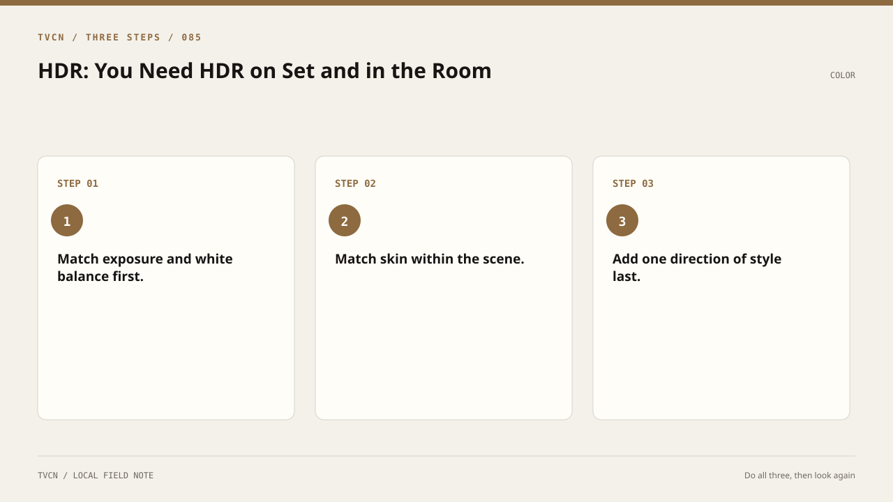

HDR is not lifting shadows infinitely; it preserves information from window to dark corner. Expose so highlights just avoid clipping, confirmed with false color or waveform; leave noise room in shadows and decide later how far to push.

<!-- DIAGRAM_START -->
<h2>Diagram</h2>
<figure>
  
  <figcaption>Watch “Confirm the monitor supports HDR and the footage” and “Make a separate pass for HDR10 or HLG”; judge whether removing one shot makes the scene faster rather than muddier.</figcaption>
</figure>
<!-- DIAGRAM_END -->
<section><h2 id="section-1">HDR protects highlights before brightness</h2>
Check on the target display before delivery: an HDR master can look gray on a normal screen. Make a separate SDR version; do not post one master everywhere.
<h2 id="section-2">Limits</h2>
HDR is not a look filter. Without an HDR display and correct metadata, the audience may see worse than SDR. Confirm the delivery chain before shooting.
<h2 id="section-3">HDR needs a monitor before it needs a delivery spec</h2>

Grading HDR without an HDR monitor is grading blind. Confirm the chain: camera log → HDR monitor → PQ/HLG delivery. If any link is SDR, you are guessing.

<ol><li>Set monitor luminance to the delivery standard, not the TV's “vivid” mode; keep room light low.</li><li>Grade highlights in PQ first, then make the SDR trim. Do not reverse-engineer HDR from SDR.</li><li>Watch the SDR version on a normal TV before delivery; highlights should not glare and shadows should not crush.</li></ol>

Acceptance: both HDR and SDR versions, skin consistent and highlights detailed. If only one works, the conversion is not reversible.
</section><section><h2 id="section-4">On set</h2>
Confirm the monitor supports HDR and the footage is 10-bit Log. Deliver HDR10 or HLG as its own pass; do not stretch an SDR grade.
</section><section><h2 id="section-5">Do this</h2>
HDR is not a brightened SDR image; capture, monitoring, and delivery must all support HDR.
<ol><li>Confirm the monitor supports HDR and the footage is 10-bit Log.</li><li>Make a separate pass for HDR10 or HLG delivery.</li><li>Do not lift an SDR version; preserve HDR highlights and shadows.</li></ol></section><section><h2 id="section-6">Avoid</h2>
Do not call a lifted SDR image HDR; the highlights are fake and shadows carry no information.
</section><section><h2>Judge</h2>
Three signals are observable on set:
<ul><li>removing one shot makes the scene faster, not muddier</li><li>skin, highlights and blacks sit inside scope limits</li><li>loudness, subtitles and file specs pass one delivery check</li></ul></section><section><h2>Failures</h2>
These three moves erase the detail you just built:
<ul><li>cuts follow the music, not the action</li><li>style before unity: shots jump in color</li><li>loudness and subtitles are checked at the very end</li></ul></section><section><h2>Extend</h2>
<strong>10-minute exercise:</strong> Take 30 seconds of footage and make an A/B, changing only “Confirm the monitor supports HDR and the footage”. Note one timecode and one difference before keeping it.
</section>
<h2>Check</h2><ul><li>Footage is 10-bit Log and the monitoring chain truly supports HDR.</li><li>The HDR pass is separate, not an SDR lift.</li><li>Watch both HDR and SDR versions; each holds its own highlights and shadows.</li></ul>

<!-- SOURCES_START -->
## Experience note

Experience note: this page draws on 5 post-production review reviews under media up to 4K and a standard platform delivery; it discusses “HDR: You Need HDR on Set and in the Room”; no external laboratory test was run, and the conclusion may not transfer when conditions change.
<!-- SOURCES_END -->

