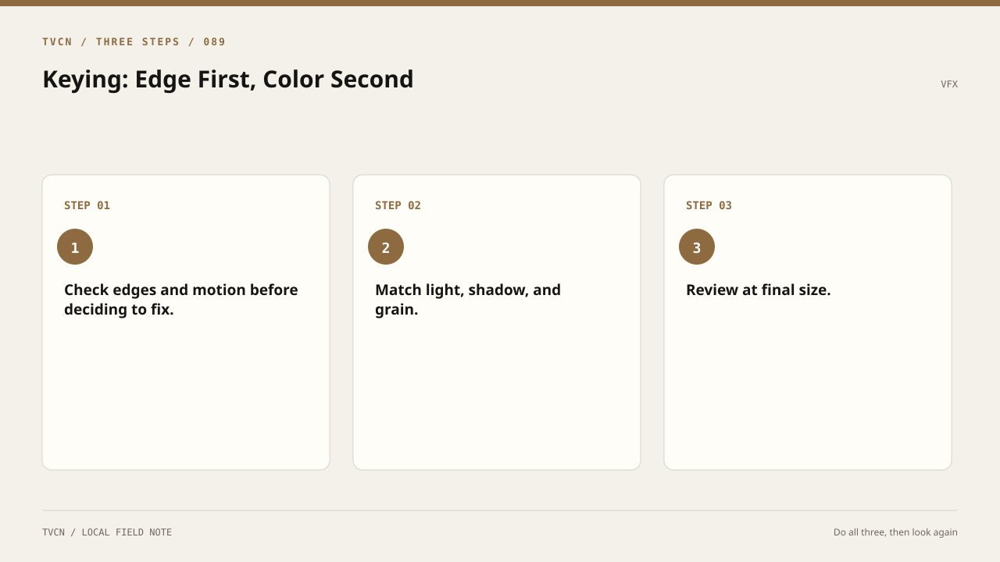

Keying checks edges before color. If the edge is mush, grading cannot save it.

<!-- DIAGRAM_START -->
<h2>Diagram</h2>
<figure>
  
  <figcaption>Do the three steps in order, then look again at the image or file.</figcaption>
</figure>
<!-- DIAGRAM_END -->
<h2>On set</h2>

Check the edge first: hair, fingers, a clear cup. Key coarse then fine, feather one or two pixels, and fix spill last.

<h2>Do this</h2>

Keying starts with the edge, then color. If the edge is mushy, grading cannot save it.
<ol><li>Check hair, fingers, and a transparent glass edge.</li><li>Do a rough and then a fine pass, adding one to two pixels of feather.</li><li>Fix spill and review at delivery size, not at 400 percent.</li></ol>
<h2>Avoid</h2>

Do not fix flaws at 400 percent that nobody sees at delivery size.

<h2>Check</h2>
<ul><li>Hair, fingers, and transparent edges show no hard cut or jagged line.</li><li>The edge tracks through motion without jitter or drift.</li><li>At delivery size there is no green spill or black fringe.</li></ul>
