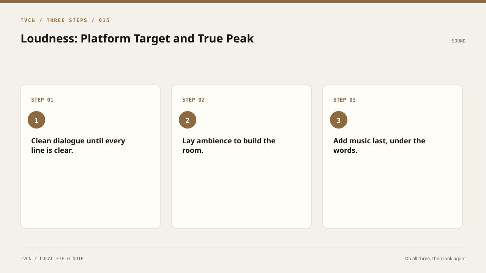

Deliver to the platform's loudness target and leave true-peak headroom. Loud is not good.

<!-- DIAGRAM_START -->
<h2>Diagram</h2>
<figure>
  
  <figcaption>Do the three steps in order, then look again at the image or file.</figcaption>
</figure>
<!-- DIAGRAM_END -->
<h2>On set</h2>

Platforms often target -14 LUFS with a -1 dB true peak. Mix to the target, leave 0.5 to 1 dB headroom, and do not slam the limiter.

<h2>Do this</h2>

Deliver to the platform loudness target and leave true-peak headroom. Loud is not better.
<ol><li>Mix to the platform target, commonly -14 LUFS.</li><li>Set true peak at -1 dB and leave another 0.5 to 1 dB of margin.</li><li>Do not slam the limiter; go back to dialogue and dynamics.</li></ol>
<h2>Avoid</h2>

Do not treat loudness as competition; a flattened limiter makes dialogue tiring.

<h2>Check</h2>
<ul><li>Integrated loudness sits near the platform target, not guessed by ear.</li><li>True peak stays at or below -1 dB with no continuous red.</li><li>Dialogue stays clear and music or ambience does not flatten the dynamics.</li></ul>

<!-- DEEP_DIVE_START -->
## Deep dive

<strong>About 5 minutes.</strong> Loudness is not turning the volume up. It is making dialogue survive the platform, headphones, and a phone speaker.

### LUFS is not a volume knob

LUFS is the average loudness of the whole film, not a single second. Platforms often target -14 to -16 LUFS with true peak near -1 dB; check the platform’s current spec.

Make dialogue hold first, then add music and ambience. If music makes you push dialogue up, the final mix will be loud and unintelligible.

### Check in this order

Listen to dialogue alone, then with music, then with ambience. Play it on a phone speaker, headphones, and a laptop. A meter gives numbers; a line you cannot understand still needs a re-cut.

Mark the quietest line and the loudest line, and jump straight to both before delivery. If the extremes hold, the middle usually holds too.

### A phone speaker is the final exam

Play the film on a phone at half volume and stand two meters away. A line you cannot hear is a mix problem, not a listener problem.

A phone speaker removes low end; the more bass in the music, the muddier the dialogue. Protect the midrange before mood.

### The balance of music and ambience

In dialogue scenes, music stays under and ambience fills the room; only in wordless passages can music lead. Do not run music from first frame to last or the audience tires.

Every time you add a layer, solo the dialogue and confirm it still holds. If it does not, lower the new layer, do not push the dialogue.

### Ten listening checks before delivery
<ul><li>Solo dialogue and confirm every line is intelligible</li><li>Add music and listen again</li><li>Add ambience and listen again</li><li>Play on a phone at half volume from two meters</li><li>Listen on headphones for sibilance and clipping</li><li>Listen once on a laptop speaker</li><li>Mark the timecode of the quietest line</li><li>Mark the timecode of the loudest line</li><li>Jump to both before delivery</li><li>Confirm true peak does not exceed minus one</li></ul>
A loudness meter proves the number, not that the audience understood. The last pass belongs to your ears, not your eyes. Play it for someone who has not seen it and ask which line they missed; that is usually the fix.

<!-- DEEP_DIVE_END -->
