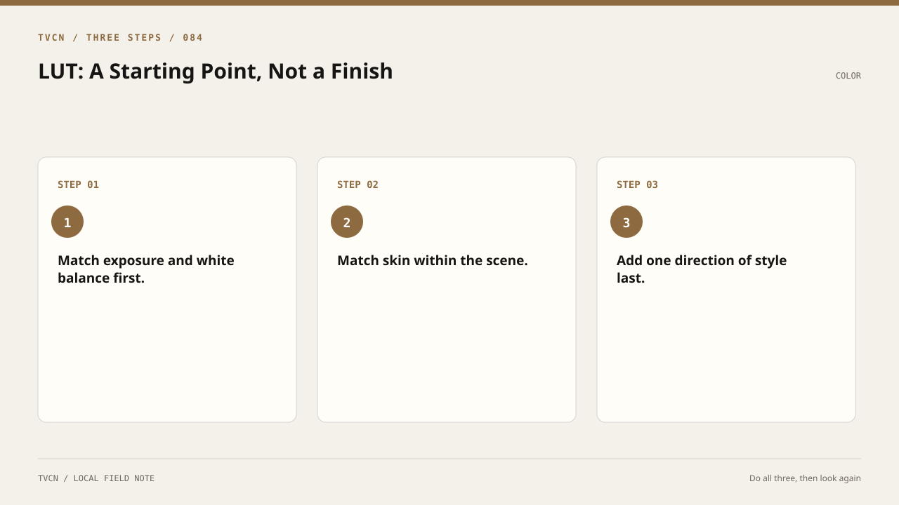

A LUT is a start, not a finish. Return to primary correction and check blacks and highlights.

<!-- DIAGRAM_START -->
<h2>Diagram</h2>
<figure>
  
  <figcaption>Do the three steps in order, then look again at the image or file.</figcaption>
</figure>
<!-- DIAGRAM_END -->
<h2>On set</h2>

Balance exposure and white balance before the LUT. After applying it, check for lifted blacks and stained highlights, then return to primary.

<h2>Do this</h2>

A LUT is a starting point, not a finish. After applying it, return to primary correction for blacks and highlights.
<ol><li>Balance exposure and white balance before the LUT.</li><li>Check whether blacks lifted or highlights picked up a cast.</li><li>Fix in primary and then decide how much LUT strength to keep.</li></ol>
<h2>Avoid</h2>

Do not use a LUT as a repair; it only tints the problem one color.

<h2>Check</h2>
<ul><li>The footage is correctly exposed and neutral before the LUT.</li><li>After the LUT, blacks are not lifted and highlights show no obvious cast.</li><li>Lower the LUT strength and the image still returns to a deliverable state.</li></ul>
