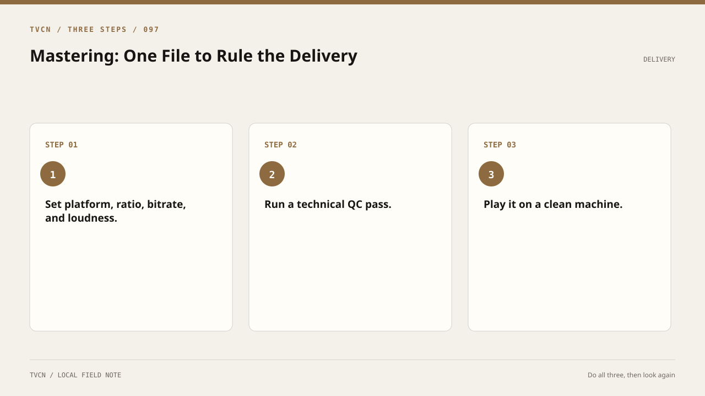

The master is the single high-quality file: max resolution, max bitrate, no burned-in captions or separate tracks. Platform versions export from it; never re-compress a platform file.

<!-- DIAGRAM_START -->
<h2>Diagram</h2>
<figure>
  
  <figcaption>Watch “Make the master in the highest-quality ProRes or” and “Derive platform, vertical, and subtitle versions from it;”; judge whether removing one shot makes the scene faster rather than muddier.</figcaption>
</figure>
<!-- DIAGRAM_END -->
<section><h2 id="section-1">Master once; platform cuts derive from it</h2>
Name it with date, version and project; keep two copies, one offline. Re-releases, caption changes and compilations all start here.
<h2 id="section-2">Limits</h2>
A master is not “the biggest file.” Bitrate beyond platform and display needs only costs storage; the goal is no visible compression, not the largest number.
</section><section><h2 id="section-3">On set</h2>
Make the master in high-quality ProRes or DNxHR and name it master. Derive the platform, vertical, and subtitled versions from it.
</section><section><h2 id="section-4">Do this</h2>
The master is the only trusted delivery source; platform, vertical, and subtitled versions derive from it.
<ol><li>Make the master in the highest-quality ProRes or DNxHR and name it master.</li><li>Derive platform, vertical, and subtitle versions from it; never edit backward.</li><li>Confirm the master opens, plays, and relinks before delivery.</li></ol></section><section><h2 id="section-5">Avoid</h2>
Do not use “latest” as the filename; delivery must be traceable.
</section><section><h2>Judge</h2>
Three signals are observable on set:
<ul><li>removing one shot makes the scene faster, not muddier</li><li>skin, highlights and blacks sit inside scope limits</li><li>loudness, subtitles and file specs pass one delivery check</li></ul></section><section><h2>Failures</h2>
These three moves erase the detail you just built:
<ul><li>cuts follow the music, not the action</li><li>style before unity: shots jump in color</li><li>loudness and subtitles are checked at the very end</li></ul></section><section><h2>Extend</h2>
<strong>10-minute exercise:</strong> Take 30 seconds of footage and make an A/B, changing only “Make the master in the highest-quality ProRes or”. Note one timecode and one difference before keeping it.
</section>
<h2>Check</h2><ul><li>The master is the highest-quality format and its filename says master.</li><li>Every platform version traces back to the same master with no backward overwrite.</li><li>The master opens, plays, and relinks on a clean machine.</li></ul>
