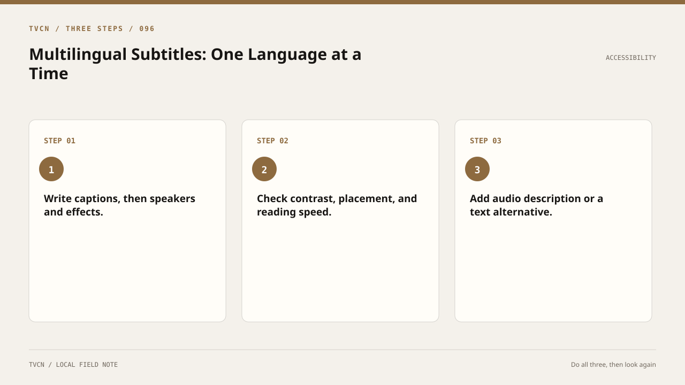

Deliver multilingual captions as separate tracks: one language each, aligned timecode, separate styles. Do not stack Chinese and English on one line; mobile collapses and neither can be turned off.

<!-- DIAGRAM_START -->
<h2>Diagram</h2>
<figure>
  
  <figcaption>Watch “One language per line.” and “Use selectable tracks or two independent versions.”; judge whether removing one shot makes the scene faster rather than muddier.</figcaption>
</figure>
<!-- DIAGRAM_END -->
<section><h2 id="section-1">One track per language, never mixed</h2>
Check line breaks per track: about 16–18 Chinese characters or 42 Latin characters per line. The languages need different breaks, not shared ones.
<h2 id="section-2">Limits</h2>
Translation is not word replacement. Place names, terms and tone follow the target language; one wrong character makes the audience doubt the whole film.
</section><section><h2 id="section-3">On set</h2>
One language per line. Use separate subtitle tracks or two versions; do not squeeze two languages into small type.
</section><section><h2 id="section-4">Do this</h2>
Do not stack two languages on one line; switch subtitle tracks or deliver separate versions.
<ol><li>One language per line.</li><li>Use selectable tracks or two independent versions.</li><li>Check type size and line count; do not squeeze bilingual text into two tiny lines.</li></ol></section><section><h2 id="section-5">Avoid</h2>
Do not squeeze bilingual text into two small lines; neither reads.
</section><aside class="regional-note">
<strong>Regional note for US / UK / EU readers</strong>

This English page keeps mainland-China examples where they are part of the method. Read platform names as examples, not as the only market: Douyin ↔ TikTok/Reels, Bilibili ↔ YouTube, Xiaohongshu ↔ Instagram/Pinterest; RMB figures are not converted here. Contracts, tax, insurance and consent rules differ by market; use the local currency and local counsel before signing or invoicing.
</aside><section><h2>Judge</h2>
This page passes on three observable checks, not slogans:
<ul><li><strong>1.</strong> Each line holds one language with no stacked bilingual text.</li><li><strong>2.</strong> Tracks switch independently, or each version is complete on its own.</li><li><strong>3.</strong> Type size and line count remain readable on a phone without shrinking for both languages.</li></ul></section><section><h2>Failures</h2>
Any one of these means stop and fix it before post:
<ul><li><strong>1.</strong> Check 1 is only staged (“Each line holds one language with no stacked b…”); another camera position or location exposes it.</li><li><strong>2.</strong> Check 2 is left to post or a verbal explanation (“Tracks switch independently, or each version i…”); nothing on set can be rechecked.</li><li><strong>3.</strong> Do not squeeze bilingual text into two small lines; neither reads.</li></ul></section><section><h2>Extend</h2>
<strong>10-minute exercise:</strong> Take 30 seconds of footage and make an A/B, changing only “One language per line.”. Note one timecode and one difference before keeping it.
</section>
<h2>Check</h2><ul><li>Each line holds one language with no stacked bilingual text.</li><li>Tracks switch independently, or each version is complete on its own.</li><li>Type size and line count remain readable on a phone without shrinking for both languages.</li></ul>

<!-- SOURCES_START -->
## References and further reading

- [S68] [W3C: WebVTT](https://www.w3.org/TR/webvtt1/) — Accessed 2026-11-26. Used to check the terminology/method/rule in the “One track per language, never mixed” section against WebVTT caption format, not platform review rules; it does not verify numbers, model choices or on-set conclusions derived from this page, and is not a substitute for a test.
- [S06] [W3C: Captions and Subtitles](https://www.w3.org/WAI/media/av/captions/) — Accessed 2026-11-26. Used to check the terminology/method/rule in the “Limits” section against W3C caption guidance, not platform review rules; it does not verify numbers, model choices or on-set conclusions derived from this page, and is not a substitute for a test.
<!-- SOURCES_END -->

