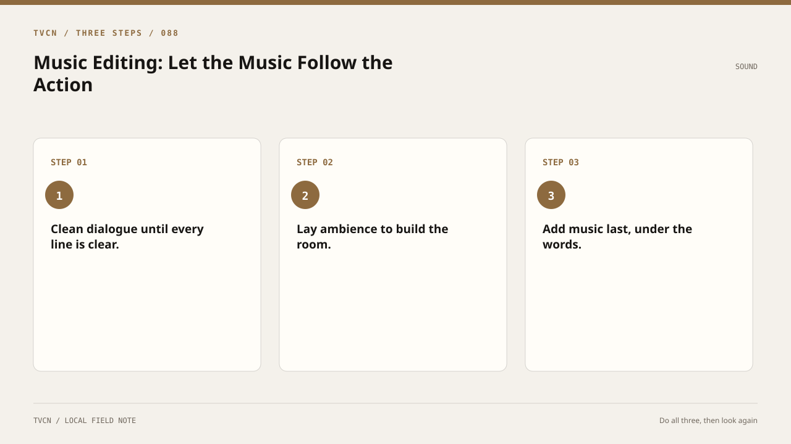

Music does not run wall to wall; it enters, exits, and leaves space at the turn.

<!-- DIAGRAM_START -->
<h2>Diagram</h2>
<figure>
  
  <figcaption>Do the three steps in order, then look again at the image or file.</figcaption>
</figure>
<!-- DIAGRAM_END -->
<h2>On set</h2>

Mark the action beats: door opens, turn, sit. Bring music in on the first, change it on the second, and take it out on the third.

<h2>Do this</h2>

Music is not wall-to-wall; it enters, changes, and exits at action turns.
<ol><li>Mark action points: door opens, turn, sit down.</li><li>Bring music in at the first point, change at the second, and exit at the third.</li><li>Leave one breath without music and let ambience take over.</li></ol>
<h2>Avoid</h2>

Do not fill every gap with music; without an exit, the entrance has no power.

<h2>Check</h2>
<ul><li>Music has at least one clear entrance, change, and exit.</li><li>The three action points line up with musical changes instead of arbitrary beats.</li><li>The silent passage works on ambience alone and does not feel like a dropout.</li></ul>

<!-- DEEP_DIVE_START -->
## Deep dive

<strong>About 5 minutes.</strong> Music is not wallpaper; it breathes with the action. When it enters and leaves matters more than the track itself.

### Find the accents first

Lay the music on the timeline and mark the hits, rests, and chorus. Major picture actions should land on accents so the audience feels the lock.

Music without accents does not support hard cuts; use ambience or silence instead. Not every track has to serve the edit; some just need to exist.

### Dialogue comes first

When dialogue enters, bring the music down. Not a little; enough to make the line clear. Expensive music that hides a line is worthless.

Do not push music over dialogue and pull it back; the audience hears the fight. Lose two bars before losing a sentence.

### Endings and silence

Leave two seconds after the last line before the music leaves. The audience needs time to react; cut the music too soon and the emotion is guillotined.

Be silent when silence is right. Silence is not absence; it returns attention to the picture. Constant music tires an audience.

### Temp track versus final score

Use a temp track to find rhythm in the rough cut, then replace it after lock. Never deliver the temp.

Keep the accent positions when swapping cues, or the whole section needs re-cutting.

### Licensing and replacement

Confirm the license scope before release: platform, territory, term. A “in-video use” license may not cover advertising.

Export a music-free version before replacing the cue; do not layer the new track over the old.

### Ten music-edit checks
<ul><li>Mark the musical accents first</li><li>Land major actions on accents</li><li>Drop music when dialogue enters</li><li>Do not fill the whole film with music</li><li>Leave a breath at transitions</li><li>Hold two seconds at the end</li><li>Be silent when silence is right</li><li>Check that bass does not mask dialogue</li><li>Listen on a phone speaker</li><li>Solo dialogue before delivery</li></ul>
Music is not there to make the film look expensive; it is there to let the audience breathe when they should.

### When you have five minutes
<ul><li>Mark the musical accents</li><li>Drop music under dialogue</li><li>Leave a breath at transitions</li><li>Hold two seconds at the end</li><li>Be silent when silence is right</li><li>Listen on a phone speaker</li></ul>
Music enters to push, and leaves so the audience can take a step alone. It does not fill silence; it decides where silence belongs. Silence is part of the score; let the last beat land on the picture before it leaves.

<!-- DEEP_DIVE_END -->
