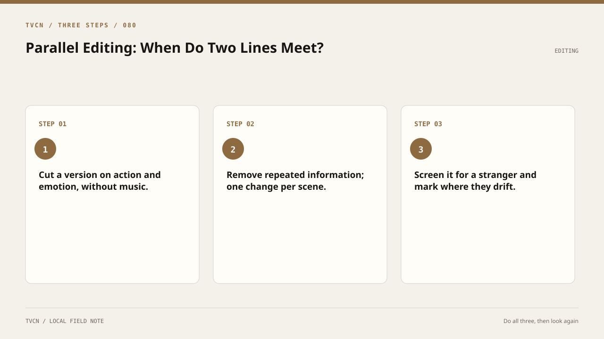

Parallel editing is not back-and-forth; it makes the audience ask when the two lines will collide.

<!-- DIAGRAM_START -->
<h2>Diagram</h2>
<figure>
  
  <figcaption>Do the three steps in order, then look again at the image or file.</figcaption>
</figure>
<!-- DIAGRAM_END -->
<h2>On set</h2>

Give each line a countdown: A has ten minutes left, B has three. Cross them when the audience starts doing the math.

<h2>Do this</h2>

Parallel editing is not constant cutting; it makes the audience ask when the two lines will collide.
<ol><li>Give each line a countdown: A has ten minutes, B has three.</li><li>Cross when the audience starts calculating, not every ten seconds.</li><li>After the cross, let the lines share an object, sound, or action.</li></ol>
<h2>Avoid</h2>

Do not cut back and forth for technique; without a countdown, the cross has no pressure.

<h2>Check</h2>
<ul><li>Each line has a readable countdown so the audience can calculate who arrives first.</li><li>The cross happens at rising pressure, not at even intervals.</li><li>After the cross, the lines share an element instead of running separately.</li></ul>
