<!-- DIAGRAM_START -->
<h2>Diagram</h2>
<figure>
  
  <figcaption>Diagram: one row per platform. Do not upload the master; derive and log each version.</figcaption>
</figure>
<!-- DIAGRAM_END -->
<h2>Lock the master before the platforms</h2>
Keep one master: highest resolution, highest bitrate, no captions, no titles, no platform compression. Platform versions derive from it; never edit the master. Filenames carry project, date, version, status; no final/final2.

Write the platform list first: one primary, two distribution, one website/private. For each, write frame, runtime, bitrate, captions, cover, loudness. Without the list, the wrong frame is discovered on upload day.
<h2>Frame and safe area: not one crop</h2>
16:9 to 9:16 is not cropping the sides. Eyes, hands, product, and captions must be recomposed. Check each platform’s safe area, especially the top and bottom buttons in vertical. A key action at the edge of the wide is lost in vertical.

Shoot two compositions: landscape wide, vertical medium. Cropping in post saves only part; if the set did not leave room, post zooms and loses both quality and composition.
<h2>Captions: burned, sidecar, open</h2>
Burned-in captions are in the picture and cannot be turned off; sidecar captions may not display; open captions serve access and silent viewing. Test all three by playing, not by checking file existence.

Caption safe area, size, lines, and CPS follow the platform. Vertical captions must not cover the mouth; landscape captions stay inside 90%. Do not squeeze two-language small type; split versions.
<h2>Loudness and QC: the platform compresses again</h2>
Deliver to platform loudness; do not expect the platform to fix it. Dialogue-led work often sits at -16 LUFS; music and ads follow platform rules. Short drama and feed can be slightly hotter but not so hot that the platform compresses. Watch the upload end to end for black frames, freezes, audio drops, and caption drift.

One QC row per platform: file, frame, runtime, loudness, captions, cover, title, link. Ticks are not paperwork; they identify which version failed.
<h2>Failure case: vertical crop removed the product</h2>
A product ad was cut in 16:9 with the product at frame right. The 9:16 center crop left half the product, and captions covered the hand. After upload, the first three seconds did not show what was sold and completion halved.

The fix is recomposition, not a product close-up sticker. Shoot a vertical medium on set so post has room; without it, a re-shoot is cheaper than patching.
<h2>Cost and acceptance</h2>
Low: master plus two platform versions, ¥1,000–3,000. Mid: four platforms, captions, covers, QC, ¥3,000–10,000. High: eight-plus platforms, bilingual, multiple versions, HDR/SDR, ¥10,000–30,000+.
<h2>Check</h2><ul><li>One master; every platform version traces back.</li><li>Each platform has frame, runtime, caption, and loudness specs.</li><li>Vertical is recomposed, not center-cropped.</li><li>All three caption types are played.</li><li>Full QC per platform.</li><li>Filename includes platform and version.</li></ul>

<!-- SOURCES_START -->
## References and further reading

- [S24] [ACESCentral: ACES](https://acescentral.com/) — Accessed 2026-11-27. Used to check the terminology and public context in the opening paragraph (“One master everywhere is the most expensive shortcut. Keep o”) against ACES color encoding, ACEScg and delivery/archive workflows; not a substitute for an on-set test.
- [S27] [ITU-R: BS.1770 音频响度与真峰值测量](https://www.itu.int/rec/R-REC-BS.1770/en) — Accessed 2026-11-27. Used to check the terminology and public context in the opening paragraph (“One master everywhere is the most expensive shortcut. Keep o”) against ITU algorithms for loudness measurement and true peak, the basis referenced by EBU R128; not a substitute for an on-set test.
- [S28] [Netflix Partner Help](https://partnerhelp.netflixstudios.com/) — Accessed 2026-11-26. Used to check the terminology and public context in the opening paragraph (“One master everywhere is the most expensive shortcut. Keep o”) against Public entry for delivery specs, HDR/SDR and QC; not a substitute for an on-set test.
- [S30] [DaVinci Resolve](https://www.blackmagicdesign.com/products/davinciresolve) — Accessed 2026-11-26. Used to check the terminology and public context in the opening paragraph (“One master everywhere is the most expensive shortcut. Keep o”) against Official entry for editing, grading, Fusion and delivery; not a substitute for an on-set test.
- [S34] [Adobe Premiere Pro Guide](https://helpx.adobe.com/premiere-pro/user-guide.html) — Accessed 2026-11-26. Used to check the terminology and public context in the opening paragraph (“One master everywhere is the most expensive shortcut. Keep o”) against Official docs for editing, proxies, color and export; not a substitute for an on-set test.
<!-- SOURCES_END -->

