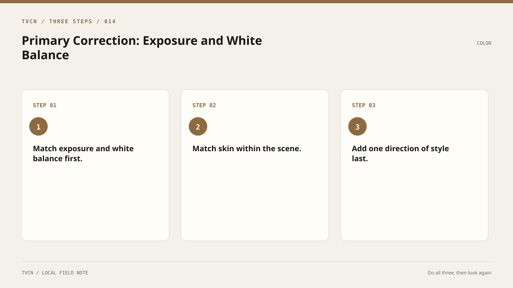

Primary correction fixes exposure and white balance first. Do not hide technical problems under a look.

<!-- DIAGRAM_START -->
<h2>Diagram</h2>
<figure>
  
  <figcaption>Do the three steps in order, then look again at the image or file.</figcaption>
</figure>
<!-- DIAGRAM_END -->
<h2>On set</h2>

Shoot a grey or color card first: set black to 0 to 5 and white below 100. Match every shot in the scene, then check the skin line.

<h2>Do this</h2>

Primary correction fixes exposure and white balance before style.
<ol><li>Shoot a gray or color chart; set black to 0 to 5 and white below 100.</li><li>Match every shot in the scene for exposure and white balance, then check the skin line.</li><li>Add contrast and style only after the technical problems are gone.</li></ol>
<h2>Avoid</h2>

Do not use a LUT to hide technical problems; it makes them look prettier.

<h2>Check</h2>
<ul><li>Black and white levels match across the scene and cuts do not jump.</li><li>Skin sits on the same vector line with no green or red drift between shots.</li><li>Turn off the style LUT and the image still holds technically.</li></ul>

<!-- DEEP_DIVE_START -->
## Deep dive

<strong>About 6 minutes.</strong> Primary correction does three things: match exposure, unify white balance, restore contrast. Do not build a look here.

### Match first, grade later

Choose the most accurate shot in the scene as reference and bring the others to it. Read the waveform, not your eye; the eye is fooled by neighboring shots.

Grade interior and exterior separately; do not pull the window to the same brightness as the room. The audience knows outside is brighter, and flattening it looks false.

### White balance on neutral gray

A white wall carries a cast; a gray card is truer. Without one, use white paper but do not overexpose it; clipped paper is no longer white.

Under mixed light there is no absolute correct. Choose one dominant source and let other colors remain. Pull everything to white and the room dies.

### Do not crush the contrast

Lifting blacks makes them milky; crushing them loses detail. Read the scope before deciding; black is not a grade contest.

Put the LUT after primary. Do not use a LUT to hide exposure errors; if primary is wrong, every later node patches the wrong image.

### The order of shot matching

Exposure first, white balance second, contrast third, skin last. Reverse the order and every adjustment undoes the one before.

After a scene, play three shots before moving on and confirm there is no jump.

### Skin and memory colors

Sky, grass, and skin are memory colors; the audience notices a small shift. Protect skin before sky.

Do not grade every face to the same brightness. Different people have different skin, and unifying it looks false.

### Ten primary-correction checks
<ul><li>Choose one reference shot per scene</li><li>Match exposure first</li><li>Then white balance</li><li>Then skin tone</li><li>Then black level</li><li>Then highlights</li><li>Keep ambient color under mixed light</li><li>Place the LUT after primary</li><li>Check on the scopes</li><li>Play the whole scene back</li></ul>
Primary correction is not about looking good; it is about making the seams between shots disappear.

### When you have five minutes
<ul><li>Choose one reference per scene</li><li>Match exposure</li><li>Then white balance</li><li>Then skin</li><li>Check black and highlight</li><li>Place the LUT after primary</li></ul>
Primary correction is the foundation for any look; if it is crooked, every later grade looks false. Make the faces in one scene look like the same person before you talk about style. The face must stay the same person across the scene, not two color temperatures.

<!-- DEEP_DIVE_END -->
<!-- SOURCES_START -->
<h2>Sources</h2>

Experience: TVCN field notes and project reviews; tested: the review setup and reproducible exercises noted on the page; references: public links below.

<ul><li>[S24] ACES Color Management</li><li>[S27] EBU R128 Loudness</li><li>[S28] Netflix Partner Help</li><li>[S30] DaVinci Resolve</li><li>[S34] Adobe Premiere Pro Guide</li><li>[S35] Avid Resource Center</li></ul>

<a href="../../SOURCES.md">Full links and notes in SOURCES.md</a>

<!-- SOURCES_END -->
