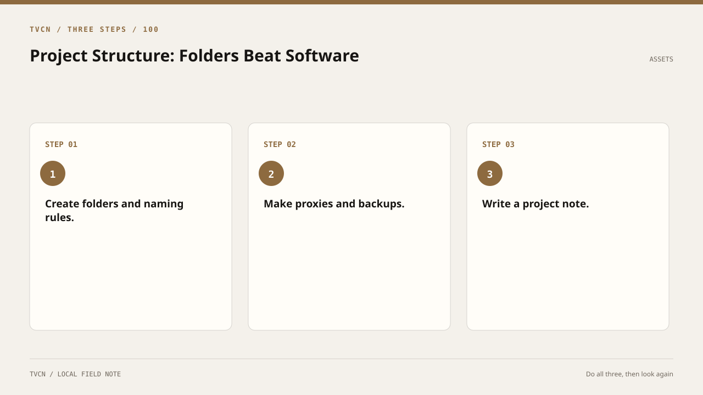

Set folders and naming before software; if the app changes, the media still makes sense.

<!-- DIAGRAM_START -->
<h2>Diagram</h2>
<figure>
  
  <figcaption>Do the three steps in order, then look again at the image or file.</figcaption>
</figure>
<!-- DIAGRAM_END -->
<h2>On set</h2>

Create 01_media, 02_project, 03_exports, and 04_docs at the root. Name files date_scene_camera; never final version.

<h2>Do this</h2>

Project structure fixes folders and names so the media survives a software change.
<ol><li>Create 01_media, 02_project, 03_exports, and 04_docs at the root.</li><li>Name files date_scene_camera, never “final”.</li><li>Keep proxies and originals separate and back up the same day.</li></ol>
<h2>Avoid</h2>

Do not leave media on the desktop; a system reinstall erases it.

<h2>Check</h2>
<ul><li>The four root folders exist and media, project, exports, and docs each live in place.</li><li>Filenames carry date, scene, and camera and sort cleanly.</li><li>On another machine or app, the path still leads to the original media.</li></ul>
