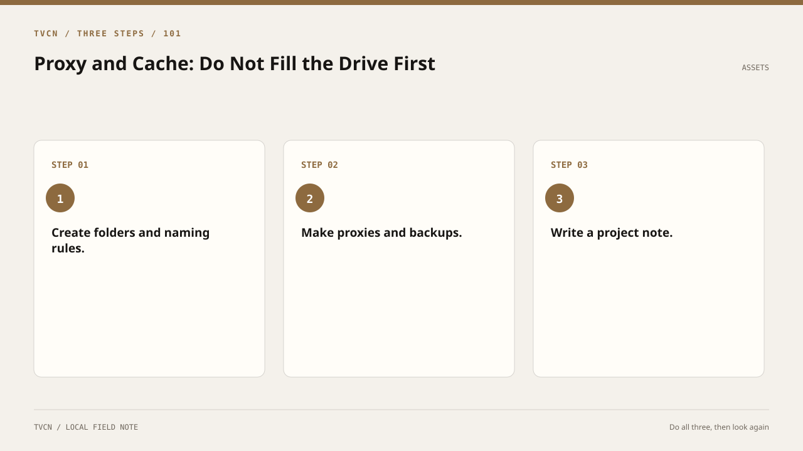

A proxy is a low-resolution copy for editing; a cache is a preview file generated for playback. Deleting cache does not lose media; deleting proxies takes the timeline offline. Keep them in separate folders.

<!-- DIAGRAM_START -->
<h2>Diagram</h2>
<figure>
  
  <figcaption>Watch “Put proxies and cache on a second SSD.” and “Keep twenty percent free on the system drive”; judge whether removing one shot makes the scene faster rather than muddier.</figcaption>
</figure>
<!-- DIAGRAM_END -->
<section><h2 id="section-1">Proxies and cache are different things</h2>
Put proxies in a Proxy folder and cache in the software's cache directory; clean cache only.
<h2 id="section-2">Limits</h2>
Do not let a cleaner app delete “media cache” in one click. It may sweep proxies and originals. Confirm the path before deleting.
</section><section><h2 id="section-3">On set</h2>
Put proxies and cache on a second SSD and keep 20 percent free on the system drive. When the edit drive fills, clear cache, not originals.
</section><section><h2 id="section-4">Do this</h2>
Proxies and cache belong on a separate drive; a full edit drive drops frames.
<ol><li>Put proxies and cache on a second SSD.</li><li>Keep twenty percent free on the system drive and never let the edit drive go red.</li><li>When space runs out, clear cache first; never delete originals.</li></ol></section><section><h2 id="section-5">Avoid</h2>
Do not delete originals for space; cache can be rebuilt, media cannot.
</section><section><h2>Judge</h2>
This page passes on three observable checks, not slogans:
<ul><li><strong>1.</strong> Proxies and cache sit on the second drive and the edit drive still has free space.</li><li><strong>2.</strong> The system drive keeps at least twenty percent free with no red warning.</li><li><strong>3.</strong> After clearing cache, the project rebuilds and every original remains.</li></ul></section><section><h2>Failures</h2>
Any one of these means stop and fix it before post:
<ul><li><strong>1.</strong> Check 1 is only staged (“Proxies and cache sit on the second drive and…”); another camera position or location exposes it.</li><li><strong>2.</strong> Check 2 is left to post or a verbal explanation (“The system drive keeps at least twenty percent…”); nothing on set can be rechecked.</li><li><strong>3.</strong> Do not delete originals for space; cache can be rebuilt, media cannot.</li></ul></section><section><h2>Extend</h2>
<strong>10-minute exercise:</strong> Take 30 seconds of footage and make an A/B, changing only “Put proxies and cache on a second SSD.”. Note one timecode and one difference before keeping it.
</section>
<h2>Check</h2><ul><li>Proxies and cache sit on the second drive and the edit drive still has free space.</li><li>The system drive keeps at least twenty percent free with no red warning.</li><li>After clearing cache, the project rebuilds and every original remains.</li></ul>

<!-- SOURCES_START -->
## References and further reading

- [S70] [FFmpeg: Documentation](https://ffmpeg.org/documentation.html) — Accessed 2026-11-26. Used to check the terminology/method/rule in the “Proxies and cache are different things” section against FFmpeg codec/muxing documentation, not a delivery spec; it does not verify numbers, model choices or on-set conclusions derived from this page, and is not a substitute for a test.
- [S35] [Avid: Resource Center](https://www.avid.com/resource-center) — Accessed 2026-11-26. Used to check the terminology/method/rule in the “Limits” section against Avid resource center, not an independent review; it does not verify numbers, model choices or on-set conclusions derived from this page, and is not a substitute for a test.
- [S29] [YouTube: Upload Encoding Specs](https://support.google.com/youtube/answer/1722171) — Accessed 2026-11-26. Used to check the terminology/method/rule in the “On set” section against YouTube upload encoding recommendations, not creative standards; it does not verify numbers, model choices or on-set conclusions derived from this page, and is not a substitute for a test.
<!-- SOURCES_END -->

