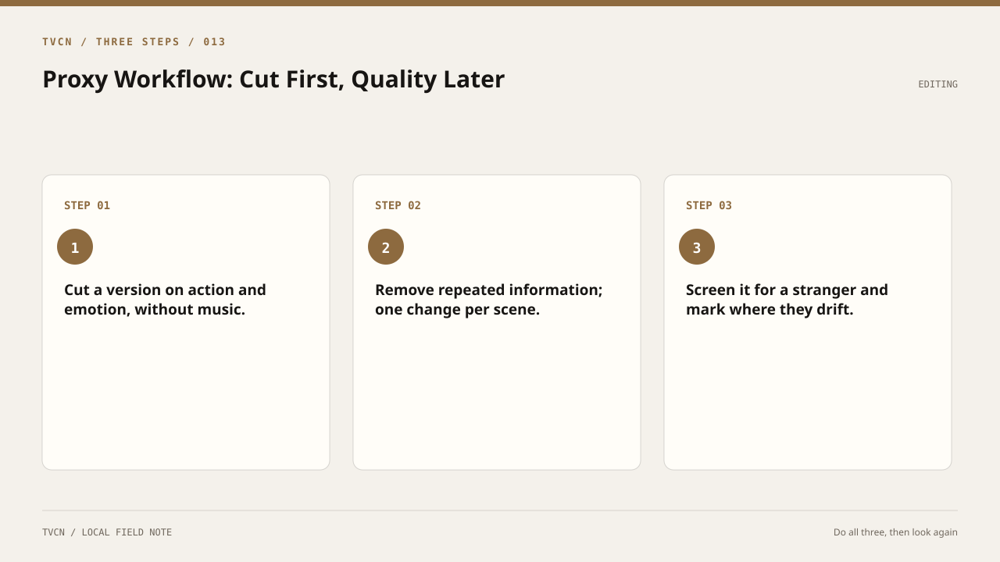

Proxies do not lower the final quality; they let the edit move. Keep the originals untouched.

<!-- DIAGRAM_START -->
<h2>Diagram</h2>
<figure>
  
  <figcaption>Do the three steps in order, then look again at the image or file.</figcaption>
</figure>
<!-- DIAGRAM_END -->
<h2>On set</h2>

Use ProRes Proxy or quarter-resolution proxies on a separate SSD. Lock the originals as read-only, edit only proxies, and relink before delivery.

<h2>Do this</h2>

Proxies do not lower delivery quality; they let the edit run. Originals stay untouched beside them.
<ol><li>Generate ProRes Proxy or quarter-resolution files on a separate SSD.</li><li>Set the originals to read-only and edit only against proxies.</li><li>Relink to originals before delivery and confirm no proxy slipped into the master.</li></ol>
<h2>Avoid</h2>

Do not treat proxies as masters; deliver before relinking and the quality shows.

<h2>Check</h2>
<ul><li>Proxies and originals live on separate drives and the originals are read-only.</li><li>The timeline references proxies only, with one-to-one names and paths.</li><li>After relinking, three random shots return to original resolution and detail.</li></ul>

<!-- DEEP_DIVE_START -->
## Deep dive

<strong>About 5 minutes.</strong> A proxy is not a quality downgrade; it makes the edit run. The original stays untouched; the proxy only buys responsiveness.

### When you need proxies

Above 4K, multicam, or an older machine: if playback stutters, make proxies. A smooth 1080 single track does not need them; do not add process for its own sake.

Set proxy resolution to the timeline. Do not make a proxy larger than the timeline; 1080 proxies are enough for a 1080 cut.

### How to generate proxies

Keep filename, timecode, and reel name identical; put them in a separate Proxy folder. Never overwrite the originals or change their folder structure.

Spot-check three shots after generating; confirm audio and color survived. A proxy can be soft, but it cannot lose sound.

### Relink and export

Lock the cut before relinking to originals. After relink, check speed changes, captions, and transitions; proxy and original can differ by a frame.

Always export from the originals; proxies stay in the project. Treat a proxy as a master and quality drops exactly when it matters.

### Proxy naming and folders

Originals in Camera, proxies in Proxy, projects in Project. Keep the three folders separate.

Add _proxy to the proxy filename so relink is obvious. Never rename the originals.

### Multicam proxies

Make multicam proxies at the same resolution and frame rate, or the timeline refuses them.

Sync once after generating and confirm audio and camera mapping before editing.

### Ten proxy-workflow checks
<ul><li>Only for high resolution or multicam</li><li>Proxy filenames match originals</li><li>Proxies in a separate folder</li><li>Never overwrite originals</li><li>Keep timecode and reel names</li><li>Spot-check three shots after generating</li><li>Edit with proxies</li><li>Lock the cut before relinking</li><li>Check speed and captions after relink</li><li>Export from originals</li></ul>
A proxy is scaffolding, not the building. Take it down after the cut; do not deliver from inside it.

### When you have five minutes
<ul><li>Only for high resolution or multicam</li><li>Proxy names match originals</li><li>Keep proxies in a separate folder</li><li>Spot-check three shots</li><li>Lock before relinking</li><li>Export from originals</li></ul>
Proxies let the edit run; originals let the film stand at the end. A broken proxy can be rebuilt; a lost original has no second take.

<!-- DEEP_DIVE_END -->
