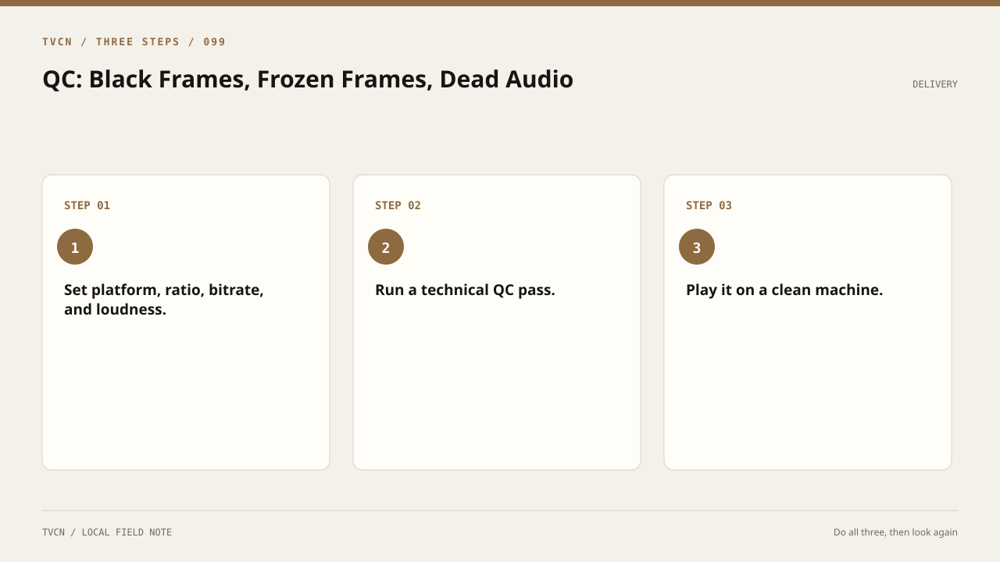

QC runs a checklist: black frames, freeze, audio dropout, subtitle overflow, channel swap.

<!-- DIAGRAM_START -->
<h2>Diagram</h2>
<figure>
  
  <figcaption>Watch “Check black frames, freeze, audio dropouts, subtitle overflow,” and “Use a calibrated monitor and headphones, not laptop”; judge whether removing one shot makes the scene faster rather than muddier.</figcaption>
</figure>
<!-- DIAGRAM_END -->
<section><h2 id="section-1">On set</h2>
Run the checklist: black frames, freeze frames, audio drops, subtitles outside safe area, channel swap. Judge on a calibrated monitor, not laptop speakers.
</section><section><h2 id="section-2">Do this</h2><ol><li>Check black frames, freeze, audio dropouts, subtitle overflow, and left-right channels.</li><li>Use a calibrated monitor and headphones, not laptop speakers.</li><li>Mark problems with timecode and fix the master, not the platform copy.</li></ol></section><section><h2 id="section-3">Avoid</h2>
Do not judge sound on laptop speakers; you will miss low end and dropouts.
</section><section><h2 id="section-4">QC checklist</h2>
Check the delivery spec: resolution, frame rate, duration, channels, loudness, subtitles, safe area and file naming. Do not only look at picture; sound and subtitles are the two easiest misses.
<ol><li>Black frames and freezes: watch from head to tail at 1x and log timecode.</li><li>Dropouts and peaks: listen with headphones, not just the waveform; check left/right and phase.</li><li>Subtitles: check safe area, typos, line breaks, timing and forced subtitles.</li></ol></section><section><h2 id="section-5">Pass order</h2><ol><li>Conform first and confirm the timeline matches the master. Do not QC a platform-compressed version.</li><li>Play the whole film at 1x and log timecode and frame number at the moment you see a problem.</li><li>Recheck with scopes, a calibrated monitor and headphones; laptop speakers are reference only.</li></ol>
QC is a full pass, not a spot check. Watch 10 minutes, rest, then continue; attention fatigue hides errors.
</section><section><h2 id="section-6">What gets missed</h2><ol><li>Laptop speakers hide low end and dropouts. Use headphones or a monitor.</li><li>Checking only the platform preview hides problems; the platform re-encodes.</li><li>Checking only the first subtitle screen misses later safe-area, typo and timing issues.</li><li>Swapped channels can sound fine in headphones. Check phase or mono.</li></ol></section><section><h2 id="section-7">QC log</h2><ul><li>Every issue has timecode, frame, type and fix status; recheck the same spot after the fix.</li><li>Black frame, freeze, dropout, subtitle, channel and loudness all have pass/fail.</li><li>Final check uses a calibrated monitor and headphones, not laptop speakers.</li><li>Log master filename, delivery version, QC operator and date; the platform copy never replaces the master.</li></ul></section><section><h2 id="section-8">Delivery log</h2>
Before delivery log master filename, duration, resolution, frame rate, loudness, subtitle version, QC operator and date. Keep the platform upload separate; fix problems in the master.
</section><section><h2>Judge</h2>
Three signals are observable on set:
<ul><li>removing one shot makes the scene faster, not muddier</li><li>skin, highlights and blacks sit inside scope limits</li><li>loudness, subtitles and file specs pass one delivery check</li></ul></section><section><h2>Failures</h2>
These three moves erase the detail you just built:
<ul><li>cuts follow the music, not the action</li><li>style before unity: shots jump in color</li><li>loudness and subtitles are checked at the very end</li></ul></section><section><h2>Extend</h2>
<strong>10-minute exercise:</strong> Take 30 seconds of footage and make an A/B, changing only “Check black frames, freeze, audio dropouts, subtitle overflow,”. Note one timecode and one difference before keeping it.
</section>
<h2>Check</h2><ul><li>Black frames, freeze, and audio dropouts are timecoded and fixed.</li><li>Subtitles stay in frame and left-right channels are correct.</li><li>Review uses a calibrated monitor and headphones, not laptop speakers.</li></ul>
