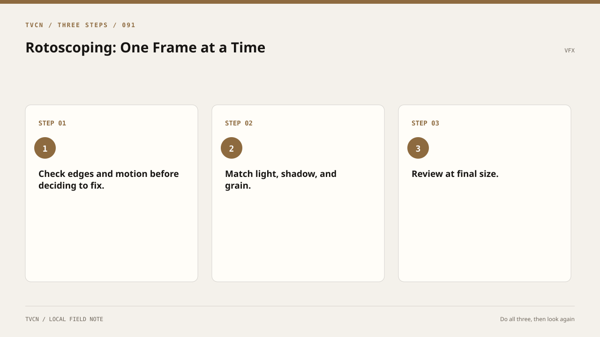

Rotoscoping is not one drag. Hair, fingers, and transparency need frame-by-frame work.

<!-- DIAGRAM_START -->
<h2>Diagram</h2>
<figure>
  
  <figcaption>Do the three steps in order, then look again at the image or file.</figcaption>
</figure>
<!-- DIAGRAM_END -->
<h2>On set</h2>

Test five frames first: hair, fingers, and something transparent. Check the edge every frame; do not wait 200 frames to notice drift.

<h2>Do this</h2>

A mask is not one drag; hair, fingers, and transparent edges need frame-by-frame work.
<ol><li>Test five frames: hair, fingers, and a transparent object.</li><li>Check each edge and confirm the mask does not eat the subject.</li><li>Only then cover the full shot; do not discover drift at frame 200.</li></ol>
<h2>Avoid</h2>

Do not use one mask for the whole shot; once the edge fails, every later frame needs rework.

<h2>Check</h2>
<ul><li>In the five-frame test, hair, fingers, and transparent edges are clean.</li><li>The mask neither eats the subject nor leaves background on the edge.</li><li>After covering the shot, three random frames show no sudden warp or drift.</li></ul>
