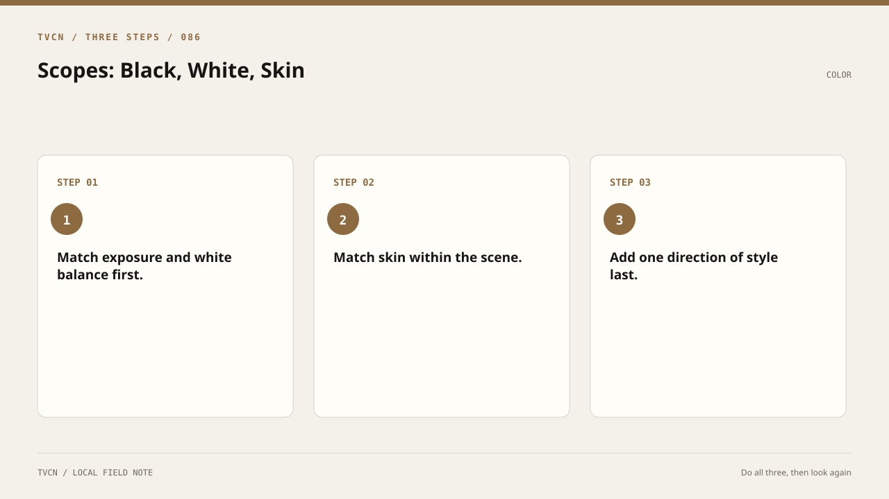

Waveform shows overall brightness and clipped highlights; vector shows saturation and hue; RGB parade shows channel alignment. Use all three to separate “bright” from “cast.”

<!-- DIAGRAM_START -->
<h2>Diagram</h2>
<figure>
  
  <figcaption>Watch “Keep black at or above 0 and white” and “Put the skin line inside the vector scope&#x27;s”; judge whether removing one shot makes the scene faster rather than muddier.</figcaption>
</figure>
<!-- DIAGRAM_END -->
<section><h2 id="section-1">Waveform for luma, vector for color, parade for separation</h2>
Check parade black and white balance, then vector skin line, then waveform highlights; do not conclude from one scope.
<h2 id="section-2">Limits</h2>
Scopes are not creative judges. Stylized low contrast, night and backlight can look “wrong”; set intention before reading them.
</section><section><h2 id="section-3">On set</h2>
Keep black above 0 and white below 100. Put the skin line in the skin patch on the vectorscope; if it drifts red, lower saturation or fix white balance.
</section><section><h2 id="section-4">Do this</h2>
Scopes answer three things: are blacks crushed, are whites clipped, is skin off.
<ol><li>Keep black at or above 0 and white at or below 100.</li><li>Put the skin line inside the vector scope's skin zone.</li><li>If it skews red, lower saturation or adjust white balance; do not guess by eye.</li></ol></section><section><h2 id="section-5">Avoid</h2>
Do not replace scopes with your eyes; an uncalibrated monitor lies too.
</section><section><h2>Judge</h2>
Three signals are observable on set:
<ul><li>removing one shot makes the scene faster, not muddier</li><li>skin, highlights and blacks sit inside scope limits</li><li>loudness, subtitles and file specs pass one delivery check</li></ul></section><section><h2>Failures</h2>
These three moves erase the detail you just built:
<ul><li>cuts follow the music, not the action</li><li>style before unity: shots jump in color</li><li>loudness and subtitles are checked at the very end</li></ul></section><section><h2>Extend</h2>
<strong>10-minute exercise:</strong> Take 30 seconds of footage and make an A/B, changing only “Keep black at or above 0 and white”. Note one timecode and one difference before keeping it.
</section>
<h2>Check</h2><ul><li>Black does not go below 0 and white does not exceed 100.</li><li>The skin line sits in the skin zone without a red or green shift.</li><li>Before-and-after scope grabs show a change that maps to a specific parameter.</li></ul>

<!-- SOURCES_START -->
## Experience note

Experience note: this page draws on 5 post-production review reviews under media up to 4K and a standard platform delivery; it discusses “Scopes: Black, White, Skin”; no external laboratory test was run, and the conclusion may not transfer when conditions change.
<!-- SOURCES_END -->

