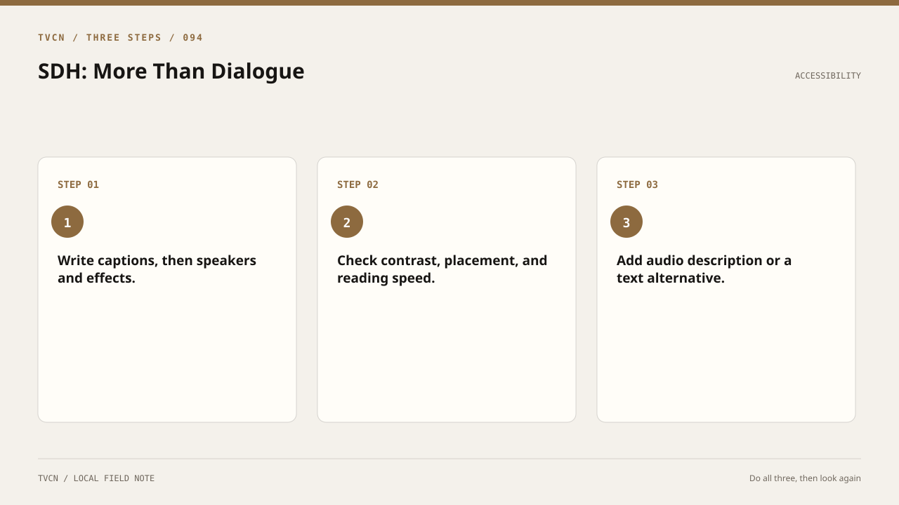

SDH is not only dialogue; it names sound events: door, footsteps, phone, music mood. Mark speaker changes by name or position; overlap gets “together.”

<!-- DIAGRAM_START -->
<h2>Diagram</h2>
<figure>
  
  <figcaption>Watch “Label speakers: male, female, phone.” and “Write ambience as [door], [rain], and music as”; judge whether removing one shot makes the scene faster rather than muddier.</figcaption>
</figure>
<!-- DIAGRAM_END -->
<section><h2 id="section-1">SDH writes what is heard</h2>
Describe music in brackets by style and feeling, not just “music.” Key plot sounds include direction: approaching from back left.
<h2 id="section-2">Limits</h2>
SDH is not a full sound list. Caption only what drives understanding or emotion; labeling every sound buries the image.
</section><section><h2 id="section-3">On set</h2>
Mark the speaker: male, female, phone. Write [door] or [rain] for effects and [music] for score; do not just transcribe dialogue.
</section><section><h2 id="section-4">Do this</h2>
SDH captions name the speaker, ambience, and key effects, not just dialogue.
<ol><li>Label speakers: male, female, phone.</li><li>Write ambience as [door], [rain], and music as [music].</li><li>Check placement and reading speed; captions never cover mouths or hands.</li></ol></section><section><h2 id="section-5">Avoid</h2>
Do not place captions over mouths or hands; the audience needs the performance.
</section><section><h2>Judge</h2>
This page passes on three observable checks, not slogans:
<ul><li><strong>1.</strong> Each caption identifies the speaker and distinguishes phone or off-screen voice.</li><li><strong>2.</strong> Door, rain, music, and other key sounds appear in the captions.</li><li><strong>3.</strong> Captions stay off mouths and hands, within two lines, and read at pace.</li></ul></section><section><h2>Failures</h2>
Any one of these means stop and fix it before post:
<ul><li><strong>1.</strong> Check 1 is only staged (“Each caption identifies the speaker and distin…”); another camera position or location exposes it.</li><li><strong>2.</strong> Check 2 is left to post or a verbal explanation (“Door, rain, music, and other key sounds appear…”); nothing on set can be rechecked.</li><li><strong>3.</strong> Do not place captions over mouths or hands; the audience needs the performance.</li></ul></section><section><h2>Extend</h2>
<strong>10-minute exercise:</strong> Take 30 seconds of footage and make an A/B, changing only “Label speakers: male, female, phone.”. Note one timecode and one difference before keeping it.
</section>
<h2>Check</h2><ul><li>Each caption identifies the speaker and distinguishes phone or off-screen voice.</li><li>Door, rain, music, and other key sounds appear in the captions.</li><li>Captions stay off mouths and hands, within two lines, and read at pace.</li></ul>

<!-- SOURCES_START -->
## References and further reading

- [S68] [W3C: WebVTT](https://www.w3.org/TR/webvtt1/) — Accessed 2026-11-26. Used to check the terminology/method/rule in the “SDH writes what is heard” section against WebVTT caption format, not platform review rules; it does not verify numbers, model choices or on-set conclusions derived from this page, and is not a substitute for a test.
- [S06] [W3C: Captions and Subtitles](https://www.w3.org/WAI/media/av/captions/) — Accessed 2026-11-26. Used to check the terminology/method/rule in the “Limits” section against W3C caption guidance, not platform review rules; it does not verify numbers, model choices or on-set conclusions derived from this page, and is not a substitute for a test.
<!-- SOURCES_END -->

