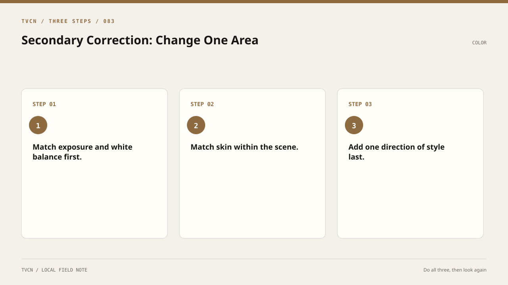

Secondary correction changes one area: skin, sky, wardrobe. More areas, more fake.

<!-- DIAGRAM_START -->
<h2>Diagram</h2>
<figure>
  
  <figcaption>Do the three steps in order, then look again at the image or file.</figcaption>
</figure>
<!-- DIAGRAM_END -->
<h2>On set</h2>

Pick one area: face or sky. Feather the qualifier 10 to 20 pixels, keep the change under five percent, and toggle it off to check.

<h2>Do this</h2>

Secondary correction changes one region: face, sky, or clothing. The more regions, the faker it looks.
<ol><li>Choose one region: face or sky.</li><li>Feather the qualifier 10 to 20 pixels and keep the change under five percent.</li><li>Toggle the node and check for halo or color patch at the edge.</li></ol>
<h2>Avoid</h2>

Do not change five regions at once; every edge leaves a trace.

<h2>Check</h2>
<ul><li>Only one region moved and neighboring colors are untouched.</li><li>Feathering looks natural with no halo, jagged edge, or patch.</li><li>With the node off, the audience cannot tell which area was isolated.</li></ul>
