<!-- DIAGRAM_START -->
<h2>Diagram</h2>
<figure>
  
  <figcaption>Diagram: treat each layer separately, combine last. Filling with music first hides dialogue problems.</figcaption>
</figure>
<!-- DIAGRAM_END -->
<h2>First decision: which layer first</h2>
Watch the film without music: is every line clear, is ambience continuous, does a cut drop into silence. If dialogue is unclear, fix dialogue; if ambience breaks, add room tone; if effects fight, lower effects. Music is the last emotional layer, not the first.

Split everything into DX dialogue, AMB ambience, SFX effects, MX music. Stems are not for a tidy session; they let you replace one layer without touching the rest.
<h2>Dialogue: keep breath before denoise</h2>
Dialogue cleanup does three things: remove low rumble, tame obvious sibilance, and fix level jumps. Do not remove all breath and mouth detail for “clean”; it starts to sound dubbed. Denoise in small sections, not one setting for the whole track.

The goal is not identical level on every line; it is consistency within a scene. Two people a metre apart should not sound as loud as ten metres apart. The audience needs space.
<h2>Ambience and effects: continuity before richness</h2>
Lay continuous ambience first: at least ten seconds of room tone per scene, no drop at cuts. Effects serve action and information: doors, steps, cloth, phone vibration. Do not put a punchy effect on every action; the audience starts watching sound instead of story.

Effect direction must match frame: off-screen voices and steps outside a door do not sit in the centre. Stereo is not filling the field; it is telling the audience where things are.
<h2>Music and final mix: enters last, leaves last</h2>
Add music last, after dialogue and effects pass. The first music rule is never bury a line: no chorus is worth losing a key sentence. Drop music 3–6 dB where needed; do not make the audience guess.

Check loudness at the final mix: dialogue-led films often sit around -16 LUFS, or follow the platform. Check phone speaker, headphones, and TV, not only the studio monitors.
<h2>Failure case: full music, muddy dialogue</h2>
A brand film laid full music in the rough cut because the client “felt” it. At the final mix, dialogue was buried, so music came down globally and the film went flat. The team then cleaned dialogue and rebuilt music in sections, doubling the work.

Music is not a cover-up. Fix dialogue first, ambience second, and save music for the end so it has room to do real emotional work.
<h2>Cost and acceptance</h2>
Low: dialogue cleanup, ambience, one music track, ¥2,000–6,000. Mid: full stems, effects, final mix, loudness, ¥6,000–20,000. High: 5.1/Atmos, ADR, Foley, multiple versions, ¥20,000–80,000+.
<h2>Check</h2><ul><li>Dialogue is clear without captions.</li><li>Ambience is continuous across every cut.</li><li>Effects match screen direction.</li><li>Music never buries a key line.</li><li>Loudness matches platform; three devices checked.</li><li>DX/AMB/SFX/MX delivered as stems.</li></ul>

<!-- SOURCES_START -->
## References and further reading

- [S27] [ITU-R: BS.1770 音频响度与真峰值测量](https://www.itu.int/rec/R-REC-BS.1770/en) — Accessed 2026-11-27. Used to check the terminology and public context in the opening paragraph (“Sound post does not start with music. The order is: dialogue”) against ITU algorithms for loudness measurement and true peak, the basis referenced by EBU R128; not a substitute for an on-set test.
- [S28] [Netflix Partner Help](https://partnerhelp.netflixstudios.com/) — Accessed 2026-11-26. Used to check the terminology and public context in the opening paragraph (“Sound post does not start with music. The order is: dialogue”) against Public entry for delivery specs, HDR/SDR and QC; not a substitute for an on-set test.
- [S30] [DaVinci Resolve](https://www.blackmagicdesign.com/products/davinciresolve) — Accessed 2026-11-26. Used to check the terminology and public context in the opening paragraph (“Sound post does not start with music. The order is: dialogue”) against Official entry for editing, grading, Fusion and delivery; not a substitute for an on-set test.
- [S34] [Adobe Premiere Pro Guide](https://helpx.adobe.com/premiere-pro/user-guide.html) — Accessed 2026-11-26. Used to check the terminology and public context in the opening paragraph (“Sound post does not start with music. The order is: dialogue”) against Official docs for editing, proxies, color and export; not a substitute for an on-set test.
- [S35] [Avid Resource Center](https://www.avid.com/resource-center) — Accessed 2026-11-26. Used to check the terminology and public context in the opening paragraph (“Sound post does not start with music. The order is: dialogue”) against Resources for Media Composer, collaboration and delivery; not a substitute for an on-set test.
<!-- SOURCES_END -->

