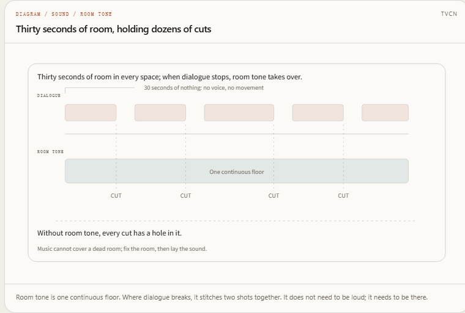

<!-- DIAGRAM_START -->
## Diagram

<figure>
  
  <figcaption>Room tone is one continuous floor. Where dialogue breaks, it stitches two shots together. It does not need to be loud; it needs to be there.</figcaption>
</figure>
<!-- DIAGRAM_END -->

The room's sound is not noise; it is the space. In every location, record thirty seconds of nothing: no voices, no movement, just the room. When the dialogue stops, room tone takes over, and the cut stops sounding like a cut.

## Thirty seconds in every space

Before recording, ask everyone to stop: no walking, no paper, no light adjustments. Put the microphone where the dialogue mic was and roll thirty seconds. Name the file with location and date, something like “kitchen_1120_room.” In the edit, those thirty seconds are worth more than a cue.

If the room has a fridge, an AC, or a fluorescent hum, record one pass normal and one with them off. Do not quietly kill the room on the day. The silence the audience hears still contains those sounds.

## Room tone is the glue

When dialogue drops between two shots, room tone fills the hole and the ear stops hearing a gap. It does not need to be loud; it needs to be there. A low bed of room under the line goes unnoticed until it is removed, and then everything sounds fake.

Match the tone to the space. A living room and a hallway are two different rooms; one generic bed cannot run under the whole film. Across a cut, the room tone has to continue, or the sound jumps before the picture does.

## Do not cover a dead room with music

If the room sounds wrong, fix the room: close the window, turn off the fridge, lower the AC, move the table. Music cannot cover a dead room; it only tells the audience “do not notice this.”

Music is allowed, but room tone is the floor. Lay the room first, then add music. Reverse the order and post becomes a permanent hole-patching job.

## Checks

- Every location has thirty seconds of room tone, findable by filename?
- Does room tone run continuously under the cuts without jumping?
- Was the dead room fixed, or covered with music?

> Intent split: this page covers the practical details of “Room Tone: Do Not Let the Picture Live in a Vacuum”; start with <a href="https://post.tvcn.org/article/loudness/">Loudness: Platform Target and True Peak</a> for the cluster-level judgement, then return here.

<!-- INTENT_SCOPE -->

<!-- SOURCES_START -->
## Experience note

Experience note: this page draws on 5 post-production review reviews under media up to 4K and a standard platform delivery; it discusses “Room Tone: Do Not Let the Picture Live in a Vacuum”; no external laboratory test was run, and the conclusion may not transfer when conditions change.
<!-- SOURCES_END -->

