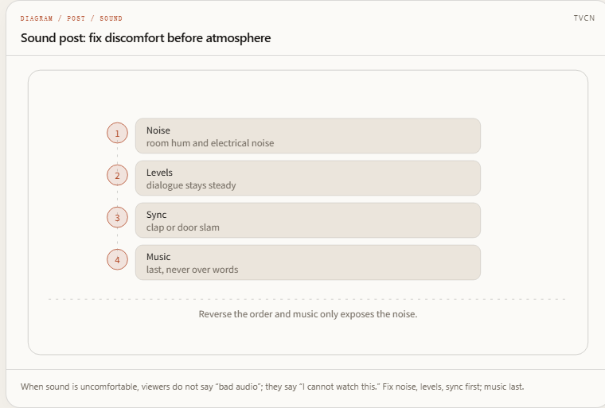

<!-- DIAGRAM_START -->
## Diagram

<figure>
  
  <figcaption>When sound is uncomfortable, viewers do not say “bad audio”; they say “I cannot watch this.” Fix noise, levels, sync first; music last.</figcaption>
</figure>
<!-- DIAGRAM_END -->

## Listen three times before touching anything

First pass for the whole thing. Second pass for voices only. Third pass with the picture off, listening to the room. Write the problems down: hiss, clipping, echo, level jumps between shots. Do not start pulling faders while you listen; you will forget what the original sounded like.

Once the list is clear, decide what to fix and what to re-record. Re-recording one line is often cheaper than ten minutes of repair.

## Do not over-clean the noise

Push noise reduction too far and voices turn to plastic. Start with constant sounds: air conditioning, a fridge, a ballast. For intermittent noise like fans and traffic, change the shot or re-record. Keep a little room tone so the ear believes the space is real.

If a passage cannot be saved, shorten it. The most effective move in sound post is often a cut, not a plug-in.

## Dialogue first, music last

Keep dialogue peaks between -6 and -3 dB, with room tone 12 to 18 dB below. Add music last. Then listen with the picture off and make sure the voice is still on top. A line buried under music does not get replayed; the viewer leaves.

Do not sync by eye. Clap at the head of every take and match the waveform. Without a clap, find a door close, a cup set down, a footstep, and match the transient.

## Checks

- The problem list separates hiss, clipping, echo, and level jumps.
- Dialogue peaks sit between -6 and -3 dB, room tone 12 to 18 dB below.
- With the picture off, the voice is still clear.

<!-- V11_DEEPEN -->

> Intent split: this page covers the practical details of “Fix the Noise Before You Build a Mood”; start with <a href="https://post.tvcn.org/article/loudness/">Loudness: Platform Target and True Peak</a> for the cluster-level judgement, then return here.

<!-- INTENT_SCOPE -->

<!-- SOURCES_START -->
## Experience note

Experience note: this page draws on 4 post-production review reviews under media up to 4K and a standard platform delivery; it discusses “Fix the Noise Before You Build a Mood”; no external laboratory test was run, and the conclusion may not transfer when conditions change.
<!-- SOURCES_END -->

