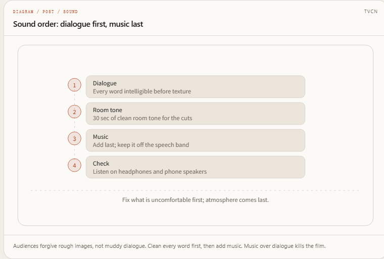

<!-- DIAGRAM_START -->
## Diagram

<figure>
  
  <figcaption>Audiences forgive rough images, not muddy dialogue. Clean every word first, then add music. Music over dialogue kills the film.</figcaption>
</figure>
<!-- DIAGRAM_END -->

An audience can forgive a rough image, but not dialogue they cannot hear. Clean the voice first, then add music and atmosphere.

## Dialogue is the spine

Fix the voice first: denoise, remove mouth clicks, match levels, and make every line intelligible. Do not lay music over noisy dialogue; that only covers the problem.

If the location audio is unusable, consider ADR instead of replacing the voice with subtitles. Subtitles are support, not a substitute for sound.

## Ambience is space

Record 30 seconds of clean room tone or ambience at every location. Lay it under the cut so shot changes do not feel like jumps in a vacuum.

Ambience is not noise. It tells the audience “this is a kitchen, a street, a valley.” Without it, the image feels thin.

## Do not fill every second with music

Music is punctuation, not wallpaper. Save it for turns, decisions, and endings; let silence carry pressure. Build a version without music first, confirm the structure, then add it.

If the film falls apart when you remove the music, the problem is the cut, not the score.

## Three checks

- Every line is intelligible without guessing from subtitles.
- Every location has ambience.
- At least one moment deliberately uses silence.
<!-- SOURCES_START -->
<h2>Sources</h2>

Experience: TVCN field notes and project reviews; tested: the review setup and reproducible exercises noted on the page; references: public links below.

<ul><li>[S24] ACES Color Management</li><li>[S27] EBU R128 Loudness</li><li>[S28] Netflix Partner Help</li><li>[S30] DaVinci Resolve</li><li>[S34] Adobe Premiere Pro Guide</li><li>[S35] Avid Resource Center</li></ul>

<a href="../../SOURCES.md">Full links and notes in SOURCES.md</a>

<!-- SOURCES_END -->
