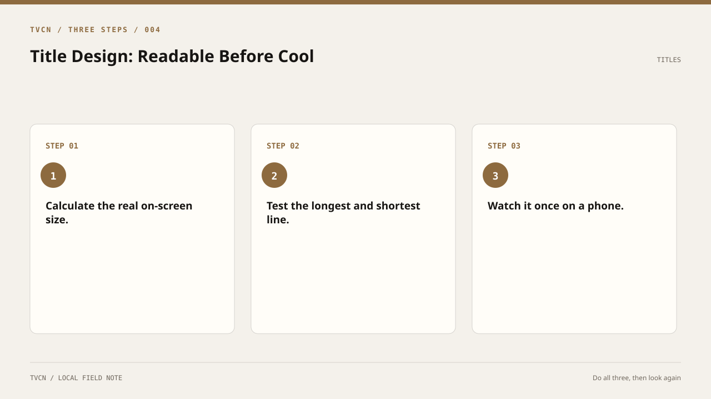

Title design must be readable before it is cool; if the name is missed, the style is wasted.

<!-- DIAGRAM_START -->
<h2>Diagram</h2>
<figure>
  
  <figcaption>Do the three steps in order, then look again at the image or file.</figcaption>
</figure>
<!-- DIAGRAM_END -->
<h2>On set</h2>

Set the title in lines of two or three characters and test the longest line at phone width. Start with white on black; add style only after it reads.

<h2>Do this</h2>

Title design starts with legibility, then style. If the audience cannot read the title, the design failed.
<ol><li>Keep two or three characters per line and measure the longest line at phone width.</li><li>Start with white type on black; add font, texture, and motion only after it reads.</li><li>Watch it on a phone without zooming and confirm it stays inside the safe area.</li></ol>
<h2>Avoid</h2>

Do not pair a thin typeface with a busy background; unreadable is failed.

<h2>Check</h2>
<ul><li>The title reads on a phone without zoom and the longest line stays in frame.</li><li>The white-on-black version works first and the styled version does not shrink the type.</li><li>Three screenshots and a type-size sheet show the minimum size and safe area.</li></ul>
