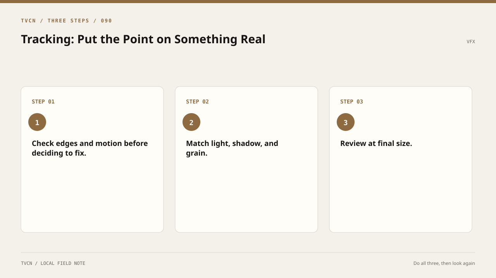

Put tracking points on real, textured, unoccluded surfaces; a flat wall will drift.

<!-- DIAGRAM_START -->
<h2>Diagram</h2>
<figure>
  
  <figcaption>Do the three steps in order, then look again at the image or file.</figcaption>
</figure>
<!-- DIAGRAM_END -->
<h2>On set</h2>

Place three tracking points: a textured corner, a high-contrast mark, and a backup. If one gets blocked, switch to manual keyframes.

<h2>Do this</h2>

Tracking points belong on real, textured, unobstructed surfaces; a flat wall will drift.
<ol><li>Place three points: a textured corner, a high-contrast mark, and a backup.</li><li>Switch to manual keys when a point is occluded.</li><li>Play the whole shot and check for drift or sliding.</li></ol>
<h2>Avoid</h2>

Do not put points on a flat wall or mirror; the tracker has nothing to grab.

<h2>Check</h2>
<ul><li>At least two of three points stay visible and textured through the shot.</li><li>When occlusion happens, manual keys take over with no hard jump.</li><li>On full playback the tracked surface shows no slide or scale drift.</li></ul>
