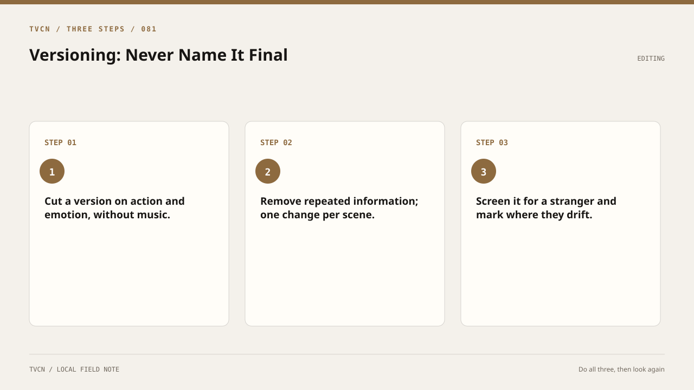

Use v001, v002, never “final” or “final2.” Every export gets one line: which scene, which shot, why. Without a note, a version number is just a number.

<!-- DIAGRAM_START -->
<h2>Diagram</h2>
<figure>
  
  <figcaption>Watch “Name files date_platform_duration_v3, e.g. 20261122_web_60s_v3.” and “Log what changed, why, and who approved it.”; judge whether removing one shot makes the scene faster rather than muddier.</figcaption>
</figure>
<!-- DIAGRAM_END -->
<section><h2 id="section-1">Version numbers only go up, with a change note</h2>
Keep current and previous in the working folder, archive older ones. State which version is the master at delivery so the client opens the right file.
<h2 id="section-2">Limits</h2>
More versions is not better. One purpose per pass, name it immediately; ten versions a day means no version control.
</section><section><h2 id="section-3">On set</h2>
Name files date_platform_duration_v3 and log every change: what changed, why, and who approved it.
</section><section><h2 id="section-4">Do this</h2>
Version names carry date, platform, duration, and reason, never “final really final.”
<ol><li>Name files date_platform_duration_v3, e.g. 20261122_web_60s_v3.</li><li>Log what changed, why, and who approved it.</li><li>Keep one current delivery and archive the rest; do not rely on memory.</li></ol></section><section><h2 id="section-5">Avoid</h2>
Do not use “latest” as a filename; in three months nobody knows what it is latest over.
</section><section><h2>Judge</h2>
This page passes on three observable checks, not slogans:
<ul><li><strong>1.</strong> The filename contains date, platform, duration, and version and sorts cleanly.</li><li><strong>2.</strong> The log shows why each change happened and who approved it.</li><li><strong>3.</strong> Pick an old version and you can state how it differs from the current one.</li></ul></section><section><h2>Failures</h2>
Any one of these means stop and fix it before post:
<ul><li><strong>1.</strong> Check 1 is only staged (“The filename contains date, platform, duration…”); another camera position or location exposes it.</li><li><strong>2.</strong> Check 2 is left to post or a verbal explanation (“The log shows why each change happened and who…”); nothing on set can be rechecked.</li><li><strong>3.</strong> Do not use “latest” as a filename; in three months nobody knows what it is latest over.</li></ul></section><section><h2>Extend</h2>
<strong>10-minute exercise:</strong> Take 30 seconds of footage and make an A/B, changing only “Name files date_platform_duration_v3, e.g. 20261122_web_60s_v3.”. Note one timecode and one difference before keeping it.
</section>
<h2>Check</h2><ul><li>The filename contains date, platform, duration, and version and sorts cleanly.</li><li>The log shows why each change happened and who approved it.</li><li>Pick an old version and you can state how it differs from the current one.</li></ul>

<!-- DEEP_DIVE_START -->
## Deep dive

<strong>About 5 minutes.</strong> Version control is not saving more files; it is knowing three months later which one can ship and which was a draft.

### Set the naming rule first

Project_date_version_status: tvcn_20261121_v03_review. Never use final, final2, or really-final; those words lie eventually.

Multiple versions in one day get letters, v03a and v03b, and never overwrite. Overwrite once and the client’s “previous version” is gone forever.

### Lock and change

After picture lock, every change goes into a change log: who asked, what changes, which shots are affected. A verbal change becomes triple work in post.

Put client approval in email or a document, not just a call. A record is not distrust; it makes everyone responsible to the same version.

### The delivery package

The package includes master, textless, captions, cover, and project archive. Miss one and you rebuild next time; rebuilding always costs more than archiving.

Open the project once before archiving and confirm no media is offline. The file exists but the link is broken, which means nothing was saved.

### Writing the change sheet

Five columns: date, requester, change, affected shots, status. One row per change, no prose.

Keep the sheet at the project root so everyone reads the same one. A “change this” in chat is not a record.

### The archive structure

Archive by media, projects, exports, documents. One folder per type, no more than three levels deep.

Put a README at the root with software versions, plug-ins, and restore steps. Three months later you will need it.

### Ten version checks before delivery
<ul><li>Filename has project, date, version, status</li><li>No final or final2</li><li>Same-day versions use letters</li><li>Picture is locked</li><li>Changes logged in a change sheet</li><li>Client approval kept in writing</li><li>Delivery package has a checklist</li><li>Master, textless, and captions all present</li><li>Project archived</li><li>Open the archive and check media before closing</li></ul>
With version control, delivery is not luck; it is opening the right folder.

### When you have five minutes
<ul><li>Filename has project, date, version, status</li><li>No final or final2</li><li>Lock picture before delivery</li><li>Log changes in a change sheet</li><li>Delivery package has a checklist</li><li>Open the archive before closing</li></ul>
Version control is not for tidiness; it is so the previous version can actually be found.

<!-- DEEP_DIVE_END -->

<!-- SOURCES_START -->
## References and further reading

- [S30] [DaVinci Resolve](https://www.blackmagicdesign.com/products/davinciresolve) — Accessed 2026-11-26. Used to check the terminology and public context in the opening paragraph (“Name versions by date, platform, duration, and change reason”) against Official entry for editing, grading, Fusion and delivery; not a substitute for an on-set test.
- [S27] [ITU-R: BS.1770 音频响度与真峰值测量](https://www.itu.int/rec/R-REC-BS.1770/en) — Accessed 2026-11-27. Used to check the terminology and public context in the opening paragraph (“Name versions by date, platform, duration, and change reason”) against ITU algorithms for loudness measurement and true peak, the basis referenced by EBU R128; not a substitute for an on-set test.
- [S67] [IETF: RFC 8216: HTTP Live Streaming](https://datatracker.ietf.org/doc/html/rfc8216) — Accessed 2026-11-26. Used to check the terminology and public context in the opening paragraph (“Name versions by date, platform, duration, and change reason”) against HLS segments, playlists and playback; not a substitute for an on-set test.
<!-- SOURCES_END -->

