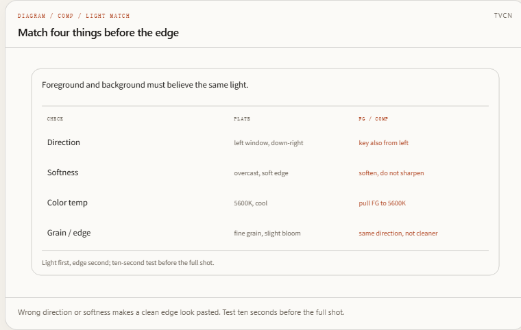

<!-- DIAGRAM_START -->
## Diagram

<figure>
  
  <figcaption>Wrong direction or softness makes a clean edge look pasted. Test ten seconds before the full shot.</figcaption>
</figure>
<!-- DIAGRAM_END -->

Drop the foreground in and turn off edge checking for a minute. See where the key comes from, where the shadow falls, and whether the background is hard sun or overcast. If the direction is wrong, a perfect edge still looks like a sticker.

Then match softness and color temperature. Window light is soft; noon sun is hard; a warm room pushes skin toward orange. Put both layers in the same light before discussing the edge.

## Contact shadow saves more than the edge

If a person stands on a floor, the area under the feet needs to go darker. If a hand rests on a table, the table needs a small shadow. Without contact, the subject floats. Follow the key direction; do not paint a black ring around everything.

Reflective surfaces also need a little bounce: a table throws shirt color up to the chin, glass throws window light onto a cheek. It does not need much. Direction is enough.

## Grain, flare, and lens share the room

A clean foreground over a grainy background gives itself away. Add grain in the same direction, then a little highlight bloom and slight dispersion so the edge belongs to the same lens. A hard key edge is often not a mask problem; the light and grain do not match.

Do a ten-second test: one turn, one occlusion, one highlight pass. If ten seconds hold, comp the shot. Finding the problem after the full shot costs days.

## Checks

- You can name the key direction in both layers, and they agree.
- Feet and hands have contact shadows; the subject does not float.
- The ten-second test has no obvious sticker edge.
