<!-- DIAGRAM_START -->
<h2>图解</h2>
<figure>
  
  <figcaption>示意：归档包不是一个压缩包，是五个部分都能独立找到；缺授权，素材就不能复用。</figcaption>
</figure>
<!-- DIAGRAM_END -->
<h2>先判断：什么值得归档</h2>
三类东西值得归档：还要复用的镜头（品牌、人物、场景）、还要改的版本（客户可能回头）、还要证明的权利（授权、肖像、音乐）。一次性、无复用价值、无授权的素材，不要占归档空间。

归档前先问：下一个人要用它做什么？答不出，就只留交付包和工程，不留全部素材。
<h2>归档包：五部分，缺一不可</h2>
工程文件、源素材/代理、LUT 与字体、授权与肖像、索引与元数据。工程文件要能离线打开；源素材要能找回；LUT 和字体要能还原画面；授权要能证明；索引要能搜到。

每个文件命名写项目、日期、场景、版本。不要用“最终”“新建文件夹”“副本”。索引表至少列：文件名、场景、人物、授权、到期日、位置。
<h2>恢复测试：归档的及格线</h2>
归档后随机抽一个镜头，在另一台机器上打开工程、重链素材、套 LUT、导出一版。打不开、找不到、颜色不对，归档就不算完成。恢复测试不是可选，是归档的一部分。

恢复测试记录写：日期、机器、软件版本、缺失文件、修复方法。下一次归档前先看上一次的问题。
<h2>复用：先查授权，再谈创意</h2>
复用旧素材前，先查三件事：授权范围（自然流量/付费/广告）、期限、地域。自然流量授权不能直接拿去做付费投放；一年授权过期后不能继续用；只在中国大陆授权的素材不能发到海外平台。

复用不是把旧片剪进新片，是提取可复用的镜头、声音、图形、模板。建立“可复用资产”索引，按人物、场景、动作、光线打标签。
<h2>失败案例：归档三年，打开全是离线</h2>
一个品牌项目归档时只拖了工程文件和代理，源素材留在旧硬盘。三年后客户要重剪，工程能打开，但每个镜头都离线；旧硬盘接口已经找不到，代理又不够调色。最后只能重新拍。

补救不是买新硬盘，是归档时做恢复测试。工程能打开不等于素材能找到；素材能找到不等于颜色能还原。
<h2>成本与验收</h2>
低成本：单项目归档 + 索引 + 一次恢复测试，¥1,000–3,000。中成本：多项目资产库、LTO/云归档、授权台账，¥3,000–15,000。高成本：部门级媒体资产管理、迁移、长期校验，¥15,000–50,000+。
<h2>验收</h2><ul><li>归档前明确复用价值。</li><li>五部分齐全：工程/素材/LUT/授权/索引。</li><li>工程能离线打开，素材能重链。</li><li>恢复测试在另一台机器完成。</li><li>复用前查授权范围、期限、地域。</li><li>索引含人物、场景、动作、光线标签。</li></ul>

<!-- SOURCES_START -->
## 参考与延伸阅读

- [S24] [ACES 色彩管理](https://www.oscars.org/science-technology/aces) — 2026-11-26 访问。用于核对首段“归档不是把文件夹拖进硬盘。它要让下一个人能打开工程、找到素材、知道授权、恢复调色和声音；复用不是翻旧片，是有索引地取用。”中的术语与公开背景（ACES 色彩管线的官方说明与规范）；不替代现场测试。
- [S27] [EBU R128 响度](https://tech.ebu.ch/publications/r128) — 2026-11-26 访问。用于核对首段“归档不是把文件夹拖进硬盘。它要让下一个人能打开工程、找到素材、知道授权、恢复调色和声音；复用不是翻旧片，是有索引地取用。”中的术语与公开背景（广播响度目标、真峰值与测量方法）；不替代现场测试。
- [S28] [Netflix 制作与交付帮助](https://partnerhelp.netflixstudios.com/) — 2026-11-26 访问。用于核对首段“归档不是把文件夹拖进硬盘。它要让下一个人能打开工程、找到素材、知道授权、恢复调色和声音；复用不是翻旧片，是有索引地取用。”中的术语与公开背景（平台交付规格、HDR/SDR 与 QC 要求的公开入口）；不替代现场测试。
- [S30] [DaVinci Resolve 产品与文档](https://www.blackmagicdesign.com/products/davinciresolve) — 2026-11-26 访问。用于核对首段“归档不是把文件夹拖进硬盘。它要让下一个人能打开工程、找到素材、知道授权、恢复调色和声音；复用不是翻旧片，是有索引地取用。”中的术语与公开背景（剪辑、调色、Fusion 与交付的官方产品入口）；不替代现场测试。
- [S34] [Adobe Premiere Pro 用户指南](https://helpx.adobe.com/premiere-pro/user-guide.html) — 2026-11-26 访问。用于核对首段“归档不是把文件夹拖进硬盘。它要让下一个人能打开工程、找到素材、知道授权、恢复调色和声音；复用不是翻旧片，是有索引地取用。”中的术语与公开背景（剪辑、代理、色彩与导出的官方文档）；不替代现场测试。
<!-- SOURCES_END -->

