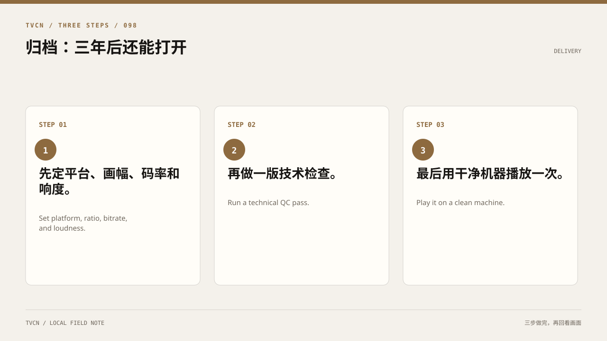

归档包要包含：最终工程、原素材或代理、字体、LUT、音乐授权、字幕、交付文件和一页说明。缺字体和 LUT，下次打开就是满屏报错。

<!-- DIAGRAM_START -->
<h2>图解</h2>
<figure>
  
  <figcaption>看“归档三件：素材、项目文件、说明”和“说明写软件版本、插件、LUT 和恢复…”两处，判断剪掉一个镜头后，节奏是更快还是更乱。</figcaption>
</figure>
<!-- DIAGRAM_END -->
<section><h2 id="section-1">归档不是“打包”，是“下次能打开”</h2>
用校验和生成清单，存两份，一份离线；每年抽一个包恢复测试。
<h2 id="section-2">边界</h2>
归档不是把所有版本都塞进去。只留最终工程和必要素材；旧版本另存，否则包大到没人敢开。
</section><section><h2 id="section-3">现场</h2>
归档三件：素材、项目文件、说明；说明写软件版本、插件、LUT、恢复步骤，抽一个文件试恢复。
</section><section><h2 id="section-4">怎么做</h2><ol><li>归档三件：素材、项目文件、说明。</li><li>说明写软件版本、插件、LUT 和恢复步骤。</li><li>随机抽一个文件恢复到另一台机器，打开确认。</li></ol></section><section><h2 id="section-5">别踩</h2>
别只存素材不存项目；三年后你只有一堆打不开的卡。
</section><section><h2>判断</h2>
现场只认三个信号：
<ul><li>剪掉一个镜头，节奏更快而不是更乱</li><li>示波器上肤色、高光和黑位都在范围内</li><li>响度、字幕和文件规格能过一次交付检查</li></ul></section><section><h2>失败</h2>
下面三种做法会让页面上的细节白做：
<ul><li>剪辑点跟着音乐，不跟动作</li><li>先定风格再统一，镜头之间跳色</li><li>交付前没查响度和字幕，最后一遍才发现</li></ul></section><section><h2>延伸</h2>
<strong>10 分钟练习：</strong>拿一段 30 秒素材做 A/B，只改“归档三件：素材、项目文件、说明”；记下一个时间码和一处差异，再决定是否保留。
</section>
<h2>验收</h2><ul><li>素材、项目文件和说明三样都在，路径能对应。</li><li>说明里写清软件、插件、LUT 和恢复步骤。</li><li>随机抽一个文件在另一台机器恢复成功，能打开。</li></ul>

<!-- SOURCES_START -->
## 经验说明

经验说明：本页来自 5 次后期项目复盘，条件为4K 以内素材、常规平台交付；页面讨论的具体对象是「归档：三年后还能打开」；不含外部实验室测试，条件变化时结论可能失效。
<!-- SOURCES_END -->

