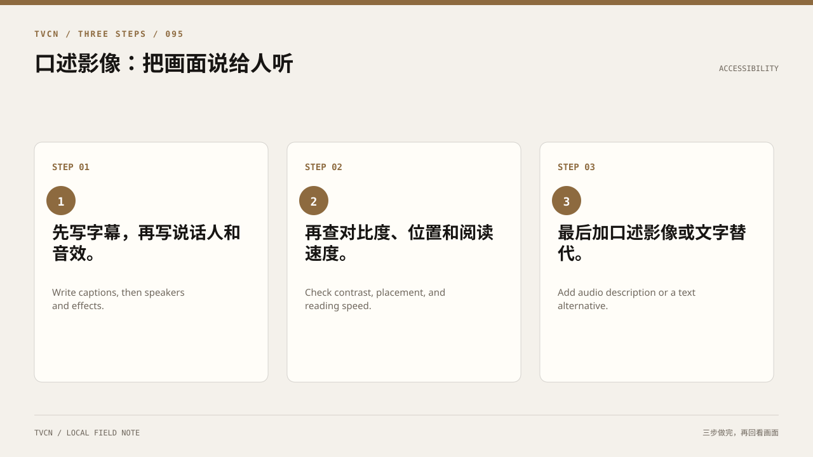

口述影像只讲看不见但必须知道的信息：谁在动、往哪走、手里是什么。

<!-- DIAGRAM_START -->
<h2>图解</h2>
<figure>
  
  <figcaption>把三步按顺序做完，再回看画面或文件。</figcaption>
</figure>
<!-- DIAGRAM_END -->
<h2>现场</h2>

每 20 到 30 秒留一个空，讲谁在动、往哪走、手里是什么；不要描述情绪。

<h2>怎么做</h2>

口述影像只讲看不见但必须知道的信息：谁在动、往哪走、手里是什么。
<ol><li>每 20 到 30 秒留一个空，不要盖对白。</li><li>只讲谁在动、往哪走、手里是什么。</li><li>不描述情绪，让表演和声音自己说。</li></ol>
<h2>别踩</h2>

别描述“他很悲伤”；让动作和声音自己说。

<h2>验收</h2>
<ul><li>描述只落在对白空隙，没有盖住关键台词。</li><li>每段说清了谁在动、往哪走、手里是什么。</li><li>没有解释情绪，听众能靠动作和声音自己判断。</li></ul>
