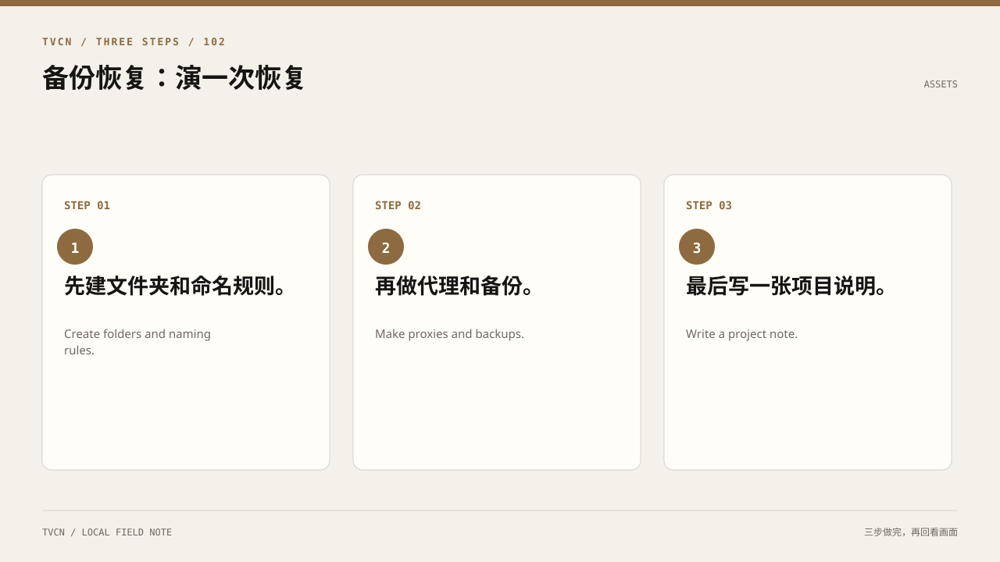

备份不是复制完就算，随机抽一个文件恢复一次，才算验证。

<!-- DIAGRAM_START -->
<h2>图解</h2>
<figure>
  
  <figcaption>把三步按顺序做完，再回看画面或文件。</figcaption>
</figure>
<!-- DIAGRAM_END -->
<h2>现场</h2>

3-2-1：三份、两种介质、一份异地；随机抽一个文件恢复到另一台机器，打开确认。

<h2>怎么做</h2>

备份不是复制完就算，随机抽一个文件恢复一次，才算验证。
<ol><li>按 3-2-1：三份、两种介质、一份异地。</li><li>随机抽一个文件恢复到另一台机器。</li><li>打开确认能播放或能回套，记录恢复耗时。</li></ol>
<h2>别踩</h2>

别只复制不恢复；坏盘不会提前通知你。

<h2>验收</h2>
<ul><li>三份备份、两种介质、一份异地都能指认。</li><li>随机文件在另一台机器恢复成功，能打开。</li><li>恢复耗时和步骤有记录，下一次能照做。</li></ul>
