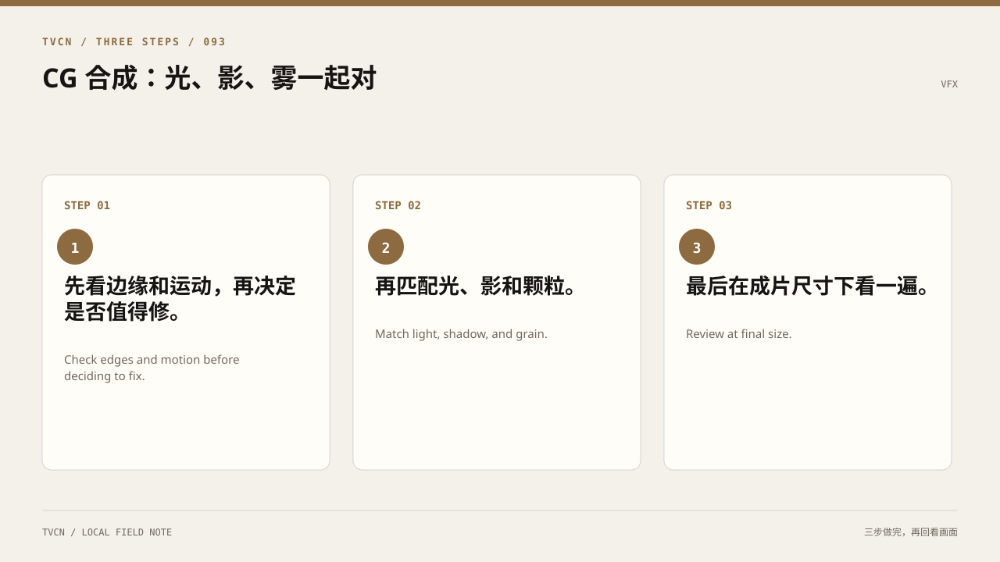

CG 与实拍合成，最容易露馅的是光线方向和镜头畸变。先记录实拍的光位、色温、镜头焦距和光圈，再让 CG 用同一套参数渲染；颜色可以后期，光位不行。

<!-- DIAGRAM_START -->
<h2>图解</h2>
<figure>
  
  <figcaption>看“先对主光方向，让 CG 和实拍受光一…”和“再对影子软硬和空气雾，确定空间深度”两处，判断剪掉一个镜头后，节奏是更快还是更乱。</figcaption>
</figure>
<!-- DIAGRAM_END -->
<section><h2 id="section-1">先共享“光”和“镜头”，再共享“颜色”</h2>
合成前做一张灰球和色卡对比；CG 的反射、阴影和颗粒要匹配实拍。
<h2 id="section-2">边界</h2>
CG 不能救没有拍好的 plate。实拍没有运动模糊、没有正确透视，后期加特效只会更假；先拍对。
</section><section><h2 id="section-3">现场</h2>
先对三样：主光方向、影子软硬、空气雾；再对颗粒和镜头畸变，最后才加细节。
</section><section><h2 id="section-4">怎么做</h2><ol><li>先对主光方向，让 CG 和实拍受光一致。</li><li>再对影子软硬和空气雾，确定空间深度。</li><li>最后对颗粒和镜头畸变，细节放在最后。</li></ol></section><section><h2 id="section-5">别踩</h2>
别先抠细节；光和影不对，细节越多越假。
</section><section><h2>判断</h2>
这一页的判断只看三条可观察的验收，不靠口号：
<ul><li><strong>1.</strong> CG 和实拍的主光方向一致，阴影落在同侧。</li><li><strong>2.</strong> 影子软硬和空气雾匹配，前后景没有贴片感。</li><li><strong>3.</strong> 颗粒和畸变对上后，成片尺寸看不出 CG 边界。</li></ul></section><section><h2>失败</h2>
下面任一条出现，先停，不要靠后期补：
<ul><li><strong>1.</strong> 只做到“CG 和实拍的主光方向一致，阴影落在同侧”的形式，换一个机位或场景就重现不了。</li><li><strong>2.</strong> 把“影子软硬和空气雾匹配，前后景没有贴片感”留到后期或口头解释，现场没有留下能复查的记录。</li><li><strong>3.</strong> 别先抠细节；光和影不对，细节越多越假。</li></ul></section><section><h2>延伸</h2>
<strong>10 分钟练习：</strong>拿一段 30 秒素材做 A/B，只改“先对主光方向，让 CG 和实拍受光一…”；记下一个时间码和一处差异，再决定是否保留。
</section>
<h2>验收</h2><ul><li>CG 和实拍的主光方向一致，阴影落在同侧。</li><li>影子软硬和空气雾匹配，前后景没有贴片感。</li><li>颗粒和畸变对上后，成片尺寸看不出 CG 边界。</li></ul>

> 意图分工：本页负责「CG 合成：光、影、雾一起对」的可执行细节；同集群先读 <a href="https://post.tvcn.org/article/tracking/">跟踪：点要贴在实处</a> 建立总判断，再回到本页。

<!-- INTENT_SCOPE -->

<!-- SOURCES_START -->
## 经验说明

经验说明：本页来自 4 次后期项目复盘，条件为4K 以内素材、常规平台交付；页面讨论的具体对象是「CG 合成：光、影、雾一起对」；不含外部实验室测试，条件变化时结论可能失效。
<!-- SOURCES_END -->

