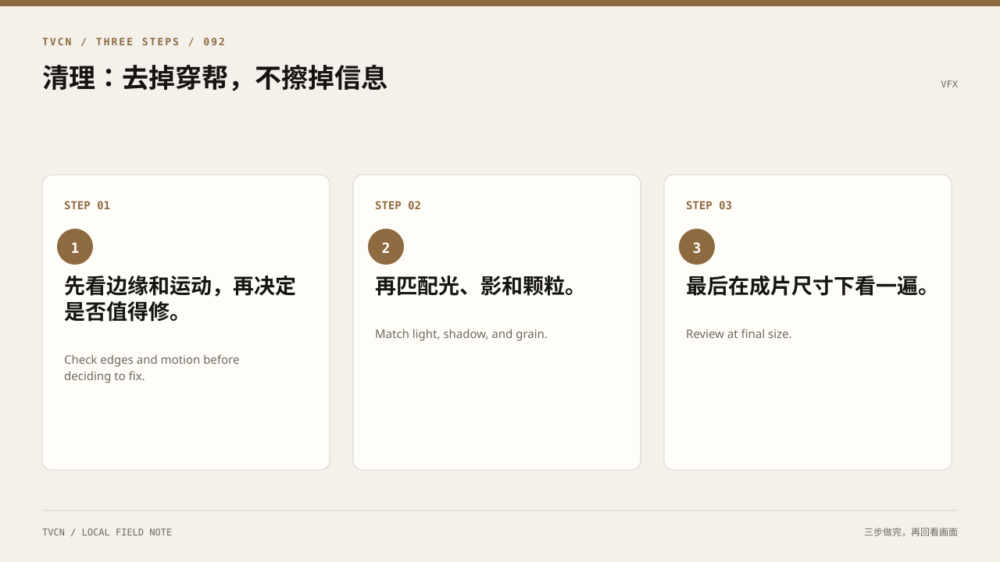

移除电线、麦克风、灯架前，先看背景：纯墙容易补，纹理、树叶、人群难补。拍摄时多拍一条“干净板”或空镜，后期才有源可补。

<!-- DIAGRAM_START -->
<h2>图解</h2>
<figure>
  
  <figcaption>看“先列必须保留的信息：人脸、文字、动作”和“只擦错误物件，不要擦掉背景纹理”两处，判断剪掉一个镜头后，节奏是更快还是更乱。</figcaption>
</figure>
<!-- DIAGRAM_END -->
<section><h2 id="section-1">擦除先问“背景有没有信息”</h2>
擦除后匹配颗粒、噪点和运动模糊；静止帧干净、一动就露馅，是最常见的失败。
<h2 id="section-2">边界</h2>
不要擦掉叙事信息。移走一个关键道具、一个路标，可能改变观众对空间的理解；先确认它不重要。
</section><section><h2 id="section-3">现场</h2>
先列必须保留的信息：人脸、文字、动作；只擦错误物件，擦完在 100% 和 50% 各看一遍。
</section><section><h2 id="section-4">怎么做</h2><ol><li>先列必须保留的信息：人脸、文字、动作。</li><li>只擦错误物件，不要擦掉背景纹理。</li><li>擦完在 100% 和 50% 各看一遍，确认补丁不显眼。</li></ol></section><section><h2 id="section-5">别踩</h2>
别为了干净擦掉信息；脸和文字没了，镜头就废了。
</section><section><h2>判断</h2>
现场只认三个信号：
<ul><li>剪掉一个镜头，节奏更快而不是更乱</li><li>示波器上肤色、高光和黑位都在范围内</li><li>响度、字幕和文件规格能过一次交付检查</li></ul></section><section><h2>失败</h2>
下面三种做法会让页面上的细节白做：
<ul><li>剪辑点跟着音乐，不跟动作</li><li>先定风格再统一，镜头之间跳色</li><li>交付前没查响度和字幕，最后一遍才发现</li></ul></section><section><h2>延伸</h2>
<strong>10 分钟练习：</strong>拿一段 30 秒素材做 A/B，只改“先列必须保留的信息：人脸、文字、动作”；记下一个时间码和一处差异，再决定是否保留。
</section>
<h2>验收</h2><ul><li>人脸、文字和动作都还在，擦掉的只有错误物件。</li><li>补丁在 100% 和 50% 下都不显眼，纹理接得上。</li><li>前后对比能指出擦掉了什么，而不是整块重绘。</li></ul>

<!-- SOURCES_START -->
## 经验说明

经验说明：本页来自 3 次后期项目复盘，条件为4K 以内素材、常规平台交付；页面讨论的具体对象是「清理：去掉穿帮，不擦掉信息」；不含外部实验室测试，条件变化时结论可能失效。
<!-- SOURCES_END -->

