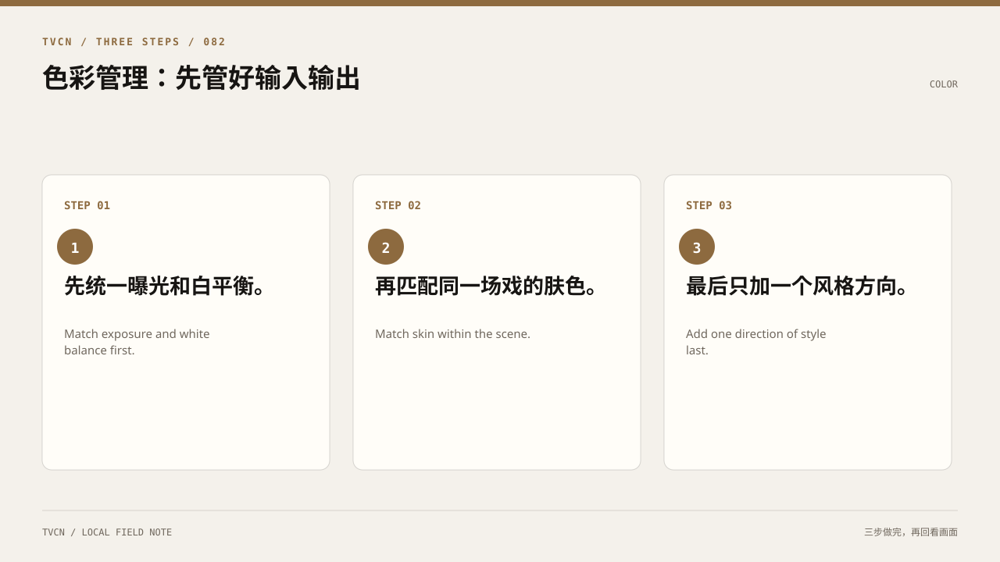

<!-- DIAGRAM_START -->
<h2>图解</h2>
<figure>
  
  <figcaption>示意：每个箭头都是一次转换；把风格 LUT 放在输入前，会把所有素材一起压坏。</figcaption>
</figure>
<!-- DIAGRAM_END -->
<h2>先分清四种空间</h2>
一条片子至少有四种空间：拍摄空间（S-Log3、LogC、RAW）、工作空间（ACES 或 DaVinci Wide Gamut）、显示空间（Rec.709、P3、HDR PQ）、交付空间（平台要求的 Rec.709、HLG、PQ）。四者混在一起，LUT 就会变成猜。

先把每个素材的输入变换找对：机型、色域、伽马、色彩矩阵。找不到，就拍灰卡/色卡做手动；不要用“看起来差不多”的 LUT 蒙混。
<h2>LUT 放在哪：三个节点，不要乱穿</h2>
输入变换之后才是工作空间；创意 LUT 放在工作空间里，显示变换放在监视器前，交付变换放在输出前。常见错误是把一个 Rec.709 风格 LUT 直接套在 Log 素材上，再套一个显示 LUT，结果高光被压两次。

每个 LUT 只回答一个问题：转换、风格、还是校准。答不出来，就不要叠。节点命名写清“输入/风格/显示/交付”，交接时别人能看懂。
<h2>监视器与校准：先相信屏幕，再相信眼睛</h2>
调色前先校准监视器：白点、伽马、色域、亮度。没有校准，所有决定都是在这块屏上成立，在别处不成立。至少用一张灰阶和一张色卡确认黑位、白位、肤色。

不要用办公显示器做最终判断；它的对比和色域会把暗部拉平。客户看片也要用同一套显示变换，不然“客户觉得偏”往往是屏幕不同，不是调色错。
<h2>交接：把 LUT、节点和参考帧一起交</h2>
交接包至少包含：项目文件、LUT、输入变换说明、显示变换说明、参考帧、限制清单。只交一个 LUT，别人不知道它该放在哪，等于没交。

参考帧要标“学光”还是“学色”：学光看方向、软硬、比例；学色看白点、肤色、饱和度。混在一起，调色师只能猜。
<h2>失败案例：一套 LUT 套所有机位</h2>
一条多机位访谈用了三台不同机型，后期把同一个“胶片 LUT”套在所有素材上。结果 A 机肤色偏绿，B 机高光发灰，C 机暗部发红。调色师以为是灯光问题，回头才发现输入变换根本没有分开。

补救是逐机位做输入变换，再统一工作空间。风格 LUT 只留一个，放在统一空间里。多机位的第一原则不是“看起来一样”，而是“转换先对”。
<h2>成本与验收</h2>
低成本：一次输入变换整理 + 一次显示校准，¥2,000–6,000。中成本：完整色彩管理、节点树、交接包，¥6,000–20,000。高成本：ACES 管线、HDR 双版本、现场 DIT 配合，¥20,000–60,000+。
<h2>验收</h2><ul><li>每个素材都有明确的输入变换。</li><li>工作空间、显示空间、交付空间分开写。</li><li>创意 LUT 只放一个，且在正确节点。</li><li>监视器已校准，灰阶/色卡通过。</li><li>参考帧标明学光还是学色。</li><li>交接包含 LUT、节点、限制清单。</li></ul>

<!-- SOURCES_START -->
## 参考与延伸阅读

- [S24] [ACESCentral：ACES 色彩规范](https://acescentral.com/) — 2026-11-26 访问。用于核对「先分清四种空间」一节的术语/方法/规则（ACES 色彩规范，不是调色教程）；不核对其中由本页经验得出的数字、型号与现场结论，也不替代测试。
- [S25] [ITU-R BT.709](https://www.itu.int/rec/R-REC-BT.709/en) — 2026-11-26 访问。用于核对「LUT 放在哪：三个节点，不要乱穿」一节的术语/方法/规则（BT.709 高清电视参数，不是现场曝光建议）；不核对其中由本页经验得出的数字、型号与现场结论，也不替代测试。
- [S30] [DaVinci Resolve：官方文档](https://www.blackmagicdesign.com/products/davinciresolve) — 2026-11-26 访问。用于核对「交接：把 LUT、节点和参考帧一起交」一节的术语/方法/规则（Resolve 官方产品/文档入口，不是第三方教程）；不核对其中由本页经验得出的数字、型号与现场结论，也不替代测试。
<!-- SOURCES_END -->

