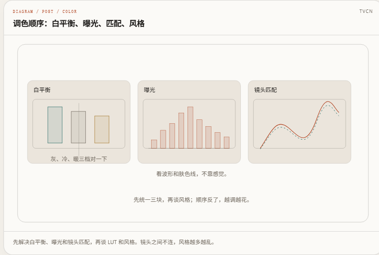

<!-- DIAGRAM_START -->
## 图解

<figure>
  
  <figcaption>先解决白平衡、曝光和镜头匹配，再谈 LUT 和风格。镜头之间不连，风格越多越乱。</figcaption>
</figure>
<!-- DIAGRAM_END -->

## 先做镜头匹配

同一场戏，不同镜头可能来自不同时间、不同镜头、不同白平衡。先并排看，把曝光、色温、对比拉到接近，再往下做。

匹配不是让每个镜头一模一样，是让观众看不出切换。人脸亮度差半档，观众就会觉得“跳”。

## 肤色是锚点

观众对肤色最敏感。先保证人脸不绿、不灰、不过红，再决定整体冷暖。示波器看肤色线，比凭感觉可靠。

风格可以偏，但同一场戏里的肤色要一致。广告可以冷，纪录片可以暖，但不能一条片里两种脸色。

## 风格只用一个方向

风格不是把每个工具都拉满。选一个方向：低饱和、高对比、冷阴影、暖高光，或者反过来。其他参数为它服务。

LUT 是起点，不是终点。套完之后还要回到一级校正，检查暗部有没有死、高光有没有爆。

## 3 条验收

- 同一场戏的人脸亮度与色温一致。
- 白色物体在画面里是中性的。
- 风格只有一个主方向，没有每个镜头换一种。
