<!-- DIAGRAM_START -->
<h2>图解</h2>
<figure>
  
  <figcaption>示意：回批不是“打开成功”，是每一刀都能对回原素材并保留 handles。</figcaption>
</figure>
<!-- DIAGRAM_END -->
<h2>先判断：什么时候需要 Online</h2>
只要片子要调色、要做 VFX、要输出多个平台版本，就需要一次 Online。纯剪、没有调色、直接导出的短片，可以在 NLE 里完成。判断标准不是片长，是“有没有回到原始素材”。

如果剪辑用了代理、转码、变速、嵌套，Online 必须回到原素材重做。拿着代理时间线直接调色，等于在低分辨率上做最终判断。
<h2>回批：EDL/XML 只是地址，不是素材</h2>
从剪辑导出 EDL/XML/AAF 时，先确认 reel name、时间码、帧率、片段名四项能对上。文件名可以改，时间码不能丢。每个剪辑点至少留 12–24 帧 handles，给转场、稳定、降噪和调色留余地。

回批后逐镜检查：源文件、入点、出点、速度、变换、音频同步。不要用“总长度对了”判断，长度对不代表每一刀对。
<h2>调色与 VFX 的顺序</h2>
先做 VFX 再做最终调色，除非 VFX 需要调色后的背景做参考。把 VFX 放在调色前，合成师拿到的是中性素材；放在调色后，合成师要追着已经定稿的颜色做，很容易反复。

需要 VFX 的镜头单独建版本，不要在原时间线上直接改。每个版本写清“有/无 VFX、有/无字幕、有/无片头”，母版只有一个，版本可以很多。
<h2>母版与版本：命名比软件重要</h2>
母版只留一个：最高质量、无字幕、无片头、无平台压缩。平台版从母版派生，不反向修改母版。文件名写项目、日期、版本、状态，禁止 final/final2。

交付前打开母版完整看一遍，确认无黑帧、无离线素材、无错字幕、无音画不同步。工程归档时把 LUT、字体、音乐授权、输出预设一起收进去。
<h2>失败案例：回批成功，但每刀都错</h2>
一次广告剪辑用了 120% 变速和大量嵌套，XML 回批到调色软件后时间线长度对了，但每个变速镜头都取错帧，转场也被拉长。调色师做了两天，客户看片发现动作不对，只能回到剪辑重做。

问题不是软件，是导出前没有把变速和嵌套拍平，也没有留 handles。Conform 的第一步不是打开，是确认时间线可以被还原。
<h2>成本与验收</h2>
低成本：单机回批 + 基础核对，¥2,000–5,000。中成本：完整套底、调色、VFX 回批、版本输出，¥5,000–20,000。高成本：多机位、多版本、HDR、字幕/片头分离，¥20,000–60,000+。
<h2>验收</h2><ul><li>EDL/XML 的时码、帧率、reel 能对上。</li><li>每个剪辑点至少 12 帧 handles。</li><li>逐镜检查源文件、入出点、速度、变换。</li><li>VFX 版本与母版分开。</li><li>母版唯一，平台版可追溯。</li><li>交付前完整看一遍母版。</li></ul>
<!-- SOURCES_START -->
<h2>参考与延伸阅读</h2>

经验来源：TVCN 现场手册与项目复盘；实测来源：页面标注的复核环境与可复现练习；参考来源：以下公开链接。

<ul><li>[S23] SMPTE 标准入口</li><li>[S30] DaVinci Resolve 产品与文档</li><li>[S34] Adobe Premiere Pro 用户指南</li></ul>

<a href="../../SOURCES.md">完整链接与用途见 SOURCES.md</a>

<!-- SOURCES_END -->
