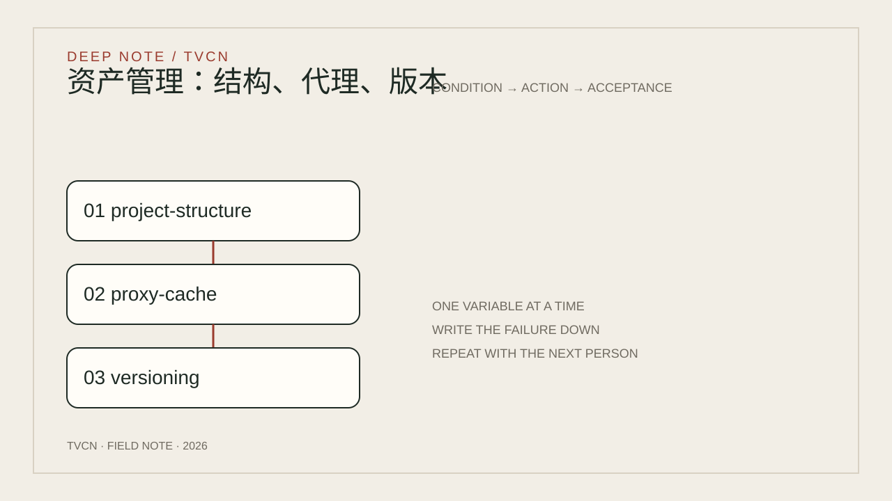

后期效率不是软件快，而是项目结构、代理和版本让每个人都知道最新文件在哪。 单看《项目结构：文件夹比软件重要》只能解决一个局部；把《项目结构：文件夹比软件重要》《代理与缓存：别让硬盘先满》《版本管理：别用“final 真的 final”》接成一条链，才会暴露“条件没写、变量太多、结果无法复现”的真问题。

<!-- DEEP_DIVE_START -->
<!-- DIAGRAM_START -->
<h2>图解</h2>
<figure>
  
  <figcaption>看“项目结构：文件夹比软件重要”和“代理与缓存：别让硬盘先满”两处，先定条件，再看失败能不能被记录下来。</figcaption>
</figure>
<!-- DIAGRAM_END -->

<section><h2 id="section-1">问题</h2>
这一页的问题不是“方法不够多”，而是三个环节各自成立、合起来却不成立：条件没写、变量太多、结果不能复现。

本页按“先定条件—再做判断—只改一个变量—留下证据”的顺序；每一步都能被下一个人复述，才算完成。
</section>
<section><h2 id="section-2">判断</h2><ul><li>《项目结构：文件夹比软件重要》的第一道门槛：四个根文件夹存在，媒体、项目、导出、文档各归其位</li><li>《代理与缓存：别让硬盘先满》的第二道门槛：文件名包含日期、场次和机位，能直接排序</li><li>《版本管理：别用“final 真的 final”》的第三道门槛：换一台机器或换软件后，仍能按路径找到原始素材</li></ul>
三条里有一条不成立，就先回到对应单页；不要用整条链掩盖一个没解决的单点。
</section>
<section><h2 id="section-3">做法</h2><ol><li>先写条件：把《项目结构：文件夹比软件重要》里“根目录建 01_media、02_project、03_exports、04_docs”落到一张三行表：素材、环境、验收。</li><li>再做一次最小动作：只按《项目结构：文件夹比软件重要》的步骤做 30 秒，不加入第二页的方法。</li><li>把《代理与缓存：别让硬盘先满》的步骤接上：文件名用日期_场次_机位，别用“最终版”。</li><li>用《版本管理：别用“final 真的 final”》做对照：代理和原始分开放，备份当天做。</li><li>每改一次只动一个变量；其他条件写进记录，不靠记忆。</li><li>把失败也拍下来：失败版本和成功版本并排，才知道哪一步不能省。</li><li>让下一个人按记录复现一次；他做不出来，说明记录还不够。</li></ol></section>
<section><h2 id="section-4">现场案例</h2>
可复现实验（不是客户案例）：拿 30 秒素材，先按《项目结构：文件夹比软件重要》的“四个根文件夹存在，媒体、项目、导出、文档各归其位”做 A 版；再按《代理与缓存：别让硬盘先满》的“文件名包含日期、场次和机位，能直接排序”做 B 版；两版只允许一个变量不同。把两版并排看，记录《版本管理：别用“final 真的 final”》里最先崩的是哪一项：条件、动作还是验收。如果一次就成功，说明变量还不够多，再加一个现实限制重做。
</section>
<section><h2 id="section-5">失败表</h2>
<table class="data-table"><thead><tr><th>现象</th><th>原因</th><th>替换动作</th></tr></thead><tbody><tr><td>别把素材放在桌面；系统重装就没了</td><td>条件没写清</td><td>回到第一页重写三行表</td></tr><tr><td>别删原始素材换空间；缓存可以重建，素材不能</td><td>条件没写清</td><td>回到第一页重写三行表</td></tr><tr><td>别用“最新版”当文件名；三个月后没人知道它最新在哪</td><td>条件没写清</td><td>回到第一页重写三行表</td></tr></tbody></table>
</section>
<section><h2 id="section-6">验收</h2><ul><li>四个根文件夹存在，媒体、项目、导出、文档各归其位。</li><li>文件名包含日期、场次和机位，能直接排序。</li><li>换一台机器或换软件后，仍能按路径找到原始素材。</li><li>代理和缓存在第二块盘，剪辑盘仍有可用空间。</li><li>系统盘保留至少 20%，没有红色警告。</li><li>清缓存后项目能重建，原始素材一条没少。</li><li>文件名包含日期、平台、时长和版本号，能直接排序。</li><li>版本表能查出每次改动的原因和批准人。</li><li>随机拿一个旧版，能说出它和当前版的差别。</li><li>文件名含项目、日期、版本、状态</li></ul></section>
<section><h2 id="section-7">替代方案</h2><ul><li>只处理《项目结构：文件夹比软件重要》里的单点问题：回到<a href="https://post.tvcn.org/article/project-structure/">《项目结构：文件夹比软件重要》</a>，不要用整条链。</li><li>只比较两个动作：看<a href="https://post.tvcn.org/article/proxy-cache/">《代理与缓存：别让硬盘先满》</a>，先不改第三页。</li><li>只做验收：看<a href="https://post.tvcn.org/article/versioning/">《版本管理：别用“final 真的 final”》</a>，把判断表拿去做自测。</li></ul></section>

<!-- SOURCES_START -->
## 参考与延伸阅读

- [S17] [Reuters Trust Principles](https://reutersagency.com/about/our-trust-principles/) — 2026-11-26 访问。用于核对首段“后期效率不是软件快，而是项目结构、代理和版本让每个人都知道最新文件在哪。”中的术语与公开背景（通讯社对独立、准确与不带偏见的公开承诺）；不替代现场测试。
- [S30] [DaVinci Resolve 产品与文档](https://www.blackmagicdesign.com/products/davinciresolve) — 2026-11-26 访问。用于核对首段“后期效率不是软件快，而是项目结构、代理和版本让每个人都知道最新文件在哪。”中的术语与公开背景（剪辑、调色、Fusion 与交付的官方产品入口）；不替代现场测试。
- [S34] [Adobe Premiere Pro 用户指南](https://helpx.adobe.com/premiere-pro/user-guide.html) — 2026-11-26 访问。用于核对首段“后期效率不是软件快，而是项目结构、代理和版本让每个人都知道最新文件在哪。”中的术语与公开背景（剪辑、代理、色彩与导出的官方文档）；不替代现场测试。
- [S27] [ITU-R：BS.1770 音频响度与真峰值测量](https://www.itu.int/rec/R-REC-BS.1770/en) — 2026-11-27 访问。用于核对首段“后期效率不是软件快，而是项目结构、代理和版本让每个人都知道最新文件在哪。”中的术语与公开背景（响度测量、真峰值与 EBU R128 所依据的 ITU 算法标准）；不替代现场测试。
- [S35] [Avid 资源中心](https://www.avid.com/resource-center) — 2026-11-26 访问。用于核对首段“后期效率不是软件快，而是项目结构、代理和版本让每个人都知道最新文件在哪。”中的术语与公开背景（Media Composer、协作与交付的资源入口）；不替代现场测试。
<!-- SOURCES_END -->

