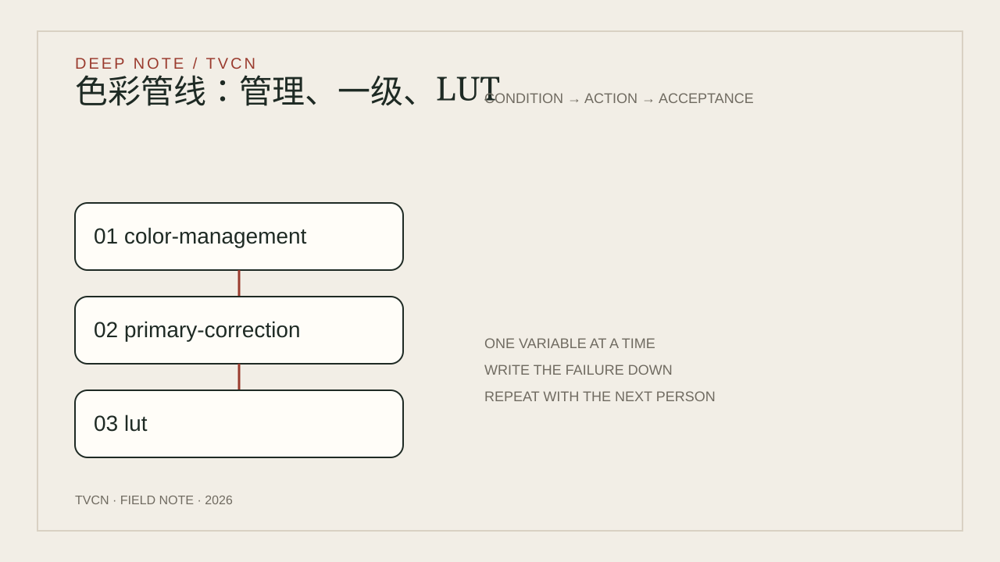

色彩不是套 LUT；管理、一级校正和 LUT 的顺序错了，越调越脏。 单看《色彩管理：把 LUT 放在正确的位置》只能解决一个局部；把《色彩管理：把 LUT 放在正确的位置》《一级校正：曝光与白平衡》《LUT：起点不是终点》接成一条链，才会暴露“条件没写、变量太多、结果无法复现”的真问题。

<!-- DEEP_DIVE_START -->
<!-- DIAGRAM_START -->
<h2>图解</h2>
<figure>
  
  <figcaption>看“色彩管理：把 LUT 放在正确的位置”和“一级校正：曝光与白平衡”两处，先定条件，再看失败能不能被记录下来。</figcaption>
</figure>
<!-- DIAGRAM_END -->

<section><h2 id="section-1">问题</h2>
这一页的问题不是“方法不够多”，而是三个环节各自成立、合起来却不成立：条件没写、变量太多、结果不能复现。

本页按“先定条件—再做判断—只改一个变量—留下证据”的顺序；每一步都能被下一个人复述，才算完成。
</section>
<section><h2 id="section-2">判断</h2><ul><li>《色彩管理：把 LUT 放在正确的位置》的第一道门槛：同场镜头的黑位和白位对齐，切点不跳</li><li>《一级校正：曝光与白平衡》的第二道门槛：肤色线落在同一区域，没有一条偏绿一条偏红</li><li>《LUT：起点不是终点》的第三道门槛：关掉风格 LUT 后，画面技术仍然成立</li></ul>
三条里有一条不成立，就先回到对应单页；不要用整条链掩盖一个没解决的单点。
</section>
<section><h2 id="section-3">做法</h2><ol><li>先写条件：把《色彩管理：把 LUT 放在正确的位置》里“先拍灰卡或色卡，黑位压到 0 到 5，白位不超过 100”落到一张三行表：素材、环境、验收。</li><li>再做一次最小动作：只按《色彩管理：把 LUT 放在正确的位置》的步骤做 30 秒，不加入第二页的方法。</li><li>把《一级校正：曝光与白平衡》的步骤接上：同场镜头逐条对齐曝光和白平衡，再看肤色线。</li><li>用《LUT：起点不是终点》做对照：技术问题清零后，才加对比和风格。</li><li>每改一次只动一个变量；其他条件写进记录，不靠记忆。</li><li>把失败也拍下来：失败版本和成功版本并排，才知道哪一步不能省。</li><li>让下一个人按记录复现一次；他做不出来，说明记录还不够。</li></ol></section>
<section><h2 id="section-4">现场案例</h2>
可复现实验（不是客户案例）：拿 30 秒素材，先按《色彩管理：把 LUT 放在正确的位置》的“同场镜头的黑位和白位对齐，切点不跳”做 A 版；再按《一级校正：曝光与白平衡》的“肤色线落在同一区域，没有一条偏绿一条偏红”做 B 版；两版只允许一个变量不同。把两版并排看，记录《LUT：起点不是终点》里最先崩的是哪一项：条件、动作还是验收。如果一次就成功，说明变量还不够多，再加一个现实限制重做。
</section>
<section><h2 id="section-5">失败表</h2>
<table class="data-table"><thead><tr><th>现象</th><th>原因</th><th>替换动作</th></tr></thead><tbody><tr><td>一条多机位访谈用了三台不同机型，后期把同一个“胶片 LUT”套在所有素材上。结果 A 机肤色偏绿，B 机高光发…</td><td>条件没写清</td><td>回到第一页重写三行表</td></tr><tr><td>补救是逐机位做输入变换，再统一工作空间。风格 LUT 只留一个，放在统一空间里。多机位的第一原则不是“看起来一…</td><td>条件没写清</td><td>回到第一页重写三行表</td></tr><tr><td>别用 LUT 掩盖技术问题；它会把问题染得更好看</td><td>条件没写清</td><td>回到第一页重写三行表</td></tr></tbody></table>
</section>
<section><h2 id="section-6">验收</h2><ul><li>同场镜头的黑位和白位对齐，切点不跳。</li><li>肤色线落在同一区域，没有一条偏绿一条偏红。</li><li>关掉风格 LUT 后，画面技术仍然成立。</li><li>每场选一条参考镜头</li><li>先对曝光</li><li>再对白平衡</li><li>再对肤色</li><li>再看黑位</li><li>套 LUT 前素材曝光正确、白平衡中性；黑位在波形上不抬、不压死。</li><li>套完后高光没有明显偏色，肤色没有统一变成橙/绿。</li></ul></section>
<section><h2 id="section-7">替代方案</h2><ul><li>只处理《色彩管理：把 LUT 放在正确的位置》里的单点问题：回到<a href="https://post.tvcn.org/article/color-management/">《色彩管理：把 LUT 放在正确的位置》</a>，不要用整条链。</li><li>只比较两个动作：看<a href="https://post.tvcn.org/article/primary-correction/">《一级校正：曝光与白平衡》</a>，先不改第三页。</li><li>只做验收：看<a href="https://post.tvcn.org/article/lut/">《LUT：起点不是终点》</a>，把判断表拿去做自测。</li></ul></section>

<!-- SOURCES_START -->
## 参考与延伸阅读

- [S19] [GAN 原始论文（2014）](https://arxiv.org/abs/1406.2661) — 2026-11-26 访问。用于核对首段“色彩不是套 LUT；管理、一级校正和 LUT 的顺序错了，越调越脏。”中的术语与公开背景（生成对抗网络：生成模型与判别模型互相博弈）；不替代现场测试。
- [S30] [DaVinci Resolve 产品与文档](https://www.blackmagicdesign.com/products/davinciresolve) — 2026-11-26 访问。用于核对首段“色彩不是套 LUT；管理、一级校正和 LUT 的顺序错了，越调越脏。”中的术语与公开背景（剪辑、调色、Fusion 与交付的官方产品入口）；不替代现场测试。
- [S34] [Adobe Premiere Pro 用户指南](https://helpx.adobe.com/premiere-pro/user-guide.html) — 2026-11-26 访问。用于核对首段“色彩不是套 LUT；管理、一级校正和 LUT 的顺序错了，越调越脏。”中的术语与公开背景（剪辑、代理、色彩与导出的官方文档）；不替代现场测试。
- [S27] [EBU R128 响度](https://tech.ebu.ch/publications/r128) — 2026-11-26 访问。用于核对首段“色彩不是套 LUT；管理、一级校正和 LUT 的顺序错了，越调越脏。”中的术语与公开背景（广播响度目标、真峰值与测量方法）；不替代现场测试。
- [S35] [Avid 资源中心](https://www.avid.com/resource-center) — 2026-11-26 访问。用于核对首段“色彩不是套 LUT；管理、一级校正和 LUT 的顺序错了，越调越脏。”中的术语与公开背景（Media Composer、协作与交付的资源入口）；不替代现场测试。
<!-- SOURCES_END -->

