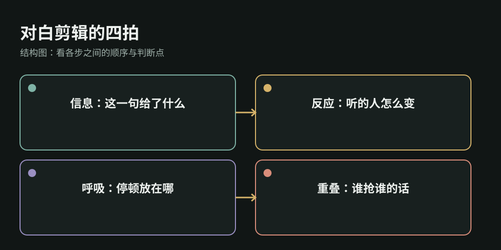

剪辑对白时，最容易把所有气口都切掉，让对话像乒乓球一样来回。听起来很“顺”，但没有反应，也没有人物思考的时间。观众听到的不是交流，是台词接力。

<!-- DIAGRAM_START -->
<h2 id="diagram">图解</h2>
<figure class="diagram">
  
  <figcaption>看“信息、反应、呼吸、重叠”四拍；如果每句都切得干干净净，人物就像在念稿，不像在说话。</figcaption>
</figure>
<!-- DIAGRAM_END -->

<section><h2 id="section-1">现场</h2>
一场厨房争吵，两条机位，演员有一句 overlap：妻子说“你从来不听”，丈夫同时说“我听了”。粗剪把两句都切干净，观众先听完妻子，再听丈夫，争吵变成两个人在轮流发言。导演说“不够真”，但不知道问题在剪辑。
</section>
<section><h2 id="section-2">判断</h2><ul><li><strong>停顿有没有信息：</strong>停顿之后，听的人变了；没有变化的停顿只是空白。</li><li><strong>反应镜头够不够：</strong>说话的人可以不出画，听的人必须在；观众要看话落在谁身上。</li><li><strong>呼吸是否被删光：</strong>每句都紧贴，人物像没有肺；留一口气，观众才有时间判断。</li><li><strong>重叠是否被抹平：</strong>真实争吵会抢话；全切成回合制，冲突就降级。</li></ul></section>
<section><h2 id="section-3">怎么做</h2><ol><li>先粗剪信息：每句只留“谁要什么、谁挡谁”，删掉重复解释；不要先修声音。</li><li>保留一次 overlap：让两个人抢同一句话，观众听见冲突，不是听见台词。</li><li>在反应上切：说话的人说到一半，切到听的人脸上；让观众看见话的作用。</li><li>留气口：每个回合至少留 0.3–0.5 秒呼吸；停顿放在动作前后，不放在句子中间。</li><li>最后混音：对白电平先统一，再处理齿音和底噪；不要用音乐填停顿。</li></ol></section>
<section><h2 id="section-4">失败</h2><ul><li><strong>每句切干净：</strong>对话像新闻播报，人物没有互相打断，冲突被剪没了。</li><li><strong>用音乐填停顿：</strong>观众听到情绪，但听不到人物在想什么；音乐一响，停顿就失效。</li><li><strong>删掉所有呼吸：</strong>人物说话像机器，观众也跟着憋气。</li></ul></section>
<section><h2 id="section-5">边界</h2>
这套方法适合有表演、有回合的对话场景；不适合快节奏广告口播，也不替代混音。对白剪辑不能救表演：如果演员没有反应，剪得再好也只是把空白换个位置。先看素材里有没有听的人，再谈停顿。
</section>
<section><h2 id="section-6">验收</h2><ul><li>至少保留一次 overlap，且观众能听出谁抢了谁的话。</li><li>每个回合有一个反应镜头，不是只有说话的人。</li><li>停顿之后人物有变化，不是空白。</li><li>关掉音乐看一遍，对白仍然成立。</li></ul></section>
<!-- DEEP_DIVE_START -->
## 深读

<strong>约 8 分钟。</strong> 下面把同一套判断放进两个不同条件，再看一个反例和一个可复用模型；不是重复前文，而是决定什么时候该换做法。

### 条件 A：争吵/冲突

争吵的剪辑核心是“抢”。不要给每句话一个完整回合，让下一句在上一句没结束时进来；观众听到重叠，就知道两个人都不肯让。重叠不用多，一次就够；第二次要更短、更狠，第三次可以突然安静，让沉默变成压力。

争吵的停顿不是休息，是蓄力。一个人停下来，另一个人会以为赢了；停得越久，下一句越重。把停顿放在动作上：放下杯子、转身、开门；不要放在句子中间，否则像忘词。

### 条件 B：亲密/低声对话

亲密对话的剪辑核心是“听”。说话的人可以背对、可以出画，镜头留在听的人脸上；观众要知道这句话对另一个人做了什么。停顿可以长，但必须有微动作：手指、吞咽、眼睛移动；没有微动作的长停顿会变成尴尬。

低声对话不要用音乐托情绪，用环境音：冰箱、远处车、雨。环境音让沉默有空间，音乐让沉默变成配乐。对白电平可以低一点，但不要低到观众要调音量；亲密不是听不见。

### 反例：停顿太长，变成尴尬

一个分手场景，剪辑在“我们到此为止”之后留了 4 秒。导演想要“沉重”，观众看到的是两个人站着不动，开始注意背景的钟。停顿没有信息，只有时长。

修法不是删到 1 秒，而是给停顿一个动作：一个人把钥匙推到桌子中间，另一个人没有拿。动作占掉 2 秒，剩下的 2 秒才有重量。停顿不是空镜，是人物在做一件不敢说的事。

### 可复用模型

<strong>信息 → 反应 → 呼吸 → 重叠。</strong> 先确保每句给新信息，再确保听的人有反应，再决定呼吸放在哪，最后才允许抢话。四步顺序不能倒：先设计重叠，会盖住信息；先加音乐，会盖住反应。

粗剪完成后关掉声音看一遍：如果只看脸也能知道谁占上风，剪辑就成立了；如果必须听台词才知道，回去补反应镜头。

<!-- DEEP_DIVE_END -->
<!-- SOURCES_START -->
## 参考与延伸阅读

- [S35] [Avid 资源中心：Avid 资源中心](https://www.avid.com/resource-center) — 2026-11-26 访问。用于核对“判断”一节的术语、方法或规则；不核对本页由经验得出的数字、型号与现场结论，也不替代测试或合同。
- [S34] [Adobe Premiere Pro 用户指南：Adobe Premiere Pro 用户指南](https://helpx.adobe.com/premiere-pro/user-guide.html) — 2026-11-26 访问。用于核对“边界”一节的术语、方法或规则；不核对本页由经验得出的数字、型号与现场结论，也不替代测试或合同。
<!-- SOURCES_END -->
