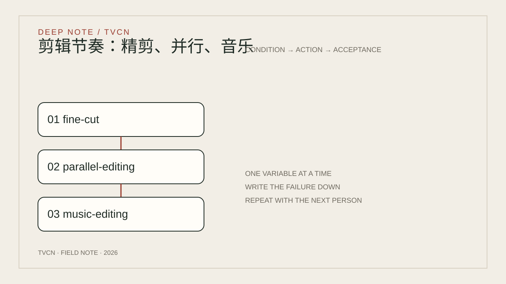

节奏不是切得快，而是精剪、并行场景和音乐在同一拍上推进。 单看《细剪：把粗剪的毛边修掉》只能解决一个局部；把《细剪：把粗剪的毛边修掉》《平行剪辑：两条线什么时候交叉》《配乐剪辑：让音乐跟着动作》接成一条链，才会暴露“条件没写、变量太多、结果无法复现”的真问题。

<!-- DEEP_DIVE_START -->
<!-- DIAGRAM_START -->
<h2>图解</h2>
<figure>
  
  <figcaption>看“细剪：把粗剪的毛边修掉”和“平行剪辑：两条线什么时候交叉”两处，先定条件，再看失败能不能被记录下来。</figcaption>
</figure>
<!-- DIAGRAM_END -->

<section><h2 id="section-1">问题</h2>
这一页的问题不是“方法不够多”，而是三个环节各自成立、合起来却不成立：条件没写、变量太多、结果不能复现。

本页按“先定条件—再做判断—只改一个变量—留下证据”的顺序；每一步都能被下一个人复述，才算完成。
</section>
<section><h2 id="section-2">判断</h2><ul><li>《细剪：把粗剪的毛边修掉》的第一道门槛：每场至少修掉三个具体毛边，切点不再“咬”一下</li><li>《平行剪辑：两条线什么时候交叉》的第二道门槛：呼吸和停顿接得上，没有一句被切半截</li><li>《配乐剪辑：让音乐跟着动作》的第三道门槛：陌生人看片时看手机的位置减少，或能说出为什么还在拖</li></ul>
三条里有一条不成立，就先回到对应单页；不要用整条链掩盖一个没解决的单点。
</section>
<section><h2 id="section-3">做法</h2><ol><li>先写条件：把《细剪：把粗剪的毛边修掉》里“每场找三个毛边：切点早半帧、呼吸重叠、空镜多一秒”落到一张三行表：素材、环境、验收。</li><li>再做一次最小动作：只按《细剪：把粗剪的毛边修掉》的步骤做 30 秒，不加入第二页的方法。</li><li>把《平行剪辑：两条线什么时候交叉》的步骤接上：只修这三类，不加新镜头。</li><li>用《配乐剪辑：让音乐跟着动作》做对照：让陌生人看一遍，记他看手机的位置，再修那一秒。</li><li>每改一次只动一个变量；其他条件写进记录，不靠记忆。</li><li>把失败也拍下来：失败版本和成功版本并排，才知道哪一步不能省。</li><li>让下一个人按记录复现一次；他做不出来，说明记录还不够。</li></ol></section>
<section><h2 id="section-4">现场案例</h2>
可复现实验（不是客户案例）：拿 30 秒素材，先按《细剪：把粗剪的毛边修掉》的“每场至少修掉三个具体毛边，切点不再“咬”一下”做 A 版；再按《平行剪辑：两条线什么时候交叉》的“呼吸和停顿接得上，没有一句被切半截”做 B 版；两版只允许一个变量不同。把两版并排看，记录《配乐剪辑：让音乐跟着动作》里最先崩的是哪一项：条件、动作还是验收。如果一次就成功，说明变量还不够多，再加一个现实限制重做。
</section>
<section><h2 id="section-5">失败表</h2>
<table class="data-table"><thead><tr><th>现象</th><th>原因</th><th>替换动作</th></tr></thead><tbody><tr><td>别用花哨转场掩盖结构问题；转场救不了拖</td><td>条件没写清</td><td>回到第一页重写三行表</td></tr><tr><td>别为了炫技来回切；没有倒计时，交叉就没有压力</td><td>条件没写清</td><td>回到第一页重写三行表</td></tr><tr><td>别用音乐填满所有空白；没有退出，进入就没有力量</td><td>条件没写清</td><td>回到第一页重写三行表</td></tr></tbody></table>
</section>
<section><h2 id="section-6">验收</h2><ul><li>每场至少修掉三个具体毛边，切点不再“咬”一下。</li><li>呼吸和停顿接得上，没有一句被切半截。</li><li>陌生人看片时看手机的位置减少，或能说出为什么还在拖。</li><li>动作切在手伸到一半的位置</li><li>视线切在看与被看之间</li><li>用一句台词的尾音盖住画面变化</li><li>让门框、桌沿、肩膀跨镜对齐</li><li>删掉重复交代的信息</li><li>两条线各有一个可读的倒计时，观众能算出谁先到。</li><li>交叉点发生在压力上升时，不是平均间隔。</li></ul></section>
<section><h2 id="section-7">替代方案</h2><ul><li>只处理《细剪：把粗剪的毛边修掉》里的单点问题：回到<a href="https://post.tvcn.org/article/fine-cut/">《细剪：把粗剪的毛边修掉》</a>，不要用整条链。</li><li>只比较两个动作：看<a href="https://post.tvcn.org/article/parallel-editing/">《平行剪辑：两条线什么时候交叉》</a>，先不改第三页。</li><li>只做验收：看<a href="https://post.tvcn.org/article/music-editing/">《配乐剪辑：让音乐跟着动作》</a>，把判断表拿去做自测。</li></ul></section>

<!-- SOURCES_START -->
## 参考与延伸阅读

- [S18] [Dangerous Documentaries（CMSI）](https://cmsimpact.org/wp-content/uploads/2015/12/dangerousdocs-feb2015.pdf) — 2026-11-26 访问。用于核对首段“节奏不是切得快，而是精剪、并行场景和音乐在同一拍上推进。”中的术语与公开背景（纪录片拍摄中的知情同意、风险与伦理决策）；不替代现场测试。
- [S30] [DaVinci Resolve 产品与文档](https://www.blackmagicdesign.com/products/davinciresolve) — 2026-11-26 访问。用于核对首段“节奏不是切得快，而是精剪、并行场景和音乐在同一拍上推进。”中的术语与公开背景（剪辑、调色、Fusion 与交付的官方产品入口）；不替代现场测试。
- [S34] [Adobe Premiere Pro 用户指南](https://helpx.adobe.com/premiere-pro/user-guide.html) — 2026-11-26 访问。用于核对首段“节奏不是切得快，而是精剪、并行场景和音乐在同一拍上推进。”中的术语与公开背景（剪辑、代理、色彩与导出的官方文档）；不替代现场测试。
- [S27] [EBU R128 响度](https://tech.ebu.ch/publications/r128) — 2026-11-26 访问。用于核对首段“节奏不是切得快，而是精剪、并行场景和音乐在同一拍上推进。”中的术语与公开背景（广播响度目标、真峰值与测量方法）；不替代现场测试。
- [S35] [Avid 资源中心](https://www.avid.com/resource-center) — 2026-11-26 访问。用于核对首段“节奏不是切得快，而是精剪、并行场景和音乐在同一拍上推进。”中的术语与公开背景（Media Composer、协作与交付的资源入口）；不替代现场测试。
<!-- SOURCES_END -->

