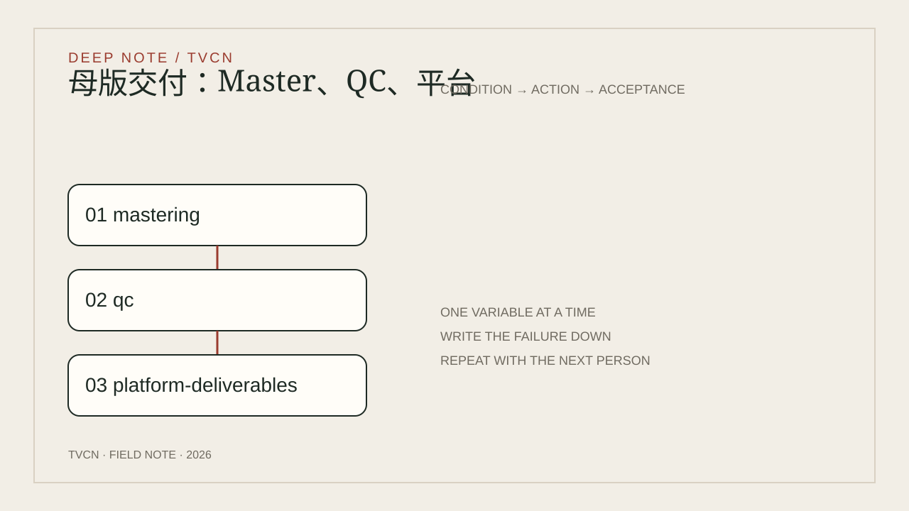

交付不是导出一个文件；母版、QC 和平台规格要一次对齐，否则上线后还要返工。 单看《母版：交付前定一个唯一版本》只能解决一个局部；把《母版：交付前定一个唯一版本》《技术检查：黑帧、静帧、断音》《平台多版本交付：一版母版，多版安全区》接成一条链，才会暴露“条件没写、变量太多、结果无法复现”的真问题。

<!-- DEEP_DIVE_START -->
<!-- DIAGRAM_START -->
<h2>图解</h2>
<figure>
  
  <figcaption>看“母版：交付前定一个唯一版本”和“技术检查：黑帧、静帧、断音”两处，先定条件，再看失败能不能被记录下来。</figcaption>
</figure>
<!-- DIAGRAM_END -->

<section><h2 id="section-1">问题</h2>
这一页的问题不是“方法不够多”，而是三个环节各自成立、合起来却不成立：条件没写、变量太多、结果不能复现。

本页按“先定条件—再做判断—只改一个变量—留下证据”的顺序；每一步都能被下一个人复述，才算完成。
</section>
<section><h2 id="section-2">判断</h2><ul><li>《母版：交付前定一个唯一版本》的第一道门槛：母版是最高质量格式，文件名明确写 master</li><li>《技术检查：黑帧、静帧、断音》的第二道门槛：所有平台版都能追溯到同一个母版，没有反向覆盖</li><li>《平台多版本交付：一版母版，多版安全区》的第三道门槛：母版在干净机器上能打开、播放和回套项目</li></ul>
三条里有一条不成立，就先回到对应单页；不要用整条链掩盖一个没解决的单点。
</section>
<section><h2 id="section-3">做法</h2><ol><li>先写条件：把《母版：交付前定一个唯一版本》里“母版用最高质量 ProRes 或 DNxHR，命名写 master”落到一张三行表：素材、环境、验收。</li><li>再做一次最小动作：只按《母版：交付前定一个唯一版本》的步骤做 30 秒，不加入第二页的方法。</li><li>把《技术检查：黑帧、静帧、断音》的步骤接上：平台版、竖版、字幕版都从母版转，不反向修改。</li><li>用《平台多版本交付：一版母版，多版安全区》做对照：交付前确认母版能打开、能播放、能回套。</li><li>每改一次只动一个变量；其他条件写进记录，不靠记忆。</li><li>把失败也拍下来：失败版本和成功版本并排，才知道哪一步不能省。</li><li>让下一个人按记录复现一次；他做不出来，说明记录还不够。</li></ol></section>
<section><h2 id="section-4">现场案例</h2>
可复现实验（不是客户案例）：拿 30 秒素材，先按《母版：交付前定一个唯一版本》的“母版是最高质量格式，文件名明确写 master”做 A 版；再按《技术检查：黑帧、静帧、断音》的“所有平台版都能追溯到同一个母版，没有反向覆盖”做 B 版；两版只允许一个变量不同。把两版并排看，记录《平台多版本交付：一版母版，多版安全区》里最先崩的是哪一项：条件、动作还是验收。如果一次就成功，说明变量还不够多，再加一个现实限制重做。
</section>
<section><h2 id="section-5">失败表</h2>
<table class="data-table"><thead><tr><th>现象</th><th>原因</th><th>替换动作</th></tr></thead><tbody><tr><td>别用“最新版”当文件名；交付要能追溯</td><td>条件没写清</td><td>回到第一页重写三行表</td></tr><tr><td>一条产品广告先剪 16:9，产品在画面右下。转 9:16 时直接中心裁，产品只剩一半，字幕又压在手上。平台上传…</td><td>条件没写清</td><td>回到第一页重写三行表</td></tr><tr><td>补救是重新构图，不是加一个“产品特写”贴片。拍摄时留竖版中景，后期才有东西可裁；没有留，重拍比修补便宜</td><td>条件没写清</td><td>回到第一页重写三行表</td></tr></tbody></table>
</section>
<section><h2 id="section-6">验收</h2><ul><li>母版是最高质量格式，文件名明确写 master。</li><li>所有平台版都能追溯到同一个母版，没有反向覆盖。</li><li>母版在干净机器上能打开、播放和回套项目。</li><li>黑帧、静帧和断音都按时间码标出并修掉。</li><li>字幕没有出画，声道左右正确。</li><li>用校准监视器和耳机复查，笔记本喇叭不作为依据。</li><li>把 母版：交付前定一个唯一版本 的条件写成一行，能复述给下一个人。</li><li>只改一个变量，另一页的结果还能复现。</li><li>失败现象能被记录成“条件—动作—结果”，不是一句感觉。</li><li>下一位同事不问你，也能按记录做出同一版。</li></ul></section>
<section><h2 id="section-7">替代方案</h2><ul><li>只处理《母版：交付前定一个唯一版本》里的单点问题：回到<a href="https://post.tvcn.org/article/mastering/">《母版：交付前定一个唯一版本》</a>，不要用整条链。</li><li>只比较两个动作：看<a href="https://post.tvcn.org/article/qc/">《技术检查：黑帧、静帧、断音》</a>，先不改第三页。</li><li>只做验收：看<a href="https://post.tvcn.org/article/platform-deliverables/">《平台多版本交付：一版母版，多版安全区》</a>，把判断表拿去做自测。</li></ul></section>

<!-- SOURCES_START -->
## 参考与延伸阅读

- [S13] [DCI](https://www.dcimovies.com/dci-specification/) — 2026-11-26 访问。用于核对首段“交付不是导出一个文件；母版、QC 和平台规格要一次对齐，否则上线后还要返工。”中的术语与公开背景（数字影院的分辨率、色彩、安全与交付规范入口）；不替代现场测试。
- [S14] [YouTube 社区准则](https://support.google.com/youtube/answer/2801973) — 2026-11-26 访问。用于核对首段“交付不是导出一个文件；母版、QC 和平台规格要一次对齐，否则上线后还要返工。”中的术语与公开背景（平台对误导、危险行为、版权与披露的现行规则）；不替代现场测试。
- [S30] [DaVinci Resolve 产品与文档](https://www.blackmagicdesign.com/products/davinciresolve) — 2026-11-26 访问。用于核对首段“交付不是导出一个文件；母版、QC 和平台规格要一次对齐，否则上线后还要返工。”中的术语与公开背景（剪辑、调色、Fusion 与交付的官方产品入口）；不替代现场测试。
- [S34] [Adobe Premiere Pro 用户指南](https://helpx.adobe.com/premiere-pro/user-guide.html) — 2026-11-26 访问。用于核对首段“交付不是导出一个文件；母版、QC 和平台规格要一次对齐，否则上线后还要返工。”中的术语与公开背景（剪辑、代理、色彩与导出的官方文档）；不替代现场测试。
- [S27] [EBU R128 响度](https://tech.ebu.ch/publications/r128) — 2026-11-26 访问。用于核对首段“交付不是导出一个文件；母版、QC 和平台规格要一次对齐，否则上线后还要返工。”中的术语与公开背景（广播响度目标、真峰值与测量方法）；不替代现场测试。
<!-- SOURCES_END -->

