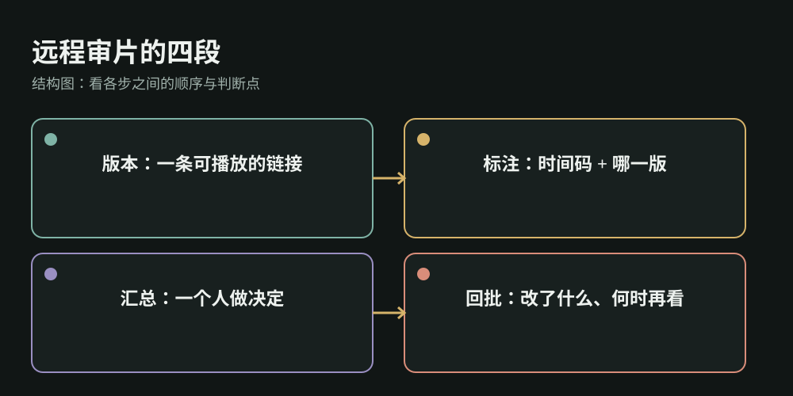

远程审片最消耗人的不是距离，是信息散。客户在三个城市，意见在微信群、邮件、语音、截图里；剪辑师每次打开工程，都要先猜“这条说的是哪一版、哪一分钟”。

<!-- DIAGRAM_START -->
<h2 id="diagram">图解</h2>
<figure class="diagram">
  
  <figcaption>看“版本、标注、汇总、回批”四段是否闭合；任何一段靠语音补，远程审片就会变成无限返工。</figcaption>
</figure>
<!-- DIAGRAM_END -->

<section><h2 id="section-1">现场</h2>
一条 6 分钟品牌片，客户有三个决策人：品牌经理、创始人、平台运营。剪辑发了一个网盘链接，文件名 `final.mp4`。两天后收到 27 条微信语音、9 张截图、4 封邮件；其中 3 条互相矛盾。剪辑改到第 4 版，创始人说“我从来没看过这一版”。
</section>
<section><h2 id="section-2">判断</h2><ul><li><strong>版本不唯一：</strong>链接会覆盖，文件名没有版本，客户看的和剪辑改的不是同一条。</li><li><strong>标注没有时间码：</strong>“这里太慢”没有分钟秒，剪辑只能全片猜。</li><li><strong>没有决策人：</strong>三个人都能提意见，没有人能说“这条不改”。</li><li><strong>回批没有记录：</strong>改完只发“已改”，客户不知道改了哪几条，下一次又重提。</li></ul></section>
<section><h2 id="section-3">怎么做</h2><ol><li>锁版本：每次审片生成一个只读链接，文件名带版本、日期、时长，例如 `brand_v3_20261126_6m.mp4`。</li><li>带时间码：审片版打开 TC，客户按“分钟:秒”提意见；截图必须带 TC。</li><li>统一入口：只收一张表，字段是“时间码、问题、想要的结果、优先级”；语音和私聊不进入修改。</li><li>一个人汇总：客户指定一个决策人，把三方意见合并成一张表，冲突项由他拍板。</li><li>回批：改完发对比表，逐条写“已改/未改/为什么”，并约定下一次审片时间；未改项要客户确认。</li></ol></section>
<section><h2 id="section-4">失败</h2><ul><li><strong>文件名 `final`：</strong>三天后出现 `final2`、`final_真`，没人知道哪一版被批准。</li><li><strong>截图没有 TC：</strong>客户圈一个区域，剪辑不知道是 2:10 还是 2:14，改错位置。</li><li><strong>多方直接改：</strong>品牌经理让剪辑改，创始人让改回去；剪辑变成两个意见的战场。</li></ul></section>
<section><h2 id="section-5">边界</h2>
这套流程适合多决策人、多版本的商业项目；不适合需要保密的未公开素材，也不替代正式的验收合同。保密片用本地加密审片或线下放映，不要把链接发到公开网盘。客户不愿用表，就先给他一张只填三行的模板，不要一次要求全部字段。
</section>
<section><h2 id="section-6">验收</h2><ul><li>每次审片只有一个只读链接，文件名带版本和日期。</li><li>所有意见都能落到时间码，且知道是哪一版。</li><li>有一个决策人签字的汇总表。</li><li>回批表逐条写清已改/未改/原因，并有下一次审片时间。</li></ul></section>
<!-- DEEP_DIVE_START -->
## 深读

<strong>约 8 分钟。</strong> 下面把同一套判断放进两个不同条件，再看一个反例和一个可复用模型；不是重复前文，而是决定什么时候该换做法。

### 条件 A：商业客户/多决策人

多决策人项目，审片流程要先把“谁拍板”写进合同或邮件，不要等到第三版才问。每轮审片只开一个窗口，比如 48 小时；窗口结束后收到的意见进入下一轮，不插队。窗口不是催促，是让所有人同时看同一版，避免 A 看完、B 又改、C 没看。

意见表要分三级：必须改（信息错误/平台不过）、建议改（节奏/表演）、可以不改（审美偏好）。剪辑先做必须改，再做建议改；可以不改的留到最后一轮。分级不是限制客户，是让修改有顺序。

### 条件 B：内部团队/保密片

内部团队不需要外部审片平台，但需要同样的版本纪律。用内部存储的只读文件夹，每个版本一个子文件夹；批注写在共享文档里，不写在聊天里。保密片不生成公开链接，用带水印的本地放映，水印上写审片人名字，谁泄露能查。

内部审片最容易“边剪边看”：导演站在剪辑后面，随时说“这里再试试”。这不算审片，算共同创作。共同创作可以，但要在时间线上留标记，不要用口头意见覆盖已经通过的版本。

### 反例：客户用语音提意见

客户发了 18 条语音，每条 30–60 秒。剪辑转成文字花了两个小时，还是有 4 条听不清时间点。改完后客户说“我说的不是这个”。问题不是客户懒，是流程允许语音代替标注。

修法不是拒绝客户，而是给他更省事的入口：一条 30 秒的录屏，客户指着画面说“这里”，系统自动带时间码。录屏比打字快，比语音准。第一次教一次，第二次他就用录屏了。

### 可复用模型

<strong>版本 → 标注 → 汇总 → 回批。</strong> 版本让所有人看同一条；标注让意见可定位；汇总让冲突有裁决；回批让修改可追踪。四段闭合，远程审片才不是“发链接—等语音—猜意见”。

每轮结束写一行记录：版本号、收到多少条、必须改多少、谁批准、下一次什么时候看。项目结束后这行记录就是交付证据，也是下一次报价的依据。

<!-- DEEP_DIVE_END -->
<!-- SOURCES_START -->
## 参考与延伸阅读

- [S35] [Avid 资源中心：Avid 资源中心](https://www.avid.com/resource-center) — 2026-11-26 访问。用于核对“判断”一节的术语、方法或规则；不核对本页由经验得出的数字、型号与现场结论，也不替代测试或合同。
- [S28] [Netflix 制作与交付帮助：Netflix 制作与交付帮助](https://partnerhelp.netflixstudios.com/) — 2026-11-26 访问。用于核对“边界”一节的术语、方法或规则；不核对本页由经验得出的数字、型号与现场结论，也不替代测试或合同。
<!-- SOURCES_END -->
