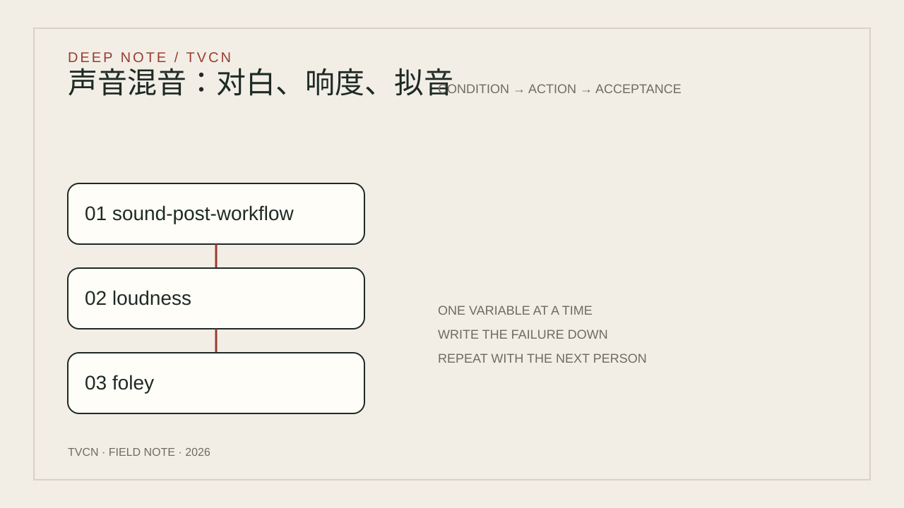

混音不是把声音调大；对白、响度和拟音要各就各位，观众才不累。 单看《声音后期：从对白到终混的顺序》只能解决一个局部；把《声音后期：从对白到终混的顺序》《响度：平台目标与真峰值》《Foley：脚步、衣服、门把手》接成一条链，才会暴露“条件没写、变量太多、结果无法复现”的真问题。

<!-- DEEP_DIVE_START -->
<!-- DIAGRAM_START -->
<h2>图解</h2>
<figure>
  
  <figcaption>看“声音后期：从对白到终混的顺序”和“响度：平台目标与真峰值”两处，先定条件，再看失败能不能被记录下来。</figcaption>
</figure>
<!-- DIAGRAM_END -->

<section><h2 id="section-1">问题</h2>
这一页的问题不是“方法不够多”，而是三个环节各自成立、合起来却不成立：条件没写、变量太多、结果不能复现。

本页按“先定条件—再做判断—只改一个变量—留下证据”的顺序；每一步都能被下一个人复述，才算完成。
</section>
<section><h2 id="section-2">判断</h2><ul><li>《声音后期：从对白到终混的顺序》的第一道门槛：整片积分响度落在平台目标附近，不是凭耳朵猜</li><li>《响度：平台目标与真峰值》的第二道门槛：真峰值不超过 -1 dB，没有连续红区</li><li>《Foley：脚步、衣服、门把手》的第三道门槛：对白仍然清楚，音乐和环境没有把动态压死</li></ul>
三条里有一条不成立，就先回到对应单页；不要用整条链掩盖一个没解决的单点。
</section>
<section><h2 id="section-3">做法</h2><ol><li>先写条件：把《声音后期：从对白到终混的顺序》里“先混到平台目标，常用 -14 LUFS”落到一张三行表：素材、环境、验收。</li><li>再做一次最小动作：只按《声音后期：从对白到终混的顺序》的步骤做 30 秒，不加入第二页的方法。</li><li>把《响度：平台目标与真峰值》的步骤接上：真峰值压到 -1 dB，再留 0.5 到 1 dB 余量。</li><li>用《Foley：脚步、衣服、门把手》做对照：不要靠压限器硬顶，回到对白和动态检查。</li><li>每改一次只动一个变量；其他条件写进记录，不靠记忆。</li><li>把失败也拍下来：失败版本和成功版本并排，才知道哪一步不能省。</li><li>让下一个人按记录复现一次；他做不出来，说明记录还不够。</li></ol></section>
<section><h2 id="section-4">现场案例</h2>
可复现实验（不是客户案例）：拿 30 秒素材，先按《声音后期：从对白到终混的顺序》的“整片积分响度落在平台目标附近，不是凭耳朵猜”做 A 版；再按《响度：平台目标与真峰值》的“真峰值不超过 -1 dB，没有连续红区”做 B 版；两版只允许一个变量不同。把两版并排看，记录《Foley：脚步、衣服、门把手》里最先崩的是哪一项：条件、动作还是验收。如果一次就成功，说明变量还不够多，再加一个现实限制重做。
</section>
<section><h2 id="section-5">失败表</h2>
<table class="data-table"><thead><tr><th>现象</th><th>原因</th><th>替换动作</th></tr></thead><tbody><tr><td>一条品牌片在粗剪时就铺满音乐，客户觉得“有情绪”。等到终混，对白被音乐盖住，只能整体降音乐；降完片子又变得平。…</td><td>条件没写清</td><td>回到第一页重写三行表</td></tr><tr><td>音乐不是遮羞布。对白不清，先修对白；环境不连续，先补底噪。把音乐留到最后，才有空间做真正的情绪</td><td>条件没写清</td><td>回到第一页重写三行表</td></tr><tr><td>别把响度当竞争力；压限器压扁了，对白会更累</td><td>条件没写清</td><td>回到第一页重写三行表</td></tr></tbody></table>
</section>
<section><h2 id="section-6">验收</h2><ul><li>整片积分响度落在平台目标附近，不是凭耳朵猜。</li><li>真峰值不超过 -1 dB，没有连续红区。</li><li>对白仍然清楚，音乐和环境没有把动态压死。</li><li>先 solo 对白，确认每句都能听懂</li><li>加音乐再听一遍</li><li>加环境再听一遍</li><li>手机外放，音量一半，站到两米外</li><li>耳机听一遍，注意齿音和爆音</li><li>脚步、衣服、门把手三类声音都能对上具体动作。</li><li>静音看画面时，每一下都有声，且没有早半帧。</li></ul></section>
<section><h2 id="section-7">替代方案</h2><ul><li>只处理《声音后期：从对白到终混的顺序》里的单点问题：回到<a href="https://post.tvcn.org/article/sound-post-workflow/">《声音后期：从对白到终混的顺序》</a>，不要用整条链。</li><li>只比较两个动作：看<a href="https://post.tvcn.org/article/loudness/">《响度：平台目标与真峰值》</a>，先不改第三页。</li><li>只做验收：看<a href="https://post.tvcn.org/article/foley/">《Foley：脚步、衣服、门把手》</a>，把判断表拿去做自测。</li></ul></section>
