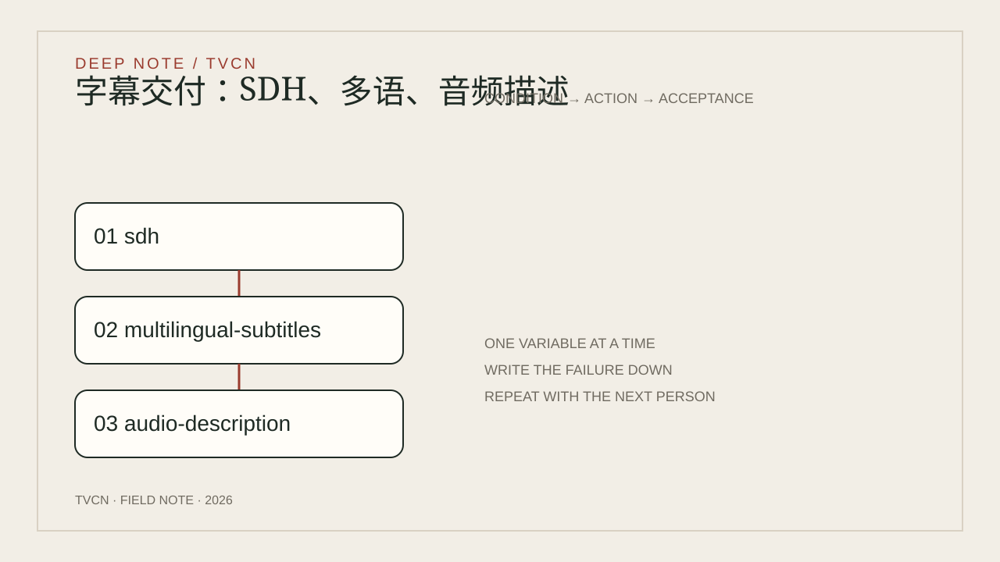

字幕不是把字打上去；SDH、多语和音频描述是三种不同的观众任务。 单看《听障字幕：不只写对白》只能解决一个局部；把《听障字幕：不只写对白》《多语言字幕：别一行塞两种语言》《口述影像：把画面说给人听》接成一条链，才会暴露“条件没写、变量太多、结果无法复现”的真问题。

<!-- DEEP_DIVE_START -->
<!-- DIAGRAM_START -->
<h2>图解</h2>
<figure>
  
  <figcaption>看“听障字幕：不只写对白”和“多语言字幕：别一行塞两种语言”两处，先定条件，再看失败能不能被记录下来。</figcaption>
</figure>
<!-- DIAGRAM_END -->

<section><h2 id="section-1">问题</h2>
这一页的问题不是“方法不够多”，而是三个环节各自成立、合起来却不成立：条件没写、变量太多、结果不能复现。

本页按“先定条件—再做判断—只改一个变量—留下证据”的顺序；每一步都能被下一个人复述，才算完成。
</section>
<section><h2 id="section-2">判断</h2><ul><li>《听障字幕：不只写对白》的第一道门槛：每条字幕能看出谁在说，电话和画外音有区分</li><li>《多语言字幕：别一行塞两种语言》的第二道门槛：门响、雨声、音乐等重要声音写进了字幕</li><li>《口述影像：把画面说给人听》的第三道门槛：字幕不挡嘴和手，两行以内，阅读速度跟得上</li></ul>
三条里有一条不成立，就先回到对应单页；不要用整条链掩盖一个没解决的单点。
</section>
<section><h2 id="section-3">做法</h2><ol><li>先写条件：把《听障字幕：不只写对白》里“字幕里标说话人：男声、女声、电话”落到一张三行表：素材、环境、验收。</li><li>再做一次最小动作：只按《听障字幕：不只写对白》的步骤做 30 秒，不加入第二页的方法。</li><li>把《多语言字幕：别一行塞两种语言》的步骤接上：环境声写 [门响]、[雨声]，音乐写 [音乐]。</li><li>用《口述影像：把画面说给人听》做对照：检查位置和阅读速度，字幕不挡嘴和手。</li><li>每改一次只动一个变量；其他条件写进记录，不靠记忆。</li><li>把失败也拍下来：失败版本和成功版本并排，才知道哪一步不能省。</li><li>让下一个人按记录复现一次；他做不出来，说明记录还不够。</li></ol></section>
<section><h2 id="section-4">现场案例</h2>
可复现实验（不是客户案例）：拿 30 秒素材，先按《听障字幕：不只写对白》的“每条字幕能看出谁在说，电话和画外音有区分”做 A 版；再按《多语言字幕：别一行塞两种语言》的“门响、雨声、音乐等重要声音写进了字幕”做 B 版；两版只允许一个变量不同。把两版并排看，记录《口述影像：把画面说给人听》里最先崩的是哪一项：条件、动作还是验收。如果一次就成功，说明变量还不够多，再加一个现实限制重做。
</section>
<section><h2 id="section-5">失败表</h2>
<table class="data-table"><thead><tr><th>现象</th><th>原因</th><th>替换动作</th></tr></thead><tbody><tr><td>别把字幕放在嘴和手上；观众要看表演</td><td>条件没写清</td><td>回到第一页重写三行表</td></tr><tr><td>别把双语压成两行小字；观众两种都读不清</td><td>条件没写清</td><td>回到第一页重写三行表</td></tr><tr><td>别描述“他很悲伤”；让动作和声音自己说</td><td>条件没写清</td><td>回到第一页重写三行表</td></tr></tbody></table>
</section>
<section><h2 id="section-6">验收</h2><ul><li>每条字幕能看出谁在说，电话和画外音有区分。</li><li>门响、雨声、音乐等重要声音写进了字幕。</li><li>字幕不挡嘴和手，两行以内，阅读速度跟得上。</li><li>每一行只有一种语言，没有中英叠在一起。</li><li>字幕轨能独立切换，或两个版本各自完整。</li><li>字号和行数在手机上可读，没有为了塞双语缩小。</li><li>描述只落在对白空隙，没有盖住关键台词。</li><li>每段说清了谁在动、往哪走、手里是什么。</li><li>没有解释情绪，听众能靠动作和声音自己判断。</li><li>把 听障字幕：不只写对白 的条件写成一行，能复述给下一个人。</li></ul></section>
<section><h2 id="section-7">替代方案</h2><ul><li>只处理《听障字幕：不只写对白》里的单点问题：回到<a href="https://post.tvcn.org/article/sdh/">《听障字幕：不只写对白》</a>，不要用整条链。</li><li>只比较两个动作：看<a href="https://post.tvcn.org/article/multilingual-subtitles/">《多语言字幕：别一行塞两种语言》</a>，先不改第三页。</li><li>只做验收：看<a href="https://post.tvcn.org/article/audio-description/">《口述影像：把画面说给人听》</a>，把判断表拿去做自测。</li></ul></section>

<!-- SOURCES_START -->
## 参考与延伸阅读

- [S06] [W3C WAI](https://www.w3.org/WAI/media/av/captions/) — 2026-11-26 访问。用于核对首段“字幕不是把字打上去；SDH、多语和音频描述是三种不同的观众任务。”中的术语与公开背景（预录与直播字幕的无障碍要求，对应 WCAG 1.2.2）；不替代现场测试。
- [S20] [DDPM 原始论文（2020）](https://arxiv.org/abs/2006.11239) — 2026-11-26 访问。用于核对首段“字幕不是把字打上去；SDH、多语和音频描述是三种不同的观众任务。”中的术语与公开背景（扩散模型：从加噪到去噪的生成路径）；不替代现场测试。
- [S30] [DaVinci Resolve 产品与文档](https://www.blackmagicdesign.com/products/davinciresolve) — 2026-11-26 访问。用于核对首段“字幕不是把字打上去；SDH、多语和音频描述是三种不同的观众任务。”中的术语与公开背景（剪辑、调色、Fusion 与交付的官方产品入口）；不替代现场测试。
- [S34] [Adobe Premiere Pro 用户指南](https://helpx.adobe.com/premiere-pro/user-guide.html) — 2026-11-26 访问。用于核对首段“字幕不是把字打上去；SDH、多语和音频描述是三种不同的观众任务。”中的术语与公开背景（剪辑、代理、色彩与导出的官方文档）；不替代现场测试。
- [S27] [ITU-R：BS.1770 音频响度与真峰值测量](https://www.itu.int/rec/R-REC-BS.1770/en) — 2026-11-27 访问。用于核对首段“字幕不是把字打上去；SDH、多语和音频描述是三种不同的观众任务。”中的术语与公开背景（响度测量、真峰值与 EBU R128 所依据的 ITU 算法标准）；不替代现场测试。
<!-- SOURCES_END -->

