<!-- DIAGRAM_START -->
<h2>图解</h2>
<figure>
  
  <figcaption>示意：校验值、备份位置、代理路径和场记必须写在同一份交接报告里。</figcaption>
</figure>
<!-- DIAGRAM_END -->
<h2>先判断：谁对素材负责</h2>
DIT 的第一件事不是插卡，是确认责任：谁拷、谁校验、谁运输、谁接收。只写“素材已备份”不够，要写清备份在哪、什么时候、谁确认。现场没有 DIT，就让摄影助理兼，但责任要写进通告单。

每张卡在格式化前必须至少有两份完整副本，且不在同一台电脑/同一块硬盘。只拷一份就格式化，是现场最不可原谅的错误。
<h2>拷卡与校验：校验值不是可选项</h2>
用支持校验的软件拷卡，生成 MD5/xxHash 清单。拷完不要只看文件数量，跑一次校验；校验失败就重拷，不要“再试一次就好了”。卡上文件保持原始目录，不要边拷边改名。

素材命名在拷完后做：项目_日期_机位_卡号_片段。改名要写进报告，不要改到无法回溯。原始卡保留到杀青，不要提前 reused。
<h2>三份备份：两份在现场，一份离开现场</h2>
三份不是三块硬盘放在同一个包里。至少一份在不同物理位置，或当天带回办公室。备份完成前，卡不格式化；备份完成后，卡也不立刻格式化，等第二天确认。

每份备份贴标签：项目、日期、内容、校验清单文件名。别用“主备份/副备份”这种无法验证的称呼，写清位置和责任人。
<h2>代理与交接：让剪辑一打开就能剪</h2>
代理要和原素材同帧率、同时间码、同文件名，否则回批会对不上。代理分辨率按剪辑机器定，1080p 或 720p 都行；码率太低会让剪辑师误判噪点。

交接包：原始素材、代理、校验清单、场记、音频、LUT、报告。报告写清每个机位的卡号、片段数、总时长、异常（坏帧、跳卡、录音断）。
<h2>失败案例：三份备份都在同一个房间</h2>
一次外地拍摄，DIT 做了三份备份，全部放在同一间酒店房间：两块移动硬盘、一台笔记本。第二天房间断电，笔记本电池耗尽，两块硬盘在同一个包里被水淹。三份备份同时失效。

补救只能回现场重拍。真正的三份备份要有地理隔离：一份随身、一份酒店保险箱、一份当天寄回/上传。备份不是数量，是位置。
<h2>成本与验收</h2>
低成本：摄影助理兼 DIT，两块 SSD + 校验软件，¥1,000–3,000/天。中成本：专职 DIT、三份备份、代理、报告，¥3,000–8,000/天。高成本：多机位、现场调色/合成、LTO 归档，¥8,000–20,000/天。
<h2>验收</h2><ul><li>每张卡拷完有校验清单。</li><li>至少三份备份，且不在同一物理位置。</li><li>原始目录保留，改名有记录。</li><li>代理与原素材同帧率、同时码、同文件名。</li><li>交接报告含卡号、片段、时长、异常。</li><li>卡格式化前有书面确认。</li></ul>
<!-- SOURCES_START -->
<h2>参考与延伸阅读</h2>

经验来源：TVCN 现场手册与项目复盘；实测来源：页面标注的复核环境与可复现练习；参考来源：以下公开链接。

<ul><li>[S23] SMPTE 标准入口</li><li>[S28] Netflix 制作与交付帮助</li></ul>

<a href="../../SOURCES.md">完整链接与用途见 SOURCES.md</a>

<!-- SOURCES_END -->
